# Cahier des charges — Module de gestion et de suivi budgétaire hospitalier

**Solution Hopitalia · Projet `hopitalia-budget` (nom affiché : Hopitalia Budget) · Version 3.2 · 13 novembre 2026 · Statut : validé le 13/11/2026**

| Version | Date | Objet |
|---|---|---|
| 1.0 | — | Première version (incluait la passation des marchés). |
| 2.0 | Novembre 2026 | Recentrage sur le suivi après attribution ; diagramme de classes V2. |
| 3.0 | 13/11/2026 | Fusion du cahier des charges V2 et du diagramme de classes V2, corrections du modèle, ajout des principes d'architecture (SOLID) et des conventions d'API. |
| 3.1 | 13/11/2026 | Validation ; intégration des réponses de cadrage (authentification propre, application séparée, référentiels gérés dans le module, plan SYSCOHADA, circuits avec ordonnateur, échanges par fichiers) ; section 17 mise à jour. |
| 3.2 | 13/11/2026 | Lecture du code `hopitalia-backend` : connexion Hopitalia réutilisée, fournisseurs et services importés, achats pharmaceutiques repris d'Hopitalia ; note d'intégration `docs/cadrage/integration-hopitalia.md`. |

> **Périmètre non négociable.** Le module prend en charge le suivi financier des marchés **déjà attribués** et des contrats **déjà signés**. Il ne prend pas en charge le lancement, la passation, l'évaluation ni l'attribution des marchés publics.

## Sommaire

1. [Contexte et objectifs](#1-contexte-et-objectifs)
2. [Périmètre](#2-périmètre)
3. [Acteurs et profils](#3-acteurs-et-profils)
4. [Exigences fonctionnelles](#4-exigences-fonctionnelles)
5. [Règles de gestion](#5-règles-de-gestion)
6. [Règles de calcul](#6-règles-de-calcul)
7. [Modèle de données](#7-modèle-de-données)
8. [Cycles de vie](#8-cycles-de-vie)
9. [Processus](#9-processus)
10. [Architecture logicielle et principes SOLID](#10-architecture-logicielle-et-principes-solid)
11. [Conventions d'API](#11-conventions-dapi)
12. [Exigences non fonctionnelles](#12-exigences-non-fonctionnelles)
13. [Intégrations](#13-intégrations)
14. [Tableaux de bord, alertes et états](#14-tableaux-de-bord-alertes-et-états)
15. [Recette](#15-recette)
16. [Livrables et lots](#16-livrables-et-lots)
17. [Décisions de cadrage](#17-décisions-de-cadrage)
18. [Annexes](#18-annexes)

---

## 1. Contexte et objectifs

Les établissements hospitaliers doivent maîtriser l'utilisation des ressources financières mises à leur disposition. Le suivi budgétaire rapproche les crédits votés ou notifiés, les engagements pris, les prestations réalisées, les dépenses liquidées, les paiements effectués et les montants restant à payer.

Les dépenses suivies sont variées : médicaments et consommables, réactifs de laboratoire, maintenance biomédicale, entretien, énergie, restauration, gardiennage, prestations intellectuelles, travaux, équipements, missions, charges de personnel et autres dépenses de fonctionnement ou d'investissement.

**Objectifs**

| Réf. | Objectif |
|---|---|
| OBJ-01 | Centraliser les données budgétaires et financières de l'établissement. |
| OBJ-02 | Suivre les crédits par exercice, section, chapitre, compte, ligne budgétaire, programme ou service. |
| OBJ-03 | Contrôler la disponibilité des crédits avant tout engagement ou validation financière. |
| OBJ-04 | Enregistrer les marchés attribués et les contrats signés, sans gérer leur passation. |
| OBJ-05 | Suivre commandes, ordres de service, livraisons, réceptions et prestations exécutées. |
| OBJ-06 | Traiter factures, décomptes, liquidations et paiements. |
| OBJ-07 | Identifier les engagements non soldés, les factures en attente et les restes à payer. |
| OBJ-08 | Produire des tableaux de bord et des états fiables pour la direction, la DAF, le contrôle de gestion et les services. |
| OBJ-09 | Conserver une piste d'audit complète de toutes les opérations. |
| OBJ-10 | Exposer une API stable, documentée et sécurisée, conçue pour durer (sections 10 et 11). |

## 2. Périmètre

### 2.1. Fonctions incluses

- Paramétrage des exercices, budgets, comptes, lignes et nomenclatures.
- Import et mise à jour des budgets et des crédits.
- Enregistrement et suivi des marchés attribués et des contrats signés.
- Engagements, commandes et actes d'exécution financière.
- Service fait, livraisons et réceptions.
- Factures, décomptes, liquidations et validations.
- Ordonnancement ou mise en paiement, selon l'organisation de l'établissement.
- Enregistrement et rapprochement des paiements.
- Suivi des recettes (volet activable).
- Tableaux de bord, alertes, états réglementaires et exports.

### 2.2. Fonctions exclues

Plan de passation, avis d'appel à concurrence, dossiers d'appel d'offres, retrait de dossiers et dépôt de soumissions, ouverture des plis, évaluation et classement des offres, attribution, approbation et notification initiale, commissions de passation.

Le module conserve les références et les pièces d'un marché attribué, mais ne se substitue pas à une plateforme de passation.

### 2.3. Vue de contexte

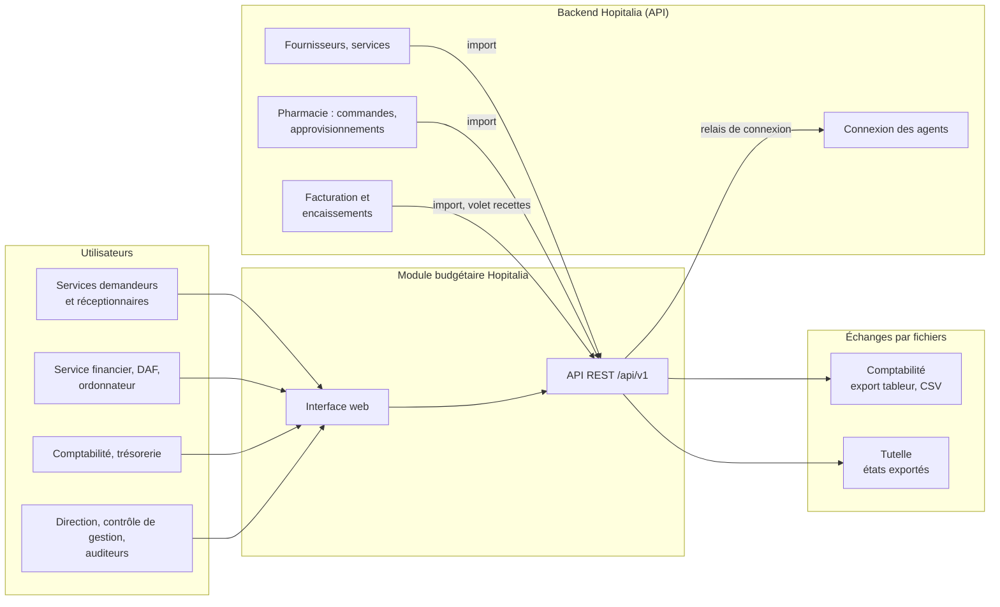

## 3. Acteurs et profils

| Profil | Rôle principal |
|---|---|
| Administrateur fonctionnel | Paramétrage : référentiels, circuits, règles d'alerte, profils. |
| Responsable budgétaire | Budgets, révisions, notifications de crédits, clôture d'exercice. |
| Agent financier | Contrôle d'imputation et de disponibilité, liquidation. |
| Gestionnaire de marchés et contrats | Fiches contrats, avenants, échéanciers. |
| Service demandeur | Expression du besoin, demande d'engagement. |
| Réceptionnaire | Réceptions, service fait, réserves. |
| Valideur (responsable de service, DAF) | Visas et validations selon les circuits. |
| Ordonnateur | Validation selon les délégations ; ordonnancement. |
| Comptable, agent de paiement | Prise en charge et enregistrement des règlements. |
| Auditeur | Consultation de la piste d'audit, sans modification. |
| Lecteur de tableaux de bord | Consultation des indicateurs et états. |

**Séparation des tâches :** lorsque les règles internes l'imposent, un même utilisateur ne peut pas créer, valider et payer seul une même opération (RG-13).

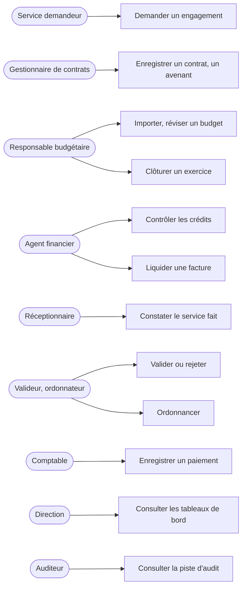

## 4. Exigences fonctionnelles

Chaque exigence porte un identifiant stable, repris dans la recette (section 15).

### 4.1. Organisation budgétaire et référentiels (lot 1)

| Réf. | Exigence |
|---|---|
| EF-REF-01 | Nomenclature configurable et hiérarchique : section, chapitre, article, paragraphe. |
| EF-REF-02 | Axes de classement : exercice et période (annuelle, trimestrielle, mensuelle), compte budgétaire, nature économique, programme ou projet, source de financement ou bailleur, centre de responsabilité, site. |
| EF-REF-03 | Le compte budgétaire de contrôle est distinct du compte comptable ; une table de correspondance les relie. |
| EF-REF-04 | Référentiels administrables : fournisseurs et coordonnées de paiement, services et responsables, types de dépenses, familles d'achats, modes de règlement, comptes de trésorerie, types de pièces, statuts. |
| EF-REF-05 | Les fournisseurs et les services sont **importés depuis Hopitalia** (identifiant externe `codeFourn`, `codeService`) et complétés dans le module (coordonnées bancaires, identifiants administratifs, fournisseurs hors pharmacie). Les établissements et sites sont gérés dans le module. |

### 4.2. Budgets et crédits (lot 1)

| Réf. | Exigence |
|---|---|
| EF-BUD-01 | Créer un budget par exercice et par établissement. |
| EF-BUD-02 | Saisir ou importer les dotations initiales par ligne budgétaire (import asynchrone, rapport d'anomalies). |
| EF-BUD-03 | Enregistrer les notifications de crédits et leurs références. |
| EF-BUD-04 | Budgets modificatifs, virements et réallocations selon les habilitations ; chaque révision est validée avant d'avoir un effet. |
| EF-BUD-05 | Historiser chaque modification avec auteur, date, motif et pièce justificative. |
| EF-BUD-06 | Afficher pour chaque ligne les indicateurs de la section 6.1, calculés et jamais saisis. |
| EF-BUD-07 | Distinguer le disponible prévisionnel et le disponible après engagements. |
| EF-BUD-08 | Bloquer toute opération qui dépasse le crédit disponible, sauf dérogation autorisée, tracée et motivée. |
| EF-BUD-09 | Clôturer un exercice sans supprimer l'historique ; reporter les engagements restant à payer selon les règles de report. |

### 4.3. Marchés et contrats (lot 2)

| Réf. | Exigence |
|---|---|
| EF-CTR-01 | Fiche contrat : numéro, intitulé, type, attributaire, dates (notification, signature, démarrage), durée, échéance, montant initial, devise, taxes, TTC, objet, périmètre, site, service bénéficiaire, responsable du suivi, périodicité et modalités de facturation, références du dossier. |
| EF-CTR-02 | Un contrat est enregistré à l'état « signé » ou « notifié » : la date de signature ou de notification est obligatoire (RG-03). |
| EF-CTR-03 | Ventilation du contrat sur une ou plusieurs lignes budgétaires, avec un montant par ligne (`ImputationContrat`). |
| EF-CTR-04 | Avenants : montant antérieur, variation, nouveau plafond, date d'effet. Seul un avenant validé modifie le plafond (RG-11). |
| EF-CTR-05 | Échéancier, lots et tranches, ordres de service, avance, retenue de garantie, révisions de prix, pénalités. |
| EF-CTR-06 | Fiche de synthèse financière actualisée automatiquement (annexe 18.1). |
| EF-CTR-07 | Alertes à 80 %, 90 % et 100 % de consommation ; alertes sur les échéances et les contrats arrivant à expiration. |
| EF-CTR-08 | Pièces jointes : contrat signé, notification, avenants, ordres de service, procès-verbaux. |

### 4.4. Engagements et commandes (lot 2 et lot 3)

| Réf. | Exigence |
|---|---|
| EF-ENG-01 | Un engagement naît d'un contrat, d'une décision autorisée ou d'une dépense hors marché. Il porte un numéro, une date, un objet, un bénéficiaire, un montant, une ou plusieurs imputations, un service demandeur et ses pièces. |
| EF-ENG-02 | Le montant de l'engagement est égal à la somme de ses imputations (RG-15). |
| EF-ENG-03 | Contrôles à la soumission et à la validation : disponibilité des crédits, cohérence engagement / contrat / fournisseur, plafond du contrat, doublons. |
| EF-ENG-04 | Validation selon un circuit configurable ; historisation des rejets, annulations, modifications et validations. |
| EF-ENG-05 | Annulation partielle ou totale tracée ; à la clôture d'un engagement, le reliquat non liquidé est désengagé automatiquement. |
| EF-CMD-01 | Bons de commande, tranches et ordres de service rattachés à un engagement validé, avec lignes (désignation, quantité, prix unitaire, taxe). |
| EF-DHM-01 | Dépenses hors marché (missions, petits achats, eau, électricité, télécoms, fonctionnement, prestations ponctuelles) : rattachées à une ligne, justifiées, soumises au circuit, et contrôlées par rapport au seuil du type de dépense. |

### 4.5. Exécution, service fait et réception (lot 3)

| Réf. | Exigence |
|---|---|
| EF-REC-01 | Réceptions totales ou partielles, en plusieurs étapes pour les marchés à exécution successive. |
| EF-REC-02 | Quantités commandées, reçues, acceptées et rejetées, par ligne de commande. |
| EF-REC-03 | Date de réception, réserves et levée des réserves. |
| EF-REC-04 | Pièces : bon de livraison, procès-verbal, attestation de service fait, décompte. |
| EF-REC-05 | Service réceptionnaire et agent responsable identifiés ; la réception est validée avant de servir de preuve. |
| EF-REC-06 | Suivi des prestations non réalisées, des retards et des réserves à lever. |
| EF-REC-07 | Les **achats pharmaceutiques** ne sont pas ressaisis : les bons de commande et approvisionnements de la pharmacie Hopitalia sont importés, rattachés aux engagements par l'agent financier, et les approvisionnements valent réceptions validées (preuve : bon de livraison). Un approvisionnement supprimé dans Hopitalia annule la réception importée, avec trace. |

### 4.6. Factures et liquidation (lot 4)

| Réf. | Exigence |
|---|---|
| EF-FAC-01 | Facture : numéro, date, fournisseur, objet, montants HT, taxes, TTC, références (contrat, engagement, commande), période de rattachement, échéance, date limite de traitement, pièce numérisée. |
| EF-FAC-02 | Types : avance, acompte, partielle, définitive, décompte, avoir. Un avoir référence la facture d'origine sans l'effacer. |
| EF-FAC-03 | Détection des doublons : même fournisseur, même numéro, même date, même montant ou même référence (RG-16). |
| EF-LIQ-01 | Rapprochement de la facture avec l'engagement, la commande et la réception ; contrôle des quantités, prix, taxes, retenues, pénalités, avances et montants déjà facturés. |
| EF-LIQ-02 | Calcul du montant liquidé, des déductions et du net à payer. |
| EF-LIQ-03 | Une liquidation porte sur une seule imputation d'engagement : une facture répartie sur plusieurs lignes donne plusieurs liquidations (RG-17). |
| EF-LIQ-04 | Rejet motivé ou retour pour correction ; validation par une personne habilitée ; date, auteur, visa et justificatifs conservés. |
| EF-LIQ-05 | Liquidation impossible au-delà du montant restant dû, sauf dérogation. |

### 4.7. Ordonnancement et paiements (lot 5)

| Réf. | Exigence |
|---|---|
| EF-ORD-01 | Constituer les dossiers de liquidations à transmettre au circuit de paiement. |
| EF-ORD-02 | Référence du mandat ou de l'ordre de paiement, date de transmission, service destinataire, statut. |
| EF-ORD-03 | Rejets, suspensions et demandes de complément ; une liquidation rejetée peut être retransmise dans un nouvel ordonnancement, l'historique est conservé. |
| EF-PAI-01 | Paiement : date, montant, bénéficiaire, mode de règlement, référence bancaire ou de transaction, pièce de caisse, compte de trésorerie, retenue à la source. |
| EF-PAI-02 | Paiements partiels et paiements groupés ; ventilation obligatoire par liquidation (`AllocationPaiement`). |
| EF-PAI-03 | Statuts distincts : facture liquidée, mise en paiement, partiellement payée, payée. |
| EF-PAI-04 | Calcul automatique des soldes ; aucun paiement au-delà du solde dû (RG-07). |

### 4.8. Recettes — volet activable (lot 6)

| Réf. | Exigence |
|---|---|
| EF-RCT-01 | Recettes par nature (subventions et dotations, recettes propres, remboursements des assurances, prestations hospitalières, autres), service, source de financement et période. |
| EF-RCT-02 | Montants prévus, facturés, encaissés et restant à recouvrer ; facturé et encaissé proviennent des modules Hopitalia par interface. |

### 4.9. Gestion documentaire et traçabilité (transverse)

| Réf. | Exigence |
|---|---|
| EF-DOC-01 | Pièces jointes à toute opération ; classement par exercice, marché, engagement, facture et fournisseur. |
| EF-DOC-02 | Empreinte (hash) de chaque fichier ; durée de conservation par type de pièce. |
| EF-DOC-03 | Recherche par numéro, date, fournisseur, montant, compte ou service. |
| EF-AUD-01 | Journal d'audit : horodatage, utilisateur, action, objet, ancienne et nouvelle valeur, adresse IP. Non modifiable par les utilisateurs opérationnels. |
| EF-AUD-02 | Journalisation des connexions et des opérations sensibles. |

## 5. Règles de gestion

RG-01 à RG-12 reprennent le cahier des charges V2. RG-13 à RG-20 explicitent des règles qui y étaient implicites et que le modèle doit garantir.

| Réf. | Règle |
|---|---|
| RG-01 | Toute dépense est rattachée à un exercice et à une imputation budgétaire. |
| RG-02 | Tout engagement fait l'objet d'un contrôle de disponibilité des crédits. |
| RG-03 | Un marché intégré au module est déjà attribué ; un contrat est déjà signé. |
| RG-04 | Le montant engagé sur un marché ne dépasse pas son montant actualisé, sauf avenant ou dérogation autorisée. |
| RG-05 | Une facture est rattachée à un engagement, une commande ou une justification autorisée. |
| RG-06 | La liquidation est appuyée par une preuve de service fait ou de réception, selon la nature de la dépense. |
| RG-07 | Un paiement ne dépasse pas le solde dû, sauf correction ou dérogation documentée. |
| RG-08 | Les paiements partiels ne clôturent pas prématurément la facture. |
| RG-09 | Toute annulation, correction ou modification après validation est tracée et justifiée. |
| RG-10 | La clôture d'un exercice ne supprime ni l'historique ni les engagements restant à payer. |
| RG-11 | Un avenant est enregistré et validé avant la prise en compte de son incidence financière. |
| RG-12 | Le module ne réalise aucune opération de lancement, d'évaluation ou d'attribution des marchés. |
| RG-13 | Séparation des tâches : un même utilisateur ne peut pas être à la fois créateur, valideur et payeur d'une même opération lorsque le circuit l'exige. |
| RG-14 | Les indicateurs (engagé, liquidé, payé, restes, disponibles) sont **calculés** à partir des pièces ; ils ne sont jamais saisis ni stockés comme valeur de référence. |
| RG-15 | Le montant d'un engagement est égal à la somme de ses imputations ; le montant d'un contrat est égal à la somme de ses imputations contractuelles. |
| RG-16 | Une facture en doublon est bloquée à l'enregistrement, sauf levée motivée par un agent habilité. |
| RG-17 | Une liquidation porte sur une seule imputation d'engagement ; le liquidé et le payé se calculent donc par ligne sans répartition au prorata. |
| RG-18 | Une opération validée n'est plus modifiable : toute correction passe par une annulation ou une contre-opération tracée. |
| RG-19 | Une dérogation n'autorise que le dépassement pour lequel elle a été accordée (nature, objet et montant). |
| RG-20 | Le contrôle de disponibilité et l'enregistrement de l'engagement sont atomiques : deux engagements simultanés ne peuvent pas consommer le même crédit. |

## 6. Règles de calcul

Chaque indicateur a **une seule définition**, documentée ici et implémentée en un seul endroit (section 10.2, principe S). Les règles marquées « paramétrable » sont portées par `ParametreCalcul` et peuvent être ajustées par établissement.

> **Important.** Engagé, facturé, liquidé, transmis en paiement et payé sont des **étapes** d'une même dépense. Ils ne s'additionnent jamais entre eux.

### 6.1. Par ligne budgétaire

| Indicateur | Formule |
|---|---|
| Budget initial | Somme des dotations initiales du budget primitif. |
| Modifications + / − | Somme des révisions **validées** qui créditent / débitent la ligne (un virement débite la source et crédite la cible). |
| Budget révisé | Budget initial + modifications positives − modifications négatives. |
| Engagé | Somme des imputations des engagements validés (y compris partiellement exécutés, exécutés, clôturés), diminuée des annulations validées. |
| En cours de validation | Somme des imputations des engagements soumis ou en contrôle. |
| Disponible après engagements | Budget révisé − engagé. |
| Disponible prévisionnel | Disponible après engagements − en cours de validation. *(paramétrable)* |
| Liquidé | Somme des consommations budgétaires des liquidations validées imputées à la ligne (voir 6.3). |
| Payé | Somme des allocations de paiements exécutés vers les liquidations de la ligne. |
| Engagé restant à liquider | Engagé − liquidé. |
| Reste à payer | Somme des nets à payer des liquidations validées − payé. |
| Taux d'engagement / de liquidation / de paiement | Engagé / liquidé / payé, divisé par le budget révisé. *(dénominateur paramétrable)* |

### 6.2. Par contrat

| Indicateur | Formule |
|---|---|
| Montant contractuel actualisé | Montant initial + avenants validés positifs − avenants validés négatifs. |
| Cumul engagé | Somme des engagements validés rattachés, diminuée des annulations. |
| Reste à engager | Montant actualisé − cumul engagé. |
| Cumul commandé | Somme des bons de commande émis. |
| Cumul réceptionné | Valeur des quantités acceptées sur les réceptions validées. |
| Cumul facturé | Somme des factures enregistrées (y compris en contrôle), nettes des avoirs. |
| Cumul liquidé / transmis / payé | Comme en 6.1, restreint au contrat. |
| Engagé non encore facturé | Cumul engagé − cumul facturé. |
| Reste contractuel à payer | Montant actualisé − cumul payé. |
| Taux de consommation | Cumul engagé / montant actualisé *(base paramétrable : engagé par défaut, ou liquidé ; section 17, point 5)*. Déclenche les alertes à 80, 90 et 100 %. |

### 6.3. Par liquidation et par facture

| Indicateur | Formule |
|---|---|
| Montant liquidé | Montant reconnu dû après pénalités et réfactions. |
| Déductions | Retenue de garantie + retenue à la source + avance récupérée + autres retenues. |
| Net à payer | Montant liquidé − déductions. |
| Consommation budgétaire | Montant liquidé − avance récupérée *(paramétrable)* : l'avance a déjà consommé le crédit lors de sa propre liquidation, elle n'est pas comptée deux fois. |
| Reste à payer (facture) | Somme des nets à payer de ses liquidations validées − somme des allocations reçues. |
| Retenues de garantie à libérer | Retenues opérées − retenues libérées. |

## 7. Modèle de données

Notation UML (Mermaid). Types : `UUID`, `Decimal`, `Date`, `DateTime`, `String`, `Json`. Les noms sont sans accents pour un usage direct en code. Les méthodes notées `() Decimal` sont des **calculs** (RG-14), pas des colonnes.

**Corrections par rapport au diagramme V2**

| # | Problème V2 | Correction V3 |
|---|---|---|
| 1 | `Derogation` définie deux fois avec des attributs différents. | Une seule classe, avec `nature`, `typeObjet` et `idObjet`. |
| 2 | `Facture "1" --> "1..*" Liquidation` : une facture reçue n'a pas encore de liquidation. | `0..*`. |
| 3 | Contrat ventilé sur plusieurs lignes sans montant par ligne. | Classe `ImputationContrat`. |
| 4 | Dépendance circulaire : `OrigineEngagement.BON_COMMANDE` alors qu'un bon de commande exige un engagement. | Valeur retirée ; une commande suit toujours un engagement. |
| 5 | Facture imputée sur une seule ligne alors que l'engagement peut en avoir plusieurs. | La liquidation porte l'imputation (`Liquidation --> ImputationEngagement`, RG-17). |
| 6 | Statuts en énumérations figées alors que le cahier des charges les veut configurables. | Statuts de référence fixes + statuts et transitions configurables (7.6). |
| 7 | `Reception`, `Contrat`, `Rapprochement` validés sans implémenter `Validable`. | Ils l'implémentent. |
| 8 | `Validable` trop large (validations, pièces, annulations, dérogations, alertes). | Découpé en interfaces ciblées (principe I, 10.2). |
| 9 | Cumuls stockés sur `LigneBudgetaire`, `AvanceContrat`, `RetenueGarantie`, `Recette`. | Remplacés par des méthodes de calcul (RG-14). |
| 10 | Pas de lien direct à l'établissement sur les objets métier. | `etablissementId` sur chaque objet métier (cloisonnement). |
| 11 | Une liquidation ne peut appartenir qu'à un ordonnancement : pas d'historique de retransmission. | Classe `LigneOrdonnancement`. |
| 12 | `AllocationPaiement` vers une facture ou une liquidation, au choix. | Toujours vers une liquidation ; l'avance est une facture de type `AVANCE`. |

### 7.1. Vue d'ensemble

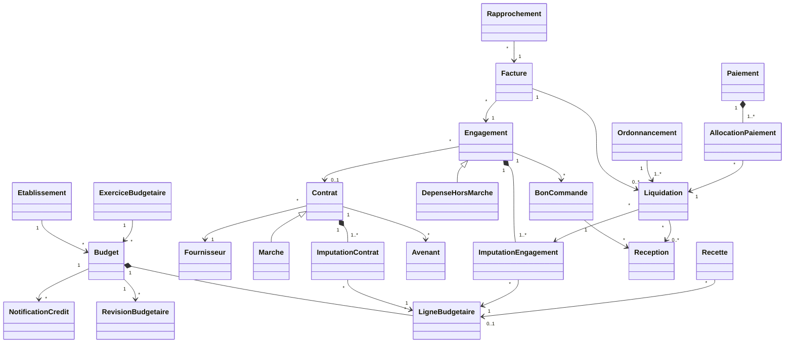

### 7.2. Domaine 1 — Établissements, budgets et crédits

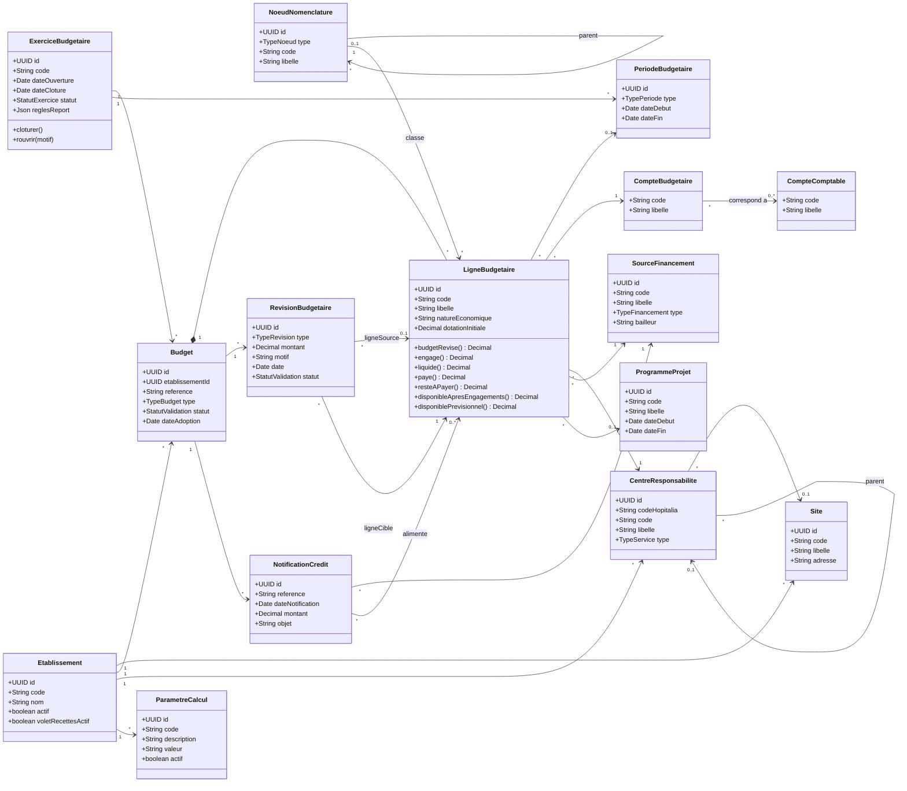

### 7.3. Domaine 2 — Marchés attribués, contrats signés et avenants

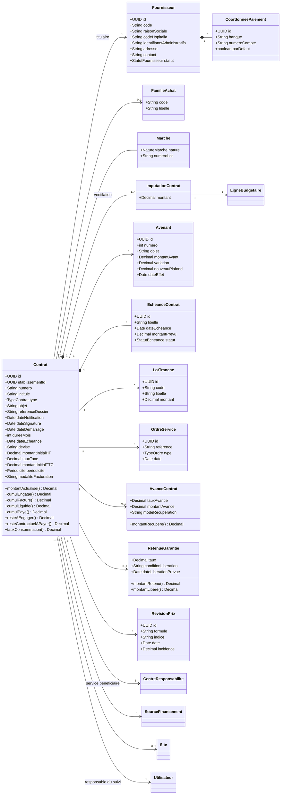

### 7.4. Domaine 3 — Chaîne d'exécution de la dépense

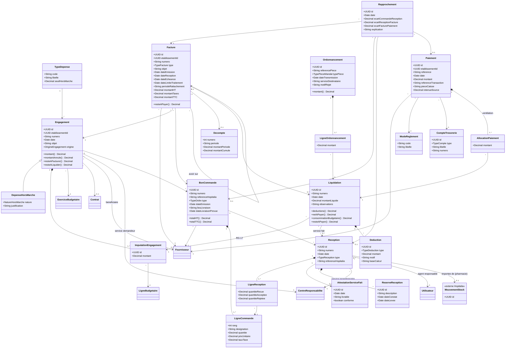

### 7.5. Domaine 4 — Recettes (volet activable)

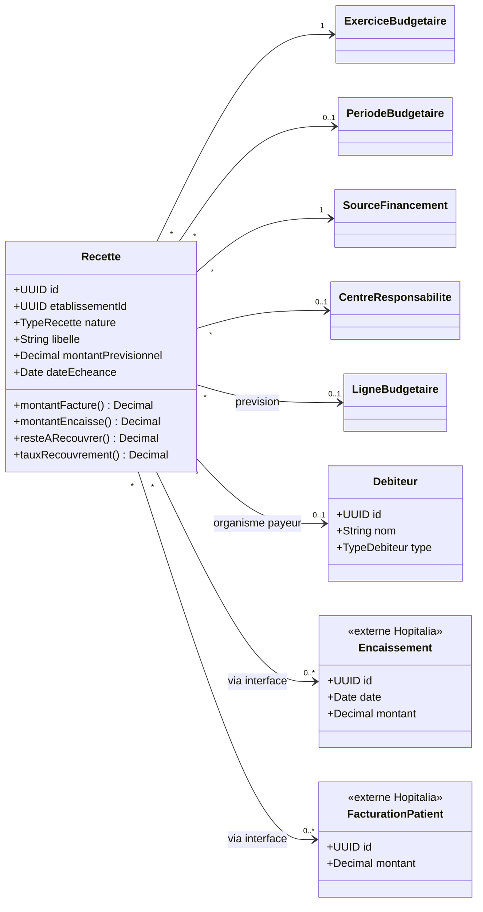

### 7.6. Domaine 5 — Habilitations, workflows, audit, alertes et intégrations

Les interfaces sont découpées selon les capacités réelles de chaque objet (principe I, section 10.2).

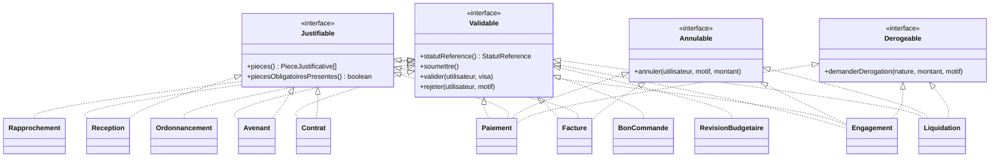

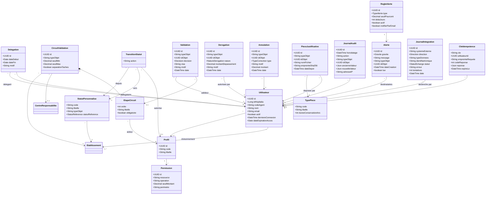

**Statuts configurables (§7.3 du cahier des charges V2).** Chaque objet a un **statut de référence** fixe (énumération, utilisé par les calculs de la section 6). Chaque établissement définit ses **statuts personnalisés** (libellés, étapes intermédiaires) rattachés à un statut de référence, et les **transitions** autorisées entre eux, avec le profil habilité. Les calculs restent stables quel que soit le paramétrage.

## 8. Cycles de vie

Les diagrammes montrent les statuts de référence. Les étapes intermédiaires propres à un établissement s'insèrent par paramétrage (7.6).

### 8.1. Engagement

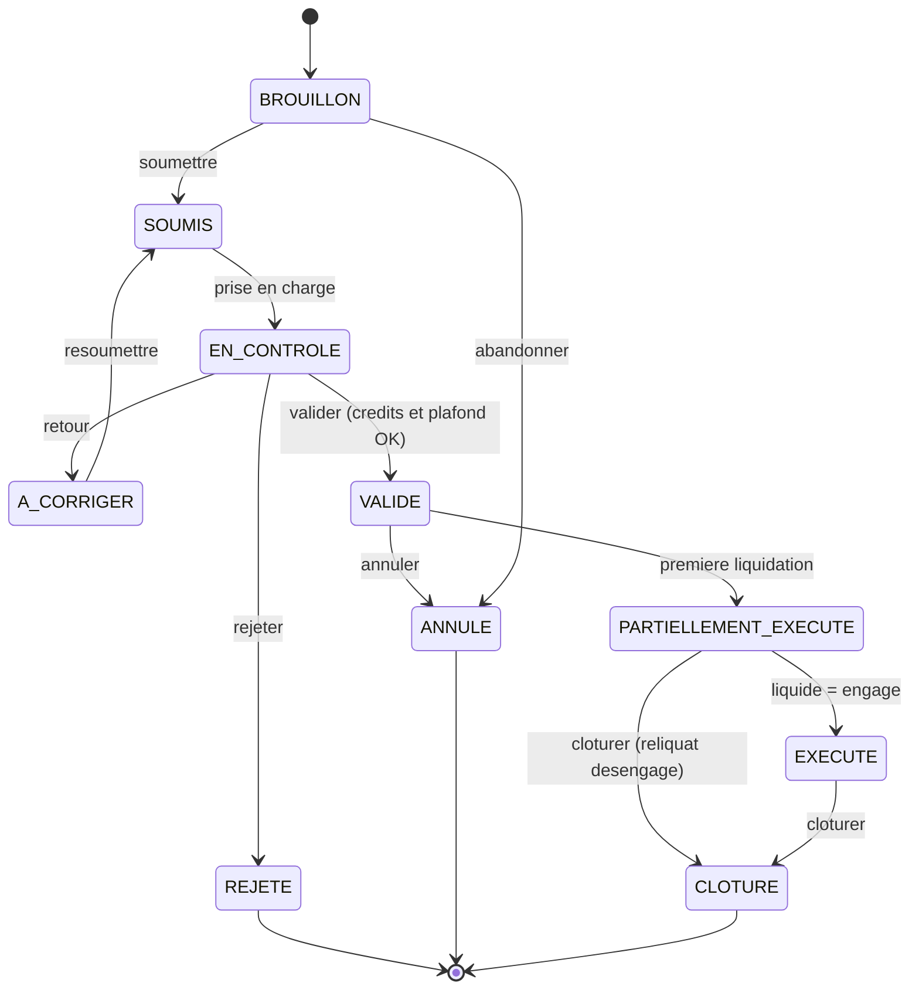

### 8.2. Facture

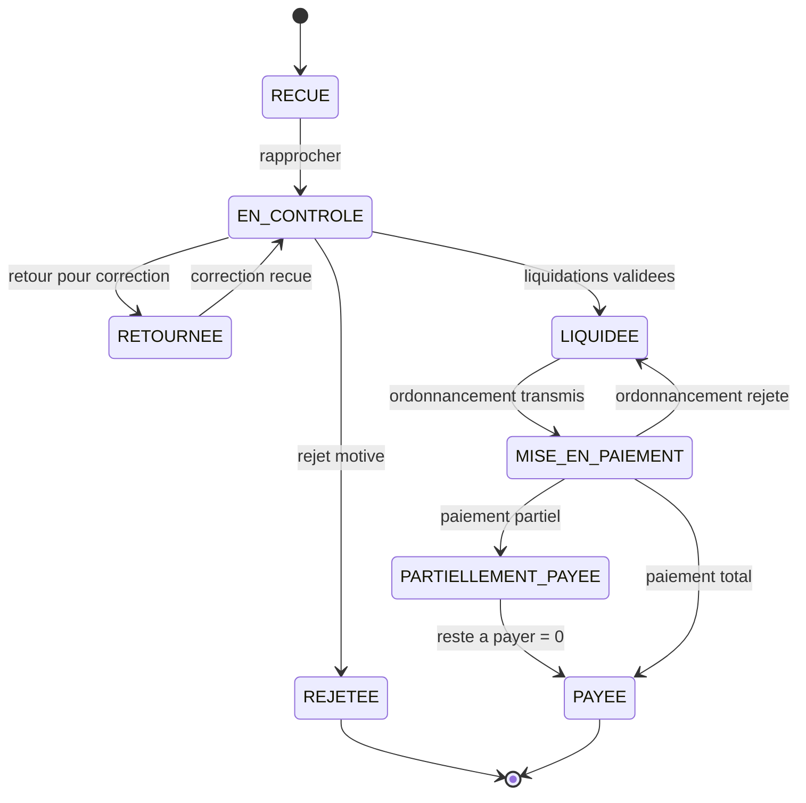

### 8.3. Ordonnancement

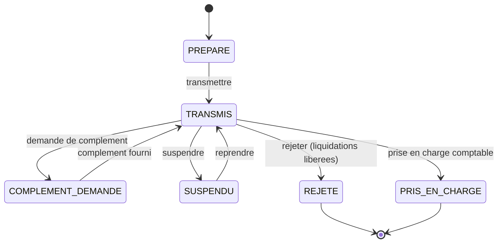

## 9. Processus

### 9.1. Chaîne de rapprochement obligatoire

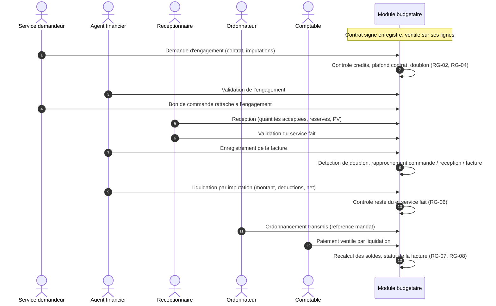

### 9.2. Enregistrement idempotent d'un paiement

Un paiement ne doit jamais être enregistré deux fois, même si le réseau coupe et que le client renvoie la requête (section 11.3).

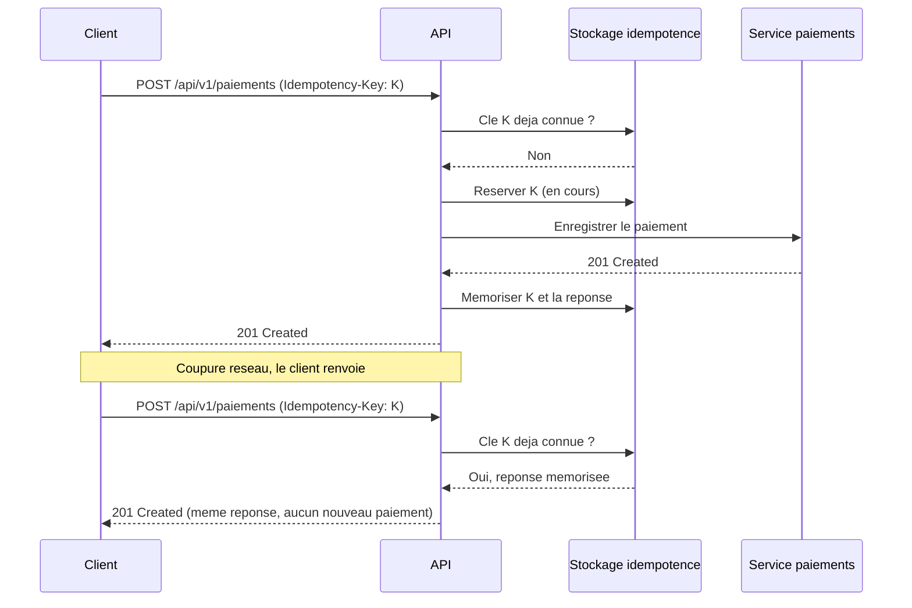

## 10. Architecture logicielle et principes SOLID

### 10.1. Architecture en couches (ports et adaptateurs)

Le domaine métier ne dépend d'aucun cadriciel, base de données ni système externe. Les dépendances pointent vers l'intérieur.

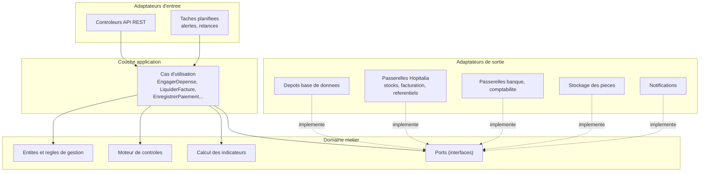

### 10.2. Application des principes SOLID

Chaque principe est traduit en exigence vérifiable en revue de code (section 15.3).

#### S — Responsabilité unique

Une classe a une seule raison de changer.

| Responsabilité | Porteur | Ce qu'il ne fait pas |
|---|---|---|
| Contrôle de disponibilité des crédits | `ControleCredits` | Ni enregistrement, ni notification. |
| Contrôle du plafond contractuel | `ControlePlafondContrat` | Ni calcul de taux de consommation. |
| Détection de doublons | `DetectionDoublonFacture` | Ni blocage : il signale, le cas d'utilisation décide. |
| Calcul des indicateurs (section 6) | `CalculIndicateurs` | Ni accès direct à la base : il reçoit les pièces d'un dépôt. |
| Persistance | Dépôts (`DepotEngagement`, …) | Aucune règle de gestion. |
| Piste d'audit | `JournaliseurAudit` | Aucune logique métier. |

**Exigence ARC-S :** une formule de la section 6 est implémentée une seule fois ; les états, tableaux de bord et contrôles l'appellent.

#### O — Ouvert / fermé

Le module s'étend sans modifier le code existant. Ajouter un contrôle, une alerte ou un type de déduction se fait en ajoutant une classe.

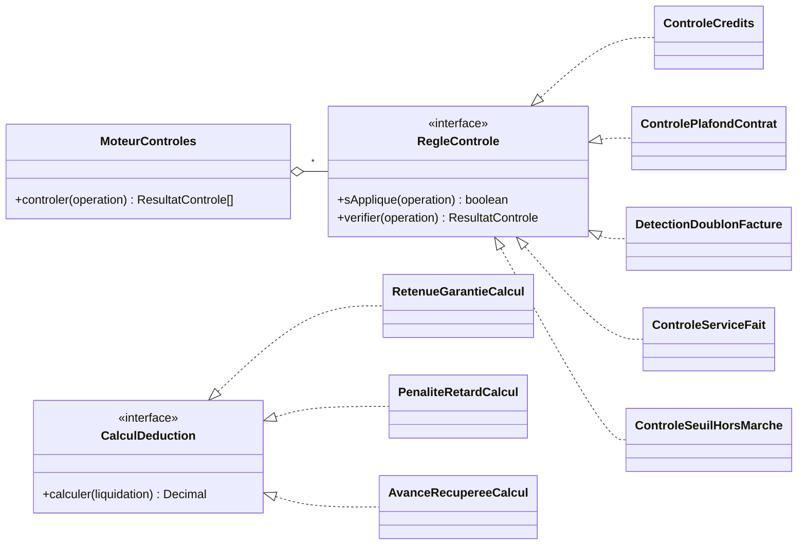

**Exigence ARC-O :** ajouter un nouveau contrôle automatique ne modifie ni `MoteurControles` ni les cas d'utilisation existants.

#### L — Substitution de Liskov

Une sous-classe s'utilise partout où sa classe mère est attendue, sans surprise.

- `Marche` est un `Contrat` : tout calcul, contrôle ou écran prévu pour un contrat fonctionne avec un marché.
- `DepenseHorsMarche` est un `Engagement` : elle ne redéfinit pas `valider()` pour lever une erreur propre. La contrainte de seuil est un contrôle (`ControleSeuilHorsMarche`) branché sur le moteur, pas une précondition durcie dans la sous-classe.
- Un avoir est une `Facture` de type `AVOIR` à montant négatif : les cumuls le traitent sans cas particulier.

**Exigence ARC-L :** les tests écrits pour `Contrat` et `Engagement` passent aussi avec `Marche` et `DepenseHorsMarche`.

#### I — Ségrégation des interfaces

Un objet n'implémente que les capacités qu'il possède. Le `Validable` unique de la V2 regroupait validations, pièces, annulations, dérogations et alertes. La V3 le découpe en `Validable`, `Justifiable`, `Annulable` et `Derogeable` (7.6).

| Objet | Validable | Justifiable | Annulable | Derogeable |
|---|:-:|:-:|:-:|:-:|
| Engagement | Oui | Oui | Oui | Oui |
| Contrat, Avenant | Oui | Oui | | |
| Révision budgétaire, Bon de commande | Oui | | | |
| Réception | Oui | Oui | | |
| Facture | Oui | Oui | Oui | |
| Liquidation | Oui | | Oui | Oui |
| Ordonnancement, Rapprochement | Oui | | | |
| Paiement | Oui | Oui | Oui | Oui |

**Exigence ARC-I :** aucune classe n'implémente une méthode d'interface par une exception « non supporté ».

#### D — Inversion des dépendances

Les cas d'utilisation dépendent d'abstractions (ports) ; les implémentations sont injectées.

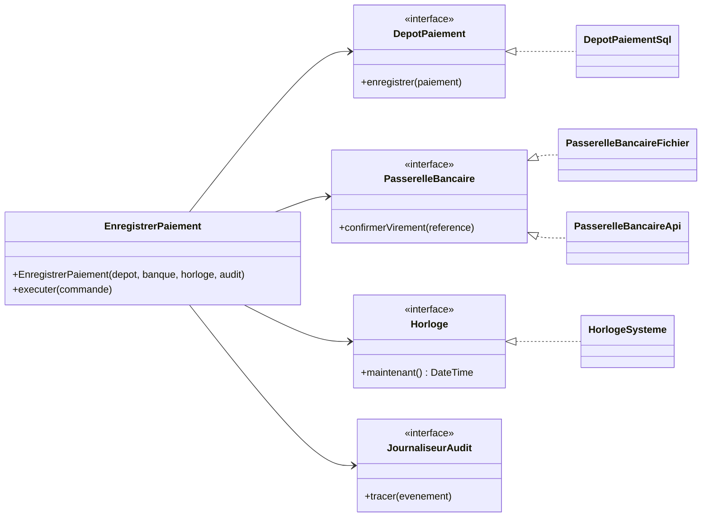

Ports prévus : dépôts de chaque agrégat, `PasserelleReferentielsHopitalia`, `PasserelleStock`, `PasserelleFacturationPatient`, `PasserelleBancaire`, `PasserelleComptabilite`, `StockagePieces`, `Notificateur`, `Horloge`, `JournaliseurAudit`.

**Exigence ARC-D :** le domaine et la couche application compilent et se testent sans base de données, sans réseau et sans module Hopitalia (implémentations de test des ports).

> SOLID est un moyen, pas un objectif : une abstraction n'est introduite que si elle a au moins deux implémentations (réelle et de test comptent) ou un point d'extension identifié par ce cahier des charges.

## 11. Conventions d'API

L'API REST sert l'interface web et les intégrations. Elle suit les règles ci-dessous, opposables en recette (section 15.2).

### 11.1. Nommage clair

- Ressources au **pluriel**, en minuscules, mots séparés par des tirets, sans accents : `/engagements`, `/bons-commande`, `/lignes-budgetaires`.
- Le **verbe HTTP** porte l'action, pas l'URL : pas de `/creerEngagement`.

| Action | Méthode | Exemple |
|---|---|---|
| Créer | `POST` | `POST /api/v1/engagements` |
| Lire | `GET` | `GET /api/v1/engagements/{id}` |
| Remplacer | `PUT` | `PUT /api/v1/fournisseurs/{id}` |
| Modifier partiellement | `PATCH` | `PATCH /api/v1/engagements/{id}` (brouillon uniquement) |
| Supprimer | `DELETE` | `DELETE /api/v1/engagements/{id}` (brouillon uniquement) |

- **Transitions de workflow = création d'une ressource.** Valider un engagement crée une `Validation` : `POST /api/v1/engagements/{id}/validations` avec `{"decision": "VALIDE", "visa": "..."}`. Même principe pour `/annulations`, `/derogations` et `/pieces`. Le modèle (7.6) et l'API restent alignés.
- **Les opérations validées sont immuables** (RG-18) : `PUT`, `PATCH` et `DELETE` répondent `409 Conflict`.
- Champs JSON en `camelCase`, identiques aux attributs du modèle.
- Montants en **chaîne décimale** (`"45000000.00"`), jamais en nombre flottant ; devise ISO 4217 (`XOF`). Dates ISO 8601.

### 11.2. Ressources principales

| Ressource | Opérations | Remarques |
|---|---|---|
| `/exercices` | GET, POST | `POST /exercices/{id}/clotures` clôture l'exercice. |
| `/budgets` | GET, POST | `POST /budgets/{id}/imports` : import asynchrone, `202 Accepted` et lien de suivi. |
| `/budgets/{id}/lignes` | GET, POST | |
| `/budgets/{id}/revisions` | GET, POST | |
| `/lignes-budgetaires/{id}/disponibilite` | GET | Indicateurs 6.1 calculés. |
| `/notifications-credits` | GET, POST | |
| `/fournisseurs` | GET, POST, PUT | Synchronisés avec le référentiel Hopitalia. |
| `/contrats` | GET, POST, PATCH | Filtre `type=MARCHE` pour les marchés. |
| `/contrats/{id}/avenants`, `/imputations`, `/echeances` | GET, POST | |
| `/contrats/{id}/synthese` | GET | Fiche de synthèse (annexe 18.1). |
| `/engagements` | GET, POST, PATCH, DELETE | |
| `/engagements/{id}/bons-commande` | GET, POST | |
| `/bons-commande/{id}/receptions` | GET, POST | |
| `/factures` | GET, POST | Détection de doublon à la création (`409` + référence du doublon). |
| `/factures/{id}/liquidations` | GET, POST | |
| `/ordonnancements` | GET, POST | |
| `/paiements` | GET, POST | Allocations dans le corps de la requête. |
| `/rapprochements` | GET, POST | |
| `/{ressource}/{id}/validations`, `/annulations`, `/derogations`, `/pieces` | GET, POST | Sur les ressources qui implémentent l'interface correspondante. |
| `/alertes` | GET, PATCH | `PATCH` pour marquer comme lue. |
| `/journal-audit` | GET | Lecture seule, pagination par curseur. |
| `/tableaux-de-bord/{code}` | GET | |
| `/etats/{code}` | GET | `Accept: application/pdf`, tableur ou JSON. |
| `/recettes` | GET, POST | Si le volet est actif. |

### 11.3. Idempotence

| Méthode | Idempotente | Règle |
|---|:-:|---|
| GET, HEAD, PUT, DELETE | Oui | Rejouer la requête donne le même état. |
| POST, PATCH | Non | Rendus sûrs par une clé d'idempotence. |

- Tout `POST` qui crée une opération financière (engagement, facture, liquidation, ordonnancement, paiement, révision, avenant) **exige** l'en-tête `Idempotency-Key` (UUID généré par le client). Sans clé : `400 Bad Request`.
- Même clé et même corps : la réponse mémorisée est renvoyée, rien n'est créé (diagramme 9.2).
- Même clé et corps différent : `422 Unprocessable Content`.
- Même clé encore en cours de traitement : `409 Conflict`.
- Les clés sont conservées au moins 24 heures *(durée paramétrable)* dans `CleIdempotence`.
- **Concurrence :** les ressources modifiables renvoient un `ETag` ; `PUT` et `PATCH` exigent `If-Match`, sinon `428`, et `412` si la ressource a changé entre-temps.

### 11.4. Pagination

- **Par décalage** pour les listes de gestion (contrats, engagements, factures) : `?page=2&taille=50`. Taille par défaut 25, maximum 100.
- **Par curseur** pour les flux volumineux qui ne font que croître (journal d'audit, journal d'intégration, alertes) : `?apres=<curseur>&taille=100`. Le curseur est opaque et la pagination reste stable même si de nouvelles lignes arrivent.

```json
{
  "donnees": [ { "id": "…", "numero": "ENG-2026-0042" } ],
  "pagination": { "page": 2, "taille": 50, "total": 312, "suivant": "/api/v1/engagements?page=3&taille=50" }
}
```

### 11.5. Tri et filtrage

- Tri : `?tri=-dateEmission,numero` (le signe `-` donne l'ordre décroissant).
- Filtres sur les axes du cahier des charges (§13) : `exercice`, `periode`, `service`, `compte`, `fournisseur`, `contrat`, `sourceFinancement`, `statut`, ainsi que des bornes `montantMin`, `montantMax`, `dateDu`, `dateAu`.
- Exemple : `GET /api/v1/factures?statut=EN_CONTROLE&fournisseur=…&tri=-dateReception&taille=50`.
- Seuls les champs listés dans la documentation sont filtrables et triables ; un champ inconnu donne `400`.

### 11.6. Références entre ressources

Une ressource rattachée à une autre est exposée **sous** son parent :

- Recommandé : `GET /api/v1/contrats/{id}/avenants/{avenantId}`
- À éviter : `GET /api/v1/avenants?contrat={id}&avenant={avenantId}` (moins lisible)

Règle d'usage : **un seul niveau d'imbrication**. Au-delà, on repart de la ressource enfant par son identifiant : `/receptions/{id}`, et non `/contrats/{c}/engagements/{e}/bons-commande/{b}/receptions/{r}`. Les réponses incluent les liens vers les ressources liées (`"liens": {"contrat": "/api/v1/contrats/…"}`).

### 11.7. Limitation de débit

- Limites par utilisateur et par client d'intégration. Valeurs proposées *(paramétrables)* : 300 requêtes par minute par utilisateur ; 10 imports ou exports par heure ; quota propre à chaque client d'intégration.
- En-têtes `RateLimit-Limit`, `RateLimit-Remaining` et `RateLimit-Reset` sur chaque réponse.
- Au-delà : `429 Too Many Requests` avec `Retry-After`.

### 11.8. Versionnement

- Version dans l'URL : `/api/v1/…`.
- Les ajouts compatibles (nouveau champ, nouvelle ressource, nouveau filtre) restent en `v1`.
- Un changement incompatible (champ supprimé ou renommé, sémantique modifiée) crée une `v2`. La `v1` est maintenue au moins 12 mois après la publication de la `v2` *(durée à valider)* ; les réponses de la version dépréciée portent les en-têtes `Deprecation` et `Sunset`.

### 11.9. Erreurs et sécurité

- Format d'erreur unique : `application/problem+json` (RFC 9457), avec un code métier stable :

```json
{
  "type": "https://hopitalia/erreurs/credit-insuffisant",
  "title": "Crédit insuffisant",
  "status": 422,
  "code": "RG-02",
  "detail": "Disponible 12 000 000 XOF, demandé 15 000 000 XOF sur la ligne 6011-PHARMA.",
  "ligneBudgetaire": "…"
}
```

- Le champ `code` est stable et sert de clé de traduction côté frontend ; `title` et `detail` suivent l'en-tête `Accept-Language` (I18N-07).
- `401` sans authentification, `403` sans habilitation ou hors de l'établissement de l'utilisateur, `404` pour un objet d'un autre établissement (on ne révèle pas son existence).
- TLS obligatoire ; jetons d'accès à durée courte, révocables ; connexion relayée vers Hopitalia et vérification locale des jetons Hopitalia ; les droits budgétaires sont propres au module (section 17, point 2).
- Documentation OpenAPI 3 générée par FastAPI et publiée avec chaque version.

## 12. Exigences non fonctionnelles

| Réf. | Exigence |
|---|---|
| ENF-01 | Application web accessible selon les habilitations et le réseau de l'établissement. |
| ENF-02 | Utilisateurs, rôles, permissions, authentification sécurisée ; sessions avec expiration et révocation. |
| ENF-03 | Chiffrement des échanges (TLS) et des données sensibles (coordonnées bancaires). |
| ENF-04 | Fonctionnement multi-établissements avec cloisonnement des données, vérifié côté serveur à chaque requête. |
| ENF-05 | Journal d'audit en ajout seul, non modifiable par les utilisateurs opérationnels. |
| ENF-06 | Sauvegardes régulières et restauration testée au moins une fois par trimestre *(fréquence à valider)*. |
| ENF-07 | Temps de réponse indicatifs : 95 % des lectures en moins d'une seconde, tableaux de bord en moins de trois secondes, à volumétrie d'un exercice. |
| ENF-08 | Contrôle de crédit atomique : verrouillage ou transaction sérialisée sur la ligne budgétaire (RG-20). |
| ENF-09 | Exports PDF, tableur et formats structurés (CSV, JSON). |
| ENF-10 | Paramétrage des exercices et clôture annuelle avec conservation de l'historique. |
| ENF-11 | Tests automatisés : règles de gestion RG-01 à RG-20 et formules de la section 6 couvertes par des tests unitaires ; scénarios de recette 15.1 automatisés au niveau de l'API. |

### 12.1. Interface utilisateur

**Pile :** React, TypeScript et Vite ; composants Ant Design 5 ; client d'API généré depuis l'OpenAPI de FastAPI.

| Réf. | Exigence |
|---|---|
| IHM-01 | **Style** sobre et fonctionnel, de type « minimaliste suisse » : grille régulière, hiérarchie typographique nette, peu d'effets. Thème clair par défaut, thème sombre en option. |
| IHM-02 | **Densité** élevée adaptée au travail sur écran toute la journée : mode compact d'Ant Design pour les tableaux et formulaires. |
| IHM-03 | **Palette** définie une seule fois dans le thème Ant Design (`ConfigProvider`), jamais de couleur en dur dans un composant. Couleur principale `#1E40AF` (bleu de confiance), fond `#F8FAFC`, cartes `#FFFFFF`, texte `#020617`, texte secondaire `#475569`, bordures `#E2E8F0`, succès `#059669`, avertissement `#B45309`, erreur `#DC2626`. |
| IHM-04 | **Typographie :** Lexend pour les titres, Source Sans 3 pour le texte, 14 px minimum dans les tableaux, 16 px dans les formulaires. Polices hébergées avec l'application, pas chargées depuis Google : le réseau de l'hôpital peut filtrer l'accès externe. |
| IHM-05 | **Montants :** chiffres à chasse fixe (`tabular-nums`), alignés à droite, séparateur de milliers, devise affichée (`45 000 000 XOF`). |
| IHM-06 | **Statuts et alertes** jamais signalés par la seule couleur : libellé et icône toujours présents (accessibilité). |
| IHM-07 | **Accessibilité :** contraste 4,5:1 minimum, navigation complète au clavier, focus visible, libellés visibles sur tous les champs, erreurs affichées près du champ concerné. |
| IHM-08 | **Responsive :** utilisable sur ordinateur (cible principale), tablette et téléphone, testé à 375, 768, 1024 et 1440 px. Sur petit écran, les listes passent en cartes ou défilent horizontalement, sans casser la page. |
| IHM-09 | **Tableaux :** tri, filtres et pagination côté serveur (section 11), sélection multiple et actions groupées (validation, export). |
| IHM-10 | **Tableaux de bord :** jauges linéaires (« bullet charts ») pour la consommation des crédits et des marchés, avec repères à 80, 90 et 100 % ; chaque graphique a sa valeur en texte et un tableau équivalent. |
| IHM-11 | **Animations** discrètes (150 à 250 ms) limitées aux retours d'action ; préférence « mouvement réduit » du système respectée. |
| IHM-12 | **Icônes** en SVG (jeu d'icônes Ant Design), jamais d'émojis. |

### 12.2. Internationalisation (i18n)

L'application est internationalisée dès le lot 0 : ajouter une langue ne demande aucune modification du code, seulement des fichiers de traduction.

| Réf. | Exigence |
|---|---|
| I18N-01 | **Langues :** français par défaut, anglais en seconde langue. La liste des langues est paramétrable. |
| I18N-02 | **Aucun texte en dur** dans les composants : chaque libellé, message, bouton et texte d'aide passe par une clé de traduction (`react-i18next`). Un contrôle automatique (lint) le vérifie. |
| I18N-03 | **Fichiers de traduction** au format JSON, un par langue et par domaine (`budget`, `contrats`, `factures`…), chargés à la demande. Une clé manquante est signalée en test et affiche la langue par défaut en production. |
| I18N-04 | **Choix de la langue :** préférence de l'utilisateur enregistrée sur son profil, sinon langue du navigateur, sinon français. Changement de langue sans rechargement de la page. |
| I18N-05 | **Formats** selon la langue choisie, avec les API `Intl` du navigateur : nombres et montants (séparateurs, position de la devise), dates, pluriels. La devise reste celle de l'opération, quelle que soit la langue. |
| I18N-06 | **Composants Ant Design** dans la langue choisie (calendriers, pagination, messages intégrés). |
| I18N-07 | **Erreurs de l'API :** le backend renvoie un code stable (section 11.9) ; le frontend traduit ce code. Le champ `detail` suit l'en-tête `Accept-Language`. |
| I18N-08 | **Contenus produits par le backend** (états PDF et tableur, courriels d'alerte) dans la langue de l'utilisateur destinataire. |
| I18N-09 | **Données métier non traduites :** libellés de comptes, de fournisseurs ou de contrats restent tels que saisis. Seule l'interface est traduite. |
| I18N-10 | **Prêt pour l'écriture de droite à gauche** (propriétés CSS logiques, `direction` d'Ant Design), sans qu'aucune langue de ce type ne soit prévue au départ. |

## 13. Intégrations

| Réf. | Exigence |
|---|---|
| INT-01 | Importer les fournisseurs et les services d'Hopitalia ; un élément disparu d'Hopitalia est désactivé, jamais supprimé. |
| INT-02 | Échanger avec la facturation hospitalière pour le volet recettes. |
| INT-03 | Importer de la pharmacie d'Hopitalia les bons de commande et les approvisionnements (EF-REC-07). Le module n'écrit jamais dans le stock, et ne confond pas consommation de stock et paiement fournisseur. |
| INT-04 | Échanges avec la comptabilité par export de fichiers (tableur, CSV) ; confirmations de virement saisies dans le module, sans échange automatique avec les banques. |
| INT-05 | Import et export des budgets, engagements, liquidations et paiements en formats structurés. |
| INT-06 | Identifiants uniques partagés entre modules pour éviter les doublons. |
| INT-07 | Chaque échange est journalisé (`JournalIntegration`) ; les erreurs sont reprises automatiquement ou manuellement ; les reprises sont idempotentes. |

## 14. Tableaux de bord, alertes et états

### 14.1. Tableau de bord de la direction

Budget initial, budget révisé et taux d'exécution ; engagements cumulés et crédits disponibles ; liquidé, ordonnancé ou transmis ; payé et restes à payer ; répartition par compte, service et nature ; principaux marchés en cours avec montant consommé et solde ; factures en attente ; échéances contractuelles et dépenses prévisionnelles.

Filtres : exercice, période, service, compte, fournisseur, marché, source de financement.

### 14.2. Indicateurs opérationnels

Taux d'engagement, de liquidation et de paiement ; reste à engager sur marchés ; reste contractuel à payer ; reste à payer sur factures ; âge des factures en attente et délai moyen de traitement ; part des dépenses par service, nature, compte et fournisseur. Définitions : section 6.

### 14.3. Alertes

| Type | Déclencheur | Effet par défaut |
|---|---|---|
| `CREDIT_INSUFFISANT` | Engagement > disponible. | Blocage, sauf dérogation. |
| `DEPASSEMENT_MARCHE` | Engagement > reste à engager du contrat. | Blocage, sauf avenant ou dérogation. |
| `SEUIL_MARCHE` | Consommation ≥ 80 %, 90 %, 100 %. | Alerte. |
| `AVENANT_NECESSAIRE` | Besoin au-delà du plafond. | Alerte ; le plafond ne change qu'à la validation de l'avenant. |
| `FACTURE_DOUBLON` | Même fournisseur, numéro, date, montant ou référence. | Blocage, sauf levée motivée. |
| `FACTURE_SUP_RECEPTION` | Facturé > réceptionné, commandé ou restant dû. | Alerte en liquidation. |
| `SERVICE_FAIT_MANQUANT` | Liquidation sans réception ni pièce requise. | Blocage. |
| `PAIEMENT_SUP_LIQUIDE` | Cumul payé > net à payer. | Blocage. |
| `FACTURE_ECHUE` | Délai paramétré dépassé. | Alerte. |
| `ECART_RAPPROCHEMENT` | Écart commande / réception / facture / paiement. | Alerte ; explication requise. |
| `ENGAGEMENT_ANCIEN` | Engagement ou liquidation non soldé depuis N jours. | Alerte. |
| `ECHEANCE_CONTRAT` | Contrat proche de son échéance. | Alerte. |
| `MODIFICATION_APRES_VALIDATION` | Tentative de modification d'une opération validée. | Blocage et trace. |

### 14.4. États et éditions

Budget primitif et révisé par compte et service ; situation des crédits disponibles ; engagements par fournisseur, marché et compte ; exécution financière de chaque contrat ; commandes et réceptions ; factures reçues, rejetées, validées et liquidées ; dossiers transmis en paiement ; paiements et rapprochements ; restes à engager, à liquider et à payer ; dépenses par service, compte, nature et période ; contrats arrivant à échéance ; journal des opérations et rapport d'audit.

La tutelle n'impose pas de modèle officiel : la présentation des états est libre (réponse de cadrage Q-D11).

## 15. Recette

### 15.1. Scénarios fonctionnels

| Réf. | Scénario | Exigences |
|---|---|---|
| REC-01 | Créer un exercice et importer les crédits par compte. | EF-BUD-01, 02 |
| REC-02 | Enregistrer un marché attribué avec montant, fournisseur, échéances, ventilation et pièces. | EF-CTR-01 à 03 |
| REC-03 | Créer un engagement lié au marché ; vérifier le contrôle des crédits et du plafond. | EF-ENG-03, RG-02, RG-04 |
| REC-04 | Enregistrer un avenant ; le plafond change seulement après validation, l'historique est conservé. | EF-CTR-04, RG-11 |
| REC-05 | Enregistrer une livraison partielle avec son procès-verbal. | EF-REC-01 à 05 |
| REC-06 | Enregistrer une facture partielle, la contrôler et la liquider sans clôturer le marché. | EF-LIQ-01 à 05 |
| REC-07 | Une facture supérieure à la réception acceptée déclenche une alerte. | 14.3 |
| REC-08 | Ordonnancer, puis enregistrer un paiement partiel : la facture reste ouverte. | EF-PAI-02, RG-08 |
| REC-09 | Enregistrer un second paiement ; vérifier le solde restant dû. | EF-PAI-04 |
| REC-10 | Un paiement groupé est ventilé et rapproché facture par facture. | EF-PAI-02 |
| REC-11 | Un doublon de facture est détecté et bloqué. | RG-16 |
| REC-12 | Rejet de facture, correction, annulation contrôlée ; vérifier la piste d'audit. | RG-09, RG-18 |
| REC-13 | Un utilisateur non habilité ne peut ni valider ni payer ; un même utilisateur ne peut pas créer, valider et payer. | RG-13 |
| REC-14 | Les tableaux de bord distinguent engagé, réceptionné, facturé, liquidé, transmis et payé ; les chiffres de l'annexe 18.2 sont retrouvés. | Section 6 |
| REC-15 | Aucune fonction de lancement ou d'attribution de marché n'est proposée. | RG-12 |
| REC-16 | Deux engagements simultanés sur le même crédit : un seul passe. | RG-20 |
| REC-17 | Un utilisateur d'un établissement ne voit aucune donnée d'un autre établissement. | ENF-04 |
| REC-18 | Passer l'interface en anglais puis en français : tous les écrans, messages d'erreur, formats de montants et de dates et l'état PDF exporté changent de langue ; les données métier restent inchangées. | I18N-01 à 09 |

### 15.2. Scénarios d'API

| Réf. | Scénario | Résultat attendu |
|---|---|---|
| API-01 | Rejouer `POST /paiements` avec la même `Idempotency-Key`. | Même réponse, un seul paiement en base. |
| API-02 | Même clé, corps différent. | `422`. |
| API-03 | `POST` financier sans clé. | `400`. |
| API-04 | `PATCH` d'un engagement validé. | `409`. |
| API-05 | `PATCH` avec un `If-Match` périmé. | `412`. |
| API-06 | Parcourir le journal d'audit par curseur pendant que des écritures arrivent. | Ni ligne perdue, ni doublon. |
| API-07 | Tri et filtre sur un champ non documenté. | `400`. |
| API-08 | Dépasser la limite de débit. | `429` avec `Retry-After`. |
| API-09 | Appeler `/api/v2/…` inexistant, puis `/api/v1/…`. | `404`, puis réponse normale. |
| API-10 | Lire un objet d'un autre établissement. | `404`. |
| API-11 | Comparer la documentation OpenAPI publiée et l'API réelle. | Conformes. |

### 15.3. Critères d'architecture (revue de code)

| Réf. | Critère |
|---|---|
| ARC-S | Chaque formule de la section 6 est implémentée une seule fois. |
| ARC-O | Un nouveau contrôle s'ajoute sans modifier le moteur ni les cas d'utilisation existants. |
| ARC-L | Les tests de `Contrat` et `Engagement` passent avec `Marche` et `DepenseHorsMarche`. |
| ARC-I | Aucune méthode d'interface n'est implémentée par une exception « non supporté ». |
| ARC-D | Le domaine se teste sans base de données, sans réseau et sans module Hopitalia. |

### 15.4. Critères généraux d'acceptation

Données budgétaires exactes et rapprochées des référentiels validés ; marchés enregistrés sans reproduire leur passation ; engagements, liquidations et paiements liés, historique consultable ; calculs vérifiables ; dépassements non autorisés et doublons courants bloqués ; habilitations et séparation des tâches conformes à la matrice ; états filtrables, imprimables et exportables ; scénarios exécutés et validés par les représentants de l'établissement.

## 16. Livrables et lots

**Livrables :** module intégré à Hopitalia ; document de conception et règles de gestion détaillées ; modèle de données et dictionnaire des champs ; workflows et matrice des habilitations ; documentation OpenAPI et des interfaces d'import et d'export ; états et modèles d'impression ; jeux d'essai et procès-verbal de recette ; guides utilisateur et administrateur ; plan de déploiement, sauvegarde, reprise et maintenance.

| Lot | Contenu | Résultat |
|---|---|---|
| 0 | Socle technique : architecture en couches, authentification, cloisonnement, audit, idempotence, conventions d'API, intégration continue. | Fondations communes |
| 1 | Référentiels, exercices, budgets, comptes et crédits. | Socle budgétaire |
| 2 | Contrats, marchés, avenants, ventilation, engagements. | Suivi contractuel et engagements |
| 3 | Commandes, réceptions, service fait. | Exécution des prestations |
| 4 | Factures, contrôles, liquidations. | Chaîne de dépense |
| 5 | Ordonnancement, paiements, restes à payer. | Suivi du règlement |
| 6 | Tableaux de bord, alertes, états ; volet recettes. | Pilotage et contrôle |
| 7 | Intégrations Hopitalia et systèmes tiers. | Interopérabilité |

Le lot 0 est ajouté : l'audit, l'idempotence et le cloisonnement sont difficiles à ajouter après coup.

## 17. Décisions de cadrage

Réponses aux questionnaires de cadrage (`docs/cadrage/`), données par le responsable du projet le 13/11/2026, puis corrigées le même jour après lecture du code `hopitalia-backend` (points 2, 12, 13 et 19 ; détail dans `docs/cadrage/integration-hopitalia.md`). Statuts : **Décidé** ; **Provisoire** (appliqué, à confirmer) ; **Ouvert** (information encore attendue).

| # | Sujet | Décision | Statut |
|---|---|---|---|
| 1 | Pile technique | Backend **FastAPI** (Python) ; interface **React + TypeScript + Ant Design** (12.1) ; base **PostgreSQL** (verrouillage de lignes pour RG-20, types numériques exacts, JSON pour l'audit). | Décidé |
| 2 | Authentification | **Connexion Hopitalia réutilisée** : le backend du module relaie la connexion vers Hopitalia et vérifie localement les jetons Hopitalia (HS512, clé en variable d'environnement). Les droits budgétaires (profils, établissements) sont attribués dans le module ; les rôles Hopitalia n'y donnent aucun droit. | Décidé |
| 3 | Nomenclature et plan comptable | Comptes comptables du **plan SYSCOHADA révisé** ; nomenclature budgétaire construite sur ce plan, chargée par import et relue par la DAF. | Décidé |
| 4 | Fournisseurs | Référentiel partagé entre établissements ; coordonnées bancaires et statut propres à chaque établissement. | Décidé |
| 5 | Taux de consommation d'un marché | Calculé sur l'engagé (cumul engagé / montant actualisé). | Décidé |
| 6 | Avance | L'avance consomme le crédit à sa liquidation ; sa récupération sur les décomptes réduit leur consommation (6.3). | Décidé |
| 7 | Limites techniques de l'API | 300 requêtes par minute par utilisateur, 10 imports ou exports par heure ; version d'API maintenue 12 mois après la suivante ; clés d'idempotence conservées 24 heures. Valeurs paramétrables. | Provisoire |
| 8 | Conservation des pièces | 10 ans par défaut, modifiable par type de pièce. | Décidé |
| 9 | Seuils hors marché | Paramétrables par type de dépense. Tant qu'aucun seuil n'est renseigné pour un type, une dépense hors marché de ce type exige une dérogation. Valeurs saisies plus tard par paramétrage. | Décidé |
| 10 | Intégration de l'interface | **Application séparée**, accessible par un lien depuis Hopitalia. | Décidé |
| 11 | Hébergement | **Serveurs de l'hôpital**, sur le réseau hospitalier. | Décidé |
| 12 | Référentiels | Fournisseurs et services importés depuis Hopitalia, complétés dans le module ; établissements et sites gérés dans le module (EF-REF-05, INT-01). | Décidé |
| 13 | Stocks et facturation patient | API Hopitalia documentées à partir du code (`docs/cadrage/integration-hopitalia.md`). Environnement de test Hopitalia à monter. | Décidé |
| 14 | Volet recettes | Activé après la mise en service, pas au démarrage. | Décidé |
| 15 | Langues | Français par défaut et anglais (I18N-01). | Décidé |
| 16 | Circuits de validation | L'ordonnateur valide **toujours**, après le valideur (DAF), quel que soit le montant : révisions, avenants, engagements, liquidations, dérogations. | Décidé |
| 17 | Comptabilité et banque | Export de fichiers vers la comptabilité ; confirmations de virement saisies dans le module (INT-04). | Décidé |
| 18 | États réglementaires | Pas de modèle officiel imposé par la tutelle : présentation libre (14.4). | Décidé |
| 19 | Achats pharmaceutiques | Commandes et approvisionnements de la pharmacie repris d'Hopitalia, sans ressaisie (EF-REC-07, INT-03). Les autres achats sont saisis dans le module. | Décidé |

**Encore attendus** (questionnaires) : charte graphique Hopitalia (Q-H04), établissements du premier déploiement (Q-H11), données réelles anonymisées pour la recette (Q-D08), interlocuteurs (Q-H12, Q-D14), compte technique et clé de vérification des jetons Hopitalia (T-017).

## 18. Annexes

### 18.1. Fiche de synthèse financière d'un contrat

| Indicateur | Définition |
|---|---|
| Montant initial | Montant du contrat signé. |
| Avenants validés | Cumul des avenants validés à incidence financière. |
| Montant contractuel actualisé | Montant initial + avenants positifs − avenants négatifs. |
| Engagements validés | Engagements rattachés, non annulés. |
| Commandes émises | Cumul des bons de commande. |
| Réceptionné | Prestations acceptées ou livraisons réceptionnées. |
| Factures reçues | Cumul des factures enregistrées, y compris en contrôle. |
| Factures liquidées | Montants validés en liquidation. |
| Transmis en paiement | Montants ordonnancés. |
| Payé | Règlements enregistrés et rapprochés. |
| Engagé non facturé | Engagements validés − factures prises en compte. |
| Reste à payer | Liquidé (net) − paiements imputés. |
| Solde non engagé | Montant actualisé − engagements validés. |

Écrans associés : liste des contrats (filtres par exercice, fournisseur, service, statut, niveau de consommation) ; fiche contrat à onglets (informations, avenants, imputations, engagements, commandes, réceptions, factures, liquidations, paiements, pièces) ; écran de rapprochement des écarts ; traitement des factures ; tableau de bord des restes à payer ; journal d'audit.

### 18.2. Exemple de suivi d'un marché (jeu d'essai)

Marché annuel de fournitures médicales, montant contractuel actualisé : 100 000 000 XOF. Le détail pièce par pièce (engagements, réceptions, factures, liquidations, paiements) et les contrôles à tester sont dans `docs/cadrage/jeu-essai-marche-fournitures.md`.

| Indicateur | Valeur (XOF) |
|---|---:|
| Montant contractuel actualisé | 100 000 000 |
| Engagements validés | 80 000 000 |
| Livraisons réceptionnées | 55 000 000 |
| Factures reçues | 50 000 000 |
| Factures liquidées | 45 000 000 |
| Paiements effectués | 30 000 000 |
| Reste à payer sur liquidé | 15 000 000 |
| Engagé non encore facturé | 30 000 000 |
| Solde contractuel non engagé | 20 000 000 |

Le tableau de bord doit faire ressortir les 15 000 000 liquidés non payés, signaler que les engagements dépassent les réceptions, et que les factures ne couvrent pas encore toutes les prestations engagées. Les rapprochements se font pièce par pièce, pas seulement sur les cumuls.

### 18.3. Situations particulières

| Situation | Comportement attendu |
|---|---|
| Facture partielle | Plusieurs factures par engagement, cumul et solde contrôlés. |
| Paiement partiel | Facture ouverte jusqu'au règlement complet ou à une clôture justifiée. |
| Paiement groupé | Un paiement couvre plusieurs liquidations, ventilation obligatoire. |
| Réception partielle | Chaque réception rattachée à sa commande et à sa facture. |
| Avoir | Facture de type `AVOIR` liée à la facture d'origine, sans effacer l'opération initiale. |
| Retenue de garantie | Montant retenu distinct du montant versé ; libération suivie. |
| Avance | Facture de type `AVANCE` liquidée et payée, puis récupérée par déduction sur les décomptes. |
| Pénalité, réfaction | Motif, base de calcul, validation et incidence sur le montant liquidé. |
| Avenant | Montant antérieur, variation, date d'effet et nouveau plafond conservés. |
| Clôture d'exercice | Engagements, factures et paiements restants suivis et rattachés au bon exercice. |

### 18.4. Énumérations (statuts de référence et types)

| Énumération | Valeurs |
|---|---|
| `StatutExercice` | OUVERT, CLOTURE, REOUVERT |
| `TypePeriode` | ANNUELLE, TRIMESTRIELLE, MENSUELLE |
| `TypeNoeud` | SECTION, CHAPITRE, ARTICLE, PARAGRAPHE |
| `TypeBudget` | PRIMITIF, MODIFICATIF |
| `TypeRevision` | BUDGET_MODIFICATIF, VIREMENT, REALLOCATION |
| `StatutValidation` | BROUILLON, SOUMIS, VALIDE, REJETE, ANNULE |
| `TypeContrat` | FOURNITURES, TRAVAUX, SERVICES, PRESTATIONS_INTELLECTUELLES, MAINTENANCE, ABONNEMENT, AUTRE |
| `StatutEngagement` | BROUILLON, SOUMIS, EN_CONTROLE, A_CORRIGER, VALIDE, REJETE, PARTIELLEMENT_EXECUTE, EXECUTE, CLOTURE, ANNULE |
| `OrigineEngagement` | CONTRAT, DECISION_AUTORISEE, HORS_MARCHE |
| `NatureHorsMarche` | MISSION, PETIT_ACHAT, EAU_ELEC_TELECOM, FONCTIONNEMENT, PRESTATION_PONCTUELLE, AUTRE |
| `TypeOrdre` | BON_COMMANDE, TRANCHE, ORDRE_SERVICE |
| `TypeReception` | TOTALE, PARTIELLE, REFUSEE |
| `TypeFacture` | AVANCE, ACOMPTE, PARTIELLE, DEFINITIVE, DECOMPTE, AVOIR |
| `StatutFacture` | RECUE, EN_CONTROLE, RETOURNEE, REJETEE, LIQUIDEE, MISE_EN_PAIEMENT, PARTIELLEMENT_PAYEE, PAYEE |
| `StatutLiquidation` | EN_COURS, A_CORRIGER, VALIDEE, REJETEE, ANNULEE |
| `TypeDeduction` | AVANCE_RECUPEREE, RETENUE_GARANTIE, PENALITE, REFACTION, RETENUE_SOURCE, AUTRE |
| `StatutOrdonnancement` | PREPARE, TRANSMIS, COMPLEMENT_DEMANDE, SUSPENDU, REJETE, PRIS_EN_CHARGE |
| `StatutPaiement` | ENREGISTRE, EXECUTE, ANNULE |
| `NatureDerogation` | CREDIT, PLAFOND_CONTRAT, LIQUIDATION_SUP_DU, PAIEMENT_SUP_SOLDE, DOUBLON |
| `TypeRecette` | SUBVENTION_DOTATION, RECETTE_PROPRE, REMBOURSEMENT_ASSURANCE, PRESTATION_HOSPITALIERE, AUTRE |
| `TypeAlerte` | voir 14.3 |

Les pénalités et réfactions diminuent le montant liquidé ; elles figurent dans `TypeDeduction` pour la traçabilité de leur calcul.

### 18.5. Traçabilité des règles de gestion

| Règle | Réalisation |
|---|---|
| RG-01 | `Engagement → ExerciceBudgetaire` ; `ImputationEngagement → LigneBudgetaire`. |
| RG-02 | `ControleCredits` ; `LigneBudgetaire.disponibleApresEngagements()` ; `Derogation(CREDIT)`. |
| RG-03 | `Contrat.dateSignature` ou `dateNotification` obligatoire ; aucune entité de passation. |
| RG-04 | `ControlePlafondContrat` ; `Contrat.montantActualise()` ; `Derogation(PLAFOND_CONTRAT)`. |
| RG-05 | `Facture → Engagement` obligatoire ; `BonCommande` facultatif. |
| RG-06 | `ControleServiceFait` ; `Liquidation → Reception` ; `AttestationServiceFait`. |
| RG-07 | `AllocationPaiement` ≤ `Liquidation.resteAPayer()` ; `Derogation(PAIEMENT_SUP_SOLDE)`. |
| RG-08 | `StatutFacture.PARTIELLEMENT_PAYEE` ; `Facture.resteAPayer()`. |
| RG-09 | `Annulation` ; `JournalAudit` (ancienne et nouvelle valeur) ; `Validation.motif`. |
| RG-10 | `ExerciceBudgetaire.cloturer()` ; `reglesReport`. |
| RG-11 | Seuls les avenants validés entrent dans `montantActualise()`. |
| RG-12 | Aucune entité ni aucun point d'API de passation. |
| RG-13 | `CircuitValidation.separationTaches` ; contrôle sur `Validation.valideur`. |
| RG-14 | Indicateurs exposés par des méthodes de calcul (section 7), aucun cumul stocké. |
| RG-15 | Contrôle à la validation : somme des imputations = montant. |
| RG-16 | `DetectionDoublonFacture` ; `409` à la création. |
| RG-17 | `Liquidation → ImputationEngagement` (multiplicité 1). |
| RG-18 | `409` sur `PUT`, `PATCH`, `DELETE` d'un objet validé ; alerte `MODIFICATION_APRES_VALIDATION`. |
| RG-19 | `Derogation.nature`, `idObjet` et `montantDepassement`. |
| RG-20 | ENF-08 ; scénario REC-16. |
