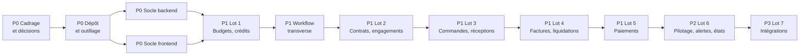

# Cahier des tâches — Module de suivi budgétaire Hopitalia

**Projet :** `hopitalia-budget` · **Dépôt :** https://github.com/LordPhenixDeNetra/hopitalia-budget · **Référence :** [cahier des charges V3](Backend/Cahier_des_charges_Module_Budgetaire_Hopitalia_V3.md) · **Pile :** FastAPI, PostgreSQL (à confirmer), React, TypeScript, Ant Design · **Mise à jour :** 13/11/2026

## Légende

| Statut | Signification |
|---|---|
| Fait | Terminé et vérifié selon le critère de fin. |
| En cours | Commencé, pas encore terminé. |
| À faire | Prêt à démarrer ou en attente de ses dépendances internes. |
| Bloqué | Ne peut pas avancer : il manque une information ou une décision **externe** (la raison est indiquée). |
| En attente | Décision interne à prendre avant de commencer. |
| Abandonné | Retiré du périmètre (garder la ligne et la raison). |

| Priorité | Signification |
|---|---|
| **P0 — Critique** | Préalable à tout le reste, ou protège l'intégrité financière et la sécurité. |
| **P1 — Haute** | Cœur du module : la chaîne de dépense complète (lots 1 à 5). |
| **P2 — Moyenne** | Pilotage, alertes, états, qualité avant la mise en production (lot 6). |
| **P3 — Basse** | Intégrations avancées, volets optionnels, documentation finale (lot 7). |

**Règles de suivi**

- Un identifiant (`T-xxx`) ne change jamais, même si la tâche change de section ou est abandonnée.
- Une tâche passe à « Fait » seulement quand son **critère de fin** est vérifié (tests verts, revue faite).
- Une tâche « Bloqué » indique toujours ce qui la bloque et qui peut la débloquer.
- Les colonnes « Réf. » renvoient aux exigences du cahier des charges (EF, RG, ENF, IHM, API, REC, ARC).

## Tableau de bord

| Priorité | Fait | En cours | À faire | Bloqué | En attente | Abandonné | Total |
|---|---:|---:|---:|---:|---:|---:|---:|
| P0 | 17 | 3 | 51 | 0 | 0 | 1 | 72 |
| P1 | 0 | 0 | 81 | 0 | 0 | 0 | 81 |
| P2 | 0 | 0 | 32 | 0 | 0 | 0 | 32 |
| P3 | 0 | 0 | 22 | 0 | 0 | 1 | 23 |
| **Total** | **17** | **3** | **186** | **0** | **0** | **2** | **208** |

Avancement : 17 / 206 tâches actives terminées (8 %), hors 2 abandonnées.

**Bloquants actuels**

Aucune tâche bloquée.

## Ordre de réalisation

---

## P0 — Critique

### P0.A — Cadrage et décisions

| ID | Tâche | Réf. | Dépend de | Statut | Critère de fin |
|---|---|---|---|---|---|
| T-001 | Rédiger le cahier des charges V3 (modèle corrigé, SOLID, conventions d'API, diagrammes). | — | — | Fait | Fichier V3 livré. |
| T-002 | Choisir le framework backend. | §17.1 | — | Fait | FastAPI retenu. |
| T-003 | Choisir le framework frontend. | §17.1 | — | Fait | React + TypeScript + Vite + Ant Design retenus. |
| T-004 | Définir la charte d'interface. | IHM-01 à 12 | T-003 | Fait | Section 12.1 du cahier des charges. |
| T-005 | Recommander l'organisation des dépôts. | — | — | Fait | Dépôt unique recommandé. |
| T-006 | Valider le cahier des charges V3 avec la DAF et l'équipe Hopitalia. | — | T-001 | Fait | Version validée, remarques intégrées (version 3.1). |
| T-007 | Confirmer le dépôt unique (monorepo). | — | T-005 | Fait | Décision écrite. |
| T-008 | Choisir l'authentification : fournisseur d'identité d'Hopitalia ou authentification propre. | §11.9, §17.2 | — | Fait | Décision écrite : connexion Hopitalia réutilisée, droits budgétaires propres au module (§17, point 2). |
| T-009 | Construire la nomenclature budgétaire sur le plan SYSCOHADA révisé (sections, chapitres, articles, comptes) et la faire relire par la DAF. | EF-REF-01, §17.3 | — | En cours | Fichier d'import de la nomenclature relu par la DAF. *Projet prêt : `docs/cadrage/nomenclature-budgetaire.csv`.* |
| T-010 | Vérifier si Hopitalia a un frontend et un dépôt central où le module doit s'intégrer. | §17.1 | — | Fait | Réponse écrite : application séparée (§17, point 10). |
| T-011 | Documenter les API Hopitalia utilisées (connexion, référentiels, pharmacie, facturation) et monter un environnement de test Hopitalia. | §13 | — | En cours | Note d'intégration écrite (fait : `docs/cadrage/integration-hopitalia.md`) et environnement de test Hopitalia en fonctionnement. |
| T-012 | Confirmer PostgreSQL comme base de données. | ENF-08, §17.1 | — | Fait | Décision écrite. |
| T-013 | Trancher les points ouverts 4 à 9 de la section 17 (fournisseurs partagés, base du taux de consommation, traitement de l'avance, limites de débit, conservation, seuils hors marché). | §17 | T-006 | Fait | Chaque point a une décision inscrite dans le cahier des charges. |
| T-014 | Vérifier le rendu des 17 diagrammes Mermaid du cahier des charges. | — | T-001 | Fait | Tous les diagrammes s'affichent sur GitHub (vérifié par le responsable du projet). |
| T-015 | Constituer un jeu de données d'essai réaliste (budget, contrats, factures) avec la DAF, dont l'exemple de l'annexe 18.2. | §18.2 | T-009 | Fait | Jeu d'essai validé le 13/11/2026 (codes fictifs à remplacer, T-009). |
| T-016 | Établir la matrice des habilitations (profil × opération × seuil). | §3, RG-13 | T-006 | Fait | Matrice validée le 13/11/2026 (l'ordonnateur valide toujours). |
| T-017 | Obtenir de l'équipe Hopitalia un compte technique en lecture et la clé de vérification des jetons ; lui transmettre, hors du dépôt, les points de sécurité relevés. | §17.2, INT-01 | T-011 | À faire | Compte et clé fournis hors dépôt ; points de sécurité transmis par écrit. |

### P0.B — Dépôt et outillage

| ID | Tâche | Réf. | Dépend de | Statut | Critère de fin |
|---|---|---|---|---|---|
| T-020 | Initialiser le dépôt git et la branche `main`. | — | T-007 | Fait | `git log` montre le premier commit. |
| T-021 | Créer le dépôt distant et y pousser `main`. | — | T-020 | Fait | `gh repo view` fonctionne. |
| T-022 | Créer la structure `backend/`, `frontend/`, `docs/` ; déplacer le cahier des charges et les images dans `docs/`. | — | T-020 | À faire | Arborescence en place, liens internes à jour. |
| T-023 | Écrire `.gitignore` (Python, Node, environnements, `CLAUDE.local.md`). | — | T-020 | En cours | `git status` propre après installation. |
| T-033 | Écrire `AGENTS.md` (règles du projet) et `CLAUDE.md` qui l'importe. | — | — | Fait | `CLAUDE.md` importe `AGENTS.md` ; liens vérifiés. |
| T-024 | Écrire le modèle de demande de fusion `.github/pull_request_template.md`. | — | T-020 | À faire | Modèle proposé à l'ouverture d'une demande de fusion. |
| T-025 | Protéger `main` : demande de fusion obligatoire, CI verte, signature DCO. | — | T-021, T-028 | À faire | Un push direct sur `main` est refusé. |
| T-026 | Écrire le `README.md` : installation, lancement, tests, conventions. | — | T-022 | À faire | Un nouveau développeur lance le projet en suivant le README. |
| T-027 | Écrire `docker-compose.yml` : PostgreSQL, backend, frontend. | ENF-01 | T-012, T-022 | À faire | `docker compose up` démarre les trois services. |
| T-028 | CI backend (`.github/workflows/backend.yml`), déclenchée par `backend/**` : lint, typage, tests. | ENF-11 | T-030 | À faire | CI verte sur une demande de fusion. |
| T-029 | CI frontend (`.github/workflows/frontend.yml`), déclenchée par `frontend/**` : lint, typage, tests, build. | ENF-11 | T-060 | À faire | CI verte sur une demande de fusion. |
| T-030 | Outils qualité backend : `ruff`, `mypy`, `pytest`, configurés dans `pyproject.toml`. | — | T-022 | À faire | Commandes lancées en local et en CI. |
| T-031 | Outils qualité frontend : ESLint (dont `jsx-a11y`), Prettier, `tsc --noEmit`. | IHM-07 | T-060 | À faire | Commandes lancées en local et en CI. |
| T-032 | Hooks `pre-commit` pour les deux sous-projets. | — | T-030, T-031 | À faire | Un commit mal formaté est refusé. |

### P0.C — Socle backend (lot 0)

| ID | Tâche | Réf. | Dépend de | Statut | Critère de fin |
|---|---|---|---|---|---|
| T-040 | Squelette FastAPI en couches : `domaine/`, `application/`, `adaptateurs/entree/`, `adaptateurs/sortie/`. | §10.1, ARC-D | T-022 | À faire | Le domaine n'importe ni FastAPI ni SQLAlchemy (vérifié par un test d'import). |
| T-041 | Configuration par variables d'environnement (`pydantic-settings`). | — | T-040 | À faire | Aucun secret dans le code. |
| T-042 | Accès base : SQLAlchemy 2, sessions, transactions. | — | T-012, T-040 | À faire | Test de connexion vert. |
| T-043 | Migrations Alembic et première migration. | — | T-042 | À faire | `alembic upgrade head` sur une base vide. |
| T-044 | Convention monétaire : `Numeric(18,2)` en base, `Decimal` en Python, chaîne décimale en JSON. | §11.1 | T-040 | À faire | Test : aller-retour JSON sans perte, aucun `float`. |
| T-045 | Préfixe de version `/api/v1` et publication OpenAPI. | §11.8, API-11 | T-040 | À faire | `/api/v1/openapi.json` accessible. |
| T-046 | Format d'erreur `application/problem+json` avec code métier. | §11.9 | T-040 | À faire | Test : une erreur métier renvoie le bon format et le code RG. |
| T-047 | Pagination par décalage (`page`, `taille`, max 100) et par curseur (`apres`). | §11.4, API-06 | T-040 | À faire | Tests des deux modes, curseur stable pendant des insertions. |
| T-048 | Tri et filtres sur liste blanche de champs. | §11.5, API-07 | T-047 | À faire | Champ inconnu donne `400`. |
| T-049 | Idempotence : en-tête `Idempotency-Key`, table `CleIdempotence`, rejeu de la réponse. | §11.3, API-01 à 03 | T-042 | À faire | Tests API-01, API-02, API-03 verts. |
| T-050 | Concurrence optimiste : `ETag`, `If-Match`, réponses `412` et `428`. | §11.3, API-05 | T-042 | À faire | Test API-05 vert. |
| T-051 | Limitation de débit par utilisateur et par client, en-têtes `RateLimit-*`, `429`. | §11.7, API-08 | T-040 | À faire | Test API-08 vert. |
| T-052 | Connexion relayée vers Hopitalia (connexion, rafraîchissement, déconnexion) et vérification locale des jetons Hopitalia (HS512, clé en variable d'environnement). | ENF-02 | T-008, T-017 | À faire | Jeton Hopitalia valide accepté ; jeton expiré ou mal signé refusé (`401`) ; agent sans profil budgétaire refusé (`403`). |
| T-039 | Gestion des comptes utilisateurs : création par l'administrateur, mot de passe haché (Argon2), réinitialisation, verrouillage après échecs répétés, désactivation, expiration des accès. | ENF-02, §17.2 | T-052 | Abandonné | *Abandonné : la connexion Hopitalia est réutilisée ; seuls les droits budgétaires sont gérés dans le module (T-053).* |
| T-053 | Habilitations : profils, permissions, seuils de montant. | §3, ENF-02 | T-052, T-016 | À faire | Appel non autorisé donne `403`. |
| T-054 | Cloisonnement par établissement, appliqué côté serveur à chaque requête. | ENF-04, REC-17 | T-053 | À faire | Tests REC-17 et API-10 verts (`404` hors établissement). |
| T-055 | Journal d'audit en ajout seul (ancienne et nouvelle valeur, IP), protégé en base contre la modification. | EF-AUD-01, ENF-05 | T-042 | À faire | Un `UPDATE` ou `DELETE` sur la table d'audit échoue. |
| T-056 | Ports transverses : `Horloge`, `JournaliseurAudit`, `StockagePieces`, `Notificateur`, avec implémentations de test. | §10.2 D | T-040 | À faire | Le domaine se teste sans base ni réseau. |
| T-057 | Journalisation technique structurée et point de santé `/health`. | — | T-040 | À faire | `/health` répond, journaux au format JSON. |
| T-058 | Base de test isolée et fabriques de données pour les tests. | ENF-11 | T-043 | À faire | Tests rejouables en CI. |
| T-059 | Langue côté backend : lecture de `Accept-Language`, catalogues de messages `fr` et `en` pour `title` et `detail` des erreurs. | I18N-07 | T-046 | À faire | Même erreur testée en `fr` et en `en`, code identique. |

### P0.D — Socle frontend (lot 0)

| ID | Tâche | Réf. | Dépend de | Statut | Critère de fin |
|---|---|---|---|---|---|
| T-060 | Projet Vite + React + TypeScript. | §12.1 | T-022, T-010 | À faire | `npm run build` sans erreur. |
| T-061 | Thème Ant Design centralisé dans `ConfigProvider` (palette, mode compact). | IHM-01 à 03 | T-060 | À faire | Aucune couleur en dur dans les composants (vérifié par lint ou revue). |
| T-062 | Polices Lexend et Source Sans 3 hébergées avec l'application. | IHM-04 | T-060 | À faire | Aucune requête vers Google au chargement. |
| T-063 | Mettre en place `react-i18next` : langues `fr` (défaut) et `en`, fichiers JSON par domaine chargés à la demande, langue de repli. | I18N-01, 03 | T-060 | À faire | Changement de langue sans rechargement ; clé manquante signalée en test. |
| T-076 | Règle de lint interdisant les textes en dur dans les composants. | I18N-02 | T-031, T-063 | À faire | Un texte en dur fait échouer la CI. |
| T-077 | Choix de la langue : profil utilisateur, puis navigateur, puis français ; sélecteur dans l'en-tête. | I18N-04 | T-063, T-064 | À faire | Langue conservée à la reconnexion. |
| T-078 | Formats selon la langue (`Intl`) : montants, nombres, dates, pluriels ; Ant Design dans la langue choisie. | I18N-05, 06 | T-063, T-071 | À faire | Tests de formatage en `fr` et en `en`. |
| T-079 | Traduction des codes d'erreur de l'API côté frontend. | I18N-07 | T-063, T-068 | À faire | Chaque code d'erreur documenté a sa traduction dans les deux langues. |
| T-064 | Gabarit de l'application : menu, fil d'Ariane, en-tête utilisateur et établissement. | IHM-08 | T-061 | À faire | Navigation utilisable de 375 à 1440 px. |
| T-065 | Routage avec liens profonds vers chaque fiche. | — | T-064 | À faire | Une URL de fiche s'ouvre directement après connexion. |
| T-066 | Génération du client d'API avec `orval` depuis l'OpenAPI FastAPI. | §12.1 | T-045, T-060 | À faire | Client régénéré en une commande, typé. |
| T-067 | TanStack Query : cache, invalidation après validation, gestion de `409` et `412`. | §11.3 | T-066 | À faire | Message clair à l'utilisateur sur conflit. |
| T-068 | Affichage des erreurs `problem+json` : près du champ, ou en notification. | IHM-07 | T-067 | À faire | Erreur de champ affichée sous le champ. |
| T-069 | Connexion, déconnexion, expiration de session. | ENF-02 | T-052 | À faire | Session expirée renvoie à la connexion sans perte silencieuse. |
| T-070 | Composant de tableau serveur : pagination, tri, filtres, sélection multiple, actions groupées. | IHM-09 | T-067 | À faire | Utilisé par une première liste. |
| T-071 | Formatage des montants (`tabular-nums`, alignement à droite, `XOF`). | IHM-05 | T-060 | À faire | Test unitaire du formatage. |
| T-072 | Badges de statut avec libellé et icône (jamais la couleur seule). | IHM-06 | T-061 | À faire | Composant unique réutilisé. |
| T-073 | Affichage adaptatif des listes sur petit écran (cartes ou défilement horizontal). | IHM-08 | T-070 | À faire | Aucun débordement de page à 375 px. |
| T-074 | Respect de la préférence « mouvement réduit ». | IHM-11 | T-061 | À faire | Animations coupées quand la préférence est active. |
| T-075 | Tests : Vitest pour les composants, Playwright pour les parcours. | ENF-11 | T-060 | À faire | Un test de chaque type passe en CI. |

---

## P1 — Haute

### P1.A — Lot 1 : référentiels, exercices, budgets et crédits

| ID | Tâche | Réf. | Dépend de | Statut | Critère de fin |
|---|---|---|---|---|---|
| T-080 | Établissements et sites. | EF-REF-02 | T-054 | À faire | CRUD API + écran + tests. |
| T-081 | Centres de responsabilité (hiérarchie, responsable habilité). | EF-REF-02 | T-080 | À faire | CRUD API + écran + tests. |
| T-082 | Sources de financement et programmes ou projets. | EF-REF-02 | T-080 | À faire | CRUD API + écran + tests. |
| T-083 | Nomenclature hiérarchique (section, chapitre, article, paragraphe). | EF-REF-01 | T-009 | À faire | Import de la nomenclature reçue + arbre affiché. |
| T-084 | Comptes budgétaires, comptes comptables et leur correspondance. | EF-REF-03 | T-083 | À faire | Correspondance consultable dans les deux sens. |
| T-085 | Fournisseurs et coordonnées de paiement (coordonnées chiffrées). | EF-REF-04, ENF-03 | T-080 | À faire | Numéro de compte chiffré en base, masqué à l'écran. |
| T-086 | Familles d'achats, types de dépenses (seuil hors marché), modes de règlement, comptes de trésorerie, types de pièces. | EF-REF-04 | T-080 | À faire | CRUD API + écrans + tests. |
| T-087 | Exercices budgétaires et périodes. | EF-BUD-01 | T-080 | À faire | Exercice ouvert avec ses périodes. |
| T-088 | Budgets (primitif, modificatif) par exercice et établissement. | EF-BUD-01 | T-087 | À faire | Un seul budget primitif par exercice et établissement. |
| T-089 | Lignes budgétaires et leurs axes (compte, centre, source, programme, période). | EF-BUD-01 | T-084, T-088 | À faire | Saisie et liste filtrable. |
| T-090 | Import asynchrone des dotations (`202`, suivi, rapport d'anomalies). | EF-BUD-02, REC-01 | T-089 | À faire | Import du jeu d'essai T-015, anomalies listées ligne par ligne. |
| T-091 | Notifications de crédits. | EF-BUD-03 | T-089 | À faire | Notification rattachée à ses lignes. |
| T-092 | Paramètres de calcul par établissement (`ParametreCalcul`). | §6 | T-080 | À faire | Chaque option paramétrable de la section 6 est lisible depuis ce paramétrage. |
| T-093 | Service unique de calcul des indicateurs de ligne (6.1). | §6.1, RG-14, ARC-S | T-089, T-092 | À faire | Tests unitaires de chaque formule ; aucune autre implémentation. |
| T-094 | Endpoint `/lignes-budgetaires/{id}/disponibilite`. | EF-BUD-06, 07 | T-093 | À faire | Valeurs conformes aux tests de T-093. |
| T-095 | Révisions budgétaires (modificatif, virement, réallocation), effectives après validation. | EF-BUD-04, 05 | T-089, T-110 | À faire | Un virement non validé ne change pas les disponibles. |
| T-096 | Écrans du lot 1 : budgets, lignes, disponibilités, révisions. | EF-BUD-06 | T-094, T-070 | À faire | Parcours Playwright REC-01 vert. |

### P1.B — Workflow transverse (validations, pièces, corrections)

| ID | Tâche | Réf. | Dépend de | Statut | Critère de fin |
|---|---|---|---|---|---|
| T-110 | Interfaces `Validable`, `Justifiable`, `Annulable`, `Derogeable`. | §7.6, ARC-I | T-040 | À faire | Aucune implémentation par exception « non supporté ». |
| T-111 | Statuts de référence, statuts personnalisés et transitions configurables. | §7.6 | T-110 | À faire | Une transition non paramétrée est refusée. |
| T-112 | Circuits de validation (étapes, profils, seuils, service). | EF-ENG-04 | T-111, T-053 | À faire | Un circuit à 2 étapes s'exécute dans l'ordre. |
| T-113 | Ressource `POST /{ressource}/{id}/validations` (visa, motif, décision). | §11.1 | T-112 | À faire | Validation, rejet et retour pour correction testés. |
| T-114 | Séparation des tâches : créateur ≠ valideur ≠ payeur selon le circuit. | RG-13, REC-13 | T-113 | À faire | Test REC-13 vert. |
| T-115 | Délégations temporaires. | §7.6 | T-112 | À faire | Une délégation expirée n'autorise plus rien. |
| T-116 | Immuabilité des objets validés (`409` sur `PUT`, `PATCH`, `DELETE`). | RG-18, API-04 | T-113 | À faire | Test API-04 vert. |
| T-117 | Annulations et contre-opérations tracées. | RG-09, RG-18 | T-116 | À faire | L'opération initiale reste visible avec son annulation. |
| T-118 | Dérogations par nature et montant. | RG-19 | T-113 | À faire | Une dérogation ne couvre que son objet et son montant. |
| T-119 | Pièces justificatives : dépôt, empreinte SHA-256, type, contrôle des pièces obligatoires. | EF-DOC-01, 02 | T-056 | À faire | Fichier altéré détecté par l'empreinte. |
| T-120 | Composants frontend : historique de validation (`Timeline`), boutons valider / rejeter, dépôt de pièces. | IHM-07 | T-113, T-119 | À faire | Réutilisés par toutes les fiches. |

### P1.C — Lot 2 : contrats, marchés, avenants

| ID | Tâche | Réf. | Dépend de | Statut | Critère de fin |
|---|---|---|---|---|---|
| T-130 | Contrats et marchés (fiche complète, date de signature ou de notification obligatoire). | EF-CTR-01, 02, RG-03 | T-085, T-110 | À faire | Contrat sans date de signature ni de notification refusé. |
| T-131 | Ventilation du contrat sur les lignes (`ImputationContrat`, somme = montant). | EF-CTR-03, RG-15 | T-130 | À faire | Ventilation incohérente refusée à la validation. |
| T-132 | Avenants : montant antérieur, variation, nouveau plafond, effet après validation. | EF-CTR-04, RG-11, REC-04 | T-130, T-113 | À faire | Test REC-04 vert. |
| T-133 | Échéancier, lots et tranches, ordres de service. | EF-CTR-05 | T-130 | À faire | CRUD + affichage dans la fiche. |
| T-134 | Avance, retenue de garantie, révisions de prix (montants calculés, pas stockés). | EF-CTR-05, RG-14 | T-130 | À faire | Montants recalculés depuis les déductions. |
| T-135 | Calculs contrat (6.2) dans le service unique d'indicateurs. | §6.2, ARC-S | T-093, T-130 | À faire | Tests unitaires de chaque formule. |
| T-136 | Endpoint `/contrats/{id}/synthese`. | EF-CTR-06, §18.1 | T-135 | À faire | Fiche de synthèse complète en JSON. |
| T-137 | Tests de substitution : les tests de `Contrat` passent avec `Marche`. | ARC-L | T-130 | À faire | Suite paramétrée verte. |
| T-138 | Écrans : liste des contrats (filtres, niveau de consommation) et fiche à onglets. | §18.1 | T-136, T-120 | À faire | Parcours Playwright REC-02 vert. |

### P1.D — Lot 2 : engagements et contrôles

| ID | Tâche | Réf. | Dépend de | Statut | Critère de fin |
|---|---|---|---|---|---|
| T-140 | Engagements et imputations (somme des imputations = montant). | EF-ENG-01, 02, RG-01, RG-15 | T-089, T-110 | À faire | Engagement incohérent refusé. |
| T-141 | Moteur de contrôles extensible (`RegleControle`, `MoteurControles`). | §10.2 O, ARC-O | T-040 | À faire | Ajouter un contrôle ne modifie pas le moteur (démontré par un contrôle de test). |
| T-142 | Contrôle de disponibilité des crédits. | RG-02, EF-ENG-03 | T-141, T-093 | À faire | Dépassement bloqué sans dérogation. |
| T-143 | Contrôle atomique du crédit (verrou de ligne ou transaction sérialisée). | RG-20, ENF-08, REC-16 | T-142 | À faire | Test de concurrence REC-16 : un seul engagement passe. |
| T-144 | Contrôle du plafond contractuel. | RG-04 | T-141, T-135 | À faire | Dépassement bloqué sans avenant ni dérogation. |
| T-145 | Contrôle de cohérence engagement / contrat / fournisseur. | EF-ENG-03 | T-141 | À faire | Fournisseur différent du titulaire refusé. |
| T-146 | Détection des doublons d'engagement. | EF-ENG-03 | T-141 | À faire | Doublon signalé. |
| T-147 | Dépenses hors marché et contrôle de seuil. | EF-DHM-01 | T-140, T-141 | À faire | Seuil dépassé bloqué ; tests `Engagement` verts avec `DepenseHorsMarche` (ARC-L). |
| T-148 | Annulation partielle et clôture avec désengagement automatique du reliquat. | EF-ENG-05 | T-117, T-140 | À faire | Disponible recrédité du reliquat, trace d'annulation créée. |
| T-149 | Idempotence de la création d'engagement. | §11.3 | T-049, T-140 | À faire | Rejeu sans doublon. |
| T-150 | Écrans : demande d'engagement, contrôle, validation, liste. | — | T-140, T-120 | À faire | Parcours Playwright REC-03 vert. |

### P1.E — Lot 3 : commandes, réceptions et service fait

| ID | Tâche | Réf. | Dépend de | Statut | Critère de fin |
|---|---|---|---|---|---|
| T-160 | Bons de commande, tranches et ordres de service, avec lignes. | EF-CMD-01 | T-140 | À faire | Commande impossible sur un engagement non validé. |
| T-161 | Réceptions totales et partielles, en plusieurs étapes. | EF-REC-01 | T-160 | À faire | Plusieurs réceptions pour une commande. |
| T-162 | Lignes de réception : quantités reçues, acceptées, rejetées. | EF-REC-02 | T-161 | À faire | Acceptée + rejetée ≤ reçue. |
| T-163 | Réserves et levée des réserves. | EF-REC-03 | T-161 | À faire | Réserves non levées listées. |
| T-164 | Attestation de service fait et pièces (BL, PV). | EF-REC-04 | T-161, T-119 | À faire | Pièces obligatoires contrôlées. |
| T-165 | Validation de la réception par le service réceptionnaire. | EF-REC-05 | T-161, T-113 | À faire | Réception non validée inutilisable comme preuve. |
| T-166 | Suivi des retards et des prestations non réalisées. | EF-REC-06 | T-161 | À faire | Liste des commandes en retard. |
| T-167 | Écrans : commandes, réceptions, service fait. | — | T-165, T-120 | À faire | Parcours Playwright REC-05 vert. |

### P1.F — Lot 4 : factures, liquidations, rapprochement

| ID | Tâche | Réf. | Dépend de | Statut | Critère de fin |
|---|---|---|---|---|---|
| T-170 | Factures (tous types) rattachées à un engagement. | EF-FAC-01, 02, RG-05 | T-140 | À faire | Facture sans engagement refusée. |
| T-171 | Détection des doublons de facture (`409` avec référence). | EF-FAC-03, RG-16, REC-11 | T-170 | À faire | Test REC-11 vert. |
| T-172 | Avoirs liés à la facture d'origine. | EF-FAC-02 | T-170 | À faire | Facture d'origine intacte, cumuls nets corrects. |
| T-173 | Décomptes successifs (marchés de travaux). | EF-FAC-02 | T-170 | À faire | Cumul des décomptes correct. |
| T-174 | Liquidations par imputation d'engagement. | EF-LIQ-03, RG-17 | T-170 | À faire | Facture sur 2 lignes donne 2 liquidations. |
| T-175 | Calculs de déduction extensibles (`CalculDeduction` : retenue de garantie, pénalité, avance récupérée, retenue à la source). | §6.3, §10.2 O | T-174 | À faire | Net à payer = liquidé − déductions, testé par type. |
| T-176 | Contrôle du service fait avant liquidation. | RG-06 | T-141, T-165 | À faire | Liquidation sans réception requise bloquée. |
| T-177 | Contrôle du reste dû et de la facture supérieure à la réception. | EF-LIQ-05, REC-07 | T-141, T-174 | À faire | Test REC-07 vert. |
| T-178 | Rejet motivé, retour pour correction, validation de la liquidation. | EF-LIQ-04 | T-113, T-174 | À faire | Historique complet consultable. |
| T-179 | Calculs par liquidation et facture (6.3) dans le service unique. | §6.3, ARC-S | T-093, T-174 | À faire | Tests unitaires de chaque formule, dont la règle de l'avance. |
| T-180 | Rapprochement commande / réception / facture / paiement, avec explication des écarts. | §9.1 | T-174 | À faire | Écart sans explication non validable. |
| T-181 | Écrans : traitement des factures, liquidation, rapprochement. | §18.1 | T-178, T-120 | À faire | Parcours Playwright REC-06 et REC-12 verts. |

### P1.G — Lot 5 : ordonnancement et paiements

| ID | Tâche | Réf. | Dépend de | Statut | Critère de fin |
|---|---|---|---|---|---|
| T-185 | Ordonnancements et lignes d'ordonnancement. | EF-ORD-01, 02 | T-174 | À faire | Une liquidation dans un seul ordonnancement actif. |
| T-186 | Statuts : transmis, complément demandé, suspendu, rejeté (liquidations libérées), pris en charge. | EF-ORD-03 | T-185, T-111 | À faire | Liquidation rejetée retransmissible, historique conservé. |
| T-187 | Paiements et allocations par liquidation. | EF-PAI-01, 02 | T-185 | À faire | Somme des allocations = montant du paiement. |
| T-188 | Paiement groupé ventilé. | EF-PAI-02, REC-10 | T-187 | À faire | Test REC-10 vert. |
| T-189 | Interdiction de payer au-delà du solde dû. | RG-07 | T-187, T-141 | À faire | Dépassement bloqué sans dérogation. |
| T-190 | Statut de la facture recalculé (partiellement payée, payée). | RG-08, EF-PAI-03 | T-187 | À faire | Tests REC-08 et REC-09 verts. |
| T-191 | Idempotence obligatoire de `POST /paiements`. | §9.2, API-01 | T-049, T-187 | À faire | Test API-01 vert sur les paiements. |
| T-192 | Annulation de paiement par contre-opération. | RG-18 | T-117, T-187 | À faire | Paiement annulé visible, soldes recalculés. |
| T-193 | Écrans : ordonnancement, saisie de paiement, ventilation. | — | T-190, T-120 | À faire | Parcours Playwright REC-08 à REC-10 verts. |

### P1.H — Recette de la chaîne de dépense

| ID | Tâche | Réf. | Dépend de | Statut | Critère de fin |
|---|---|---|---|---|---|
| T-195 | Scénario de bout en bout de l'annexe 18.2 (marché de 100 M XOF). | REC-14, §18.2 | T-193, T-015 | À faire | Tous les montants de l'annexe retrouvés. |
| T-196 | Test d'absence de fonction de passation dans l'API et les écrans. | RG-12, REC-15 | T-193 | À faire | Aucun point d'API ni écran de passation. |
| T-197 | Revue d'architecture ARC-S, ARC-O, ARC-L, ARC-I, ARC-D. | §15.3 | T-193 | À faire | Grille de revue complétée, écarts corrigés. |
| T-198 | Recette utilisateur des lots 1 à 5 avec la DAF. | §15.4 | T-195 | À faire | Procès-verbal de recette partiel signé. |

---

## P2 — Moyenne

### P2.A — Lot 6 : tableaux de bord et indicateurs

| ID | Tâche | Réf. | Dépend de | Statut | Critère de fin |
|---|---|---|---|---|---|
| T-210 | Tableau de bord de la direction. | §14.1 | T-195 | À faire | Engagé, réceptionné, facturé, liquidé, transmis et payé distincts (REC-14). |
| T-211 | Indicateurs opérationnels (taux, restes, âge des factures, délai moyen). | §14.2 | T-210 | À faire | Valeurs conformes à la section 6. |
| T-212 | Filtres : exercice, période, service, compte, fournisseur, marché, source. | §14.1 | T-210 | À faire | Chaque filtre testé. |
| T-213 | Jauges de consommation avec repères 80 / 90 / 100 % et tableau équivalent. | IHM-10 | T-210 | À faire | Valeur lisible en texte, sans dépendre de la couleur. |
| T-214 | Tableau de bord des restes à payer et des factures en attente. | §18.1 | T-210 | À faire | Liste exportable. |

### P2.B — Lot 6 : alertes

| ID | Tâche | Réf. | Dépend de | Statut | Critère de fin |
|---|---|---|---|---|---|
| T-220 | Règles d'alerte paramétrables (`RegleAlerte`). | §14.3 | T-092 | À faire | Seuils et délais modifiables par établissement. |
| T-221 | Alertes immédiates déclenchées par les contrôles (crédit, plafond, doublon, service fait, paiement). | §14.3 | T-220, T-141 | À faire | Chaque contrôle bloquant crée son alerte. |
| T-222 | Alertes planifiées (seuils 80/90/100 %, factures échues, engagements anciens, échéances de contrat). | §14.3 | T-220 | À faire | Tâche planifiée testée avec une horloge simulée. |
| T-223 | Alerte de modification après validation. | §14.3, RG-18 | T-116, T-220 | À faire | Tentative tracée et signalée. |
| T-224 | Centre d'alertes (liste, marquer comme lue) et pagination par curseur. | §11.2 | T-221 | À faire | Écran et API testés. |
| T-225 | Notifications par courriel (option par règle), dans la langue du destinataire. | §7.6, I18N-08 | T-222, T-056, T-059 | À faire | Courriel reçu en environnement de test, dans la langue du destinataire. |

### P2.C — Lot 6 : états, audit, clôture

| ID | Tâche | Réf. | Dépend de | Statut | Critère de fin |
|---|---|---|---|---|---|
| T-230 | Moteur d'états : PDF, tableur, JSON (`/etats/{code}`), dans la langue de l'utilisateur. | ENF-09, I18N-08 | T-195, T-059 | À faire | Un état produit dans les trois formats, en `fr` et en `en`. |
| T-231 | États budgétaires : budget primitif et révisé, crédits disponibles. | §14.4 | T-230 | À faire | Totaux identiques au tableau de bord. |
| T-232 | États d'engagement et d'exécution des contrats. | §14.4 | T-230 | À faire | Idem. |
| T-233 | États des commandes, réceptions, factures, liquidations. | §14.4 | T-230 | À faire | Idem. |
| T-234 | États des paiements, rapprochements et restes (à engager, liquider, payer). | §14.4 | T-230 | À faire | Idem. |
| T-235 | État des dépenses par service, compte, nature, période ; contrats arrivant à échéance. | §14.4 | T-230 | À faire | Idem. |
| T-236 | Consultation du journal d'audit et rapport d'audit (profil auditeur, lecture seule). | EF-AUD-01, §14.4 | T-055 | À faire | Test API-06 vert ; aucune action de modification pour l'auditeur. |
| T-237 | Journalisation des connexions et opérations sensibles. | EF-AUD-02 | T-052, T-055 | À faire | Connexions réussies et échouées tracées. |
| T-238 | Recherche transverse (numéro, date, fournisseur, montant, compte, service). | EF-DOC-03 | T-195 | À faire | Résultats en moins de 3 s sur un exercice. |
| T-239 | Clôture d'exercice avec report des engagements restant à payer. | EF-BUD-09, RG-10 | T-195 | À faire | Historique intact, restes rattachés au nouvel exercice. |
| T-240 | Réouverture d'exercice motivée. | §7.2 | T-239 | À faire | Réouverture tracée. |

### P2.D — Qualité, sécurité et exploitation

| ID | Tâche | Réf. | Dépend de | Statut | Critère de fin |
|---|---|---|---|---|---|
| T-245 | Couverture de tests des règles RG-01 à RG-20 (une règle, au moins un test nommé). | ENF-11 | T-195 | À faire | Tableau règle → test complet. |
| T-246 | Automatisation des scénarios REC-01 à REC-18. | §15.1 | T-195 | À faire | Tous verts en CI. |
| T-247 | Automatisation des scénarios API-01 à API-11. | §15.2 | T-193 | À faire | Tous verts en CI. |
| T-248 | Vérification de conformité OpenAPI publiée / API réelle. | API-11 | T-045 | À faire | Test de contrat en CI. |
| T-249 | Audit d'accessibilité (contraste, clavier, focus, libellés). | IHM-07 | T-193 | À faire | Aucun défaut bloquant. |
| T-250 | Tests responsive à 375, 768, 1024 et 1440 px. | IHM-08 | T-193 | À faire | Captures Playwright sans débordement. |
| T-251 | Tests de performance à volumétrie d'un exercice. | ENF-07 | T-195 | À faire | Lectures < 1 s (95 %), tableaux de bord < 3 s. |
| T-252 | Revue de sécurité (OWASP, dépendances, secrets, chiffrement des coordonnées bancaires). | ENF-03 | T-195 | À faire | Aucune faille critique ouverte. |
| T-253 | Sauvegardes automatiques et test de restauration. | ENF-06 | T-027 | À faire | Restauration réussie et chronométrée. |
| T-254 | Environnement de recette déployé. | — | T-027 | À faire | Accessible aux testeurs de la DAF. |

---

## P3 — Basse

### P3.A — Lot 7 : intégrations

| ID | Tâche | Réf. | Dépend de | Statut | Critère de fin |
|---|---|---|---|---|---|
| T-200 | Journal d'intégration, reprises automatiques et manuelles, idempotentes. | INT-07 | T-049 | À faire | Échange en échec repris sans doublon. |
| T-201 | Import des fournisseurs et services depuis Hopitalia (identifiant externe, désactivation sans suppression). | INT-01, EF-REF-05 | T-011, T-017, T-200 | À faire | Deux synchronisations successives sans doublon ; un fournisseur retiré d'Hopitalia est désactivé. |
| T-202 | Import des bons de commande et approvisionnements de la pharmacie Hopitalia, rattachement aux engagements, annulation des réceptions supprimées. | INT-03 | T-011, T-017, T-160, T-161, T-200 | À faire | Approvisionnement importé une seule fois ; suppression dans Hopitalia annule la réception avec trace (EF-REC-07). |
| T-203 | Échange avec la facturation patient et le recouvrement (volet recettes). | INT-02 | T-011, T-017, T-262 | À faire | Facturé et encaissé alimentés par interface. *Bloqué : T-011.* |
| T-204 | Échange avec la banque (confirmation des virements). | INT-04 | T-187 | Abandonné | *Abandonné : confirmations de virement saisies à la main dans le module (§17, point 17).* |
| T-205 | Export vers la comptabilité par fichier (tableur, CSV). | INT-04 | T-187, T-206 | À faire | Fichier accepté par le service comptable. |
| T-206 | Import et export structurés (budgets, engagements, liquidations, paiements). | INT-05 | T-200 | À faire | Aller-retour export → import sans perte. |
| T-207 | Identifiants uniques partagés entre modules. | INT-06 | T-200 | À faire | Aucun doublon après deux synchronisations. |

### P3.B — Volet recettes (activable)

| ID | Tâche | Réf. | Dépend de | Statut | Critère de fin |
|---|---|---|---|---|---|
| T-260 | Activation du volet par établissement. | §7.2 | T-080 | À faire | Volet invisible quand il est désactivé. |
| T-261 | Recettes et débiteurs (nature, service, source, période). | EF-RCT-01 | T-260 | À faire | CRUD API + écran + tests. |
| T-262 | Calculs : facturé, encaissé, reste à recouvrer, taux. | EF-RCT-02, RG-14 | T-261 | À faire | Tests unitaires. |
| T-263 | Tableau de bord des recettes. | EF-RCT-02 | T-262 | À faire | Filtres par nature, service, période. |

### P3.C — Options d'interface

| ID | Tâche | Réf. | Dépend de | Statut | Critère de fin |
|---|---|---|---|---|---|
| T-270 | Thème sombre (algorithme sombre d'Ant Design). | IHM-01 | T-061 | À faire | Contrastes conformes en mode sombre. |
| T-271 | Préférences utilisateur (densité, colonnes visibles des tableaux). | IHM-02 | T-070 | À faire | Préférences conservées entre les sessions. |
| T-272 | Traduction anglaise complète et relue de tous les écrans. | I18N-01 | T-193 | À faire | Aucune clé `en` manquante (contrôle automatique). |
| T-273 | Compatibilité écriture de droite à gauche (propriétés CSS logiques, `direction` d'Ant Design). | I18N-10 | T-061 | À faire | Gabarit affiché correctement en mode droite à gauche de test. |

### P3.D — Livrables documentaires

| ID | Tâche | Réf. | Dépend de | Statut | Critère de fin |
|---|---|---|---|---|---|
| T-280 | Dictionnaire des données (généré depuis le modèle). | §16 | T-195 | À faire | Chaque table et champ documenté. |
| T-281 | Description des workflows et matrice des habilitations finale. | §16 | T-112, T-016 | À faire | Validée par la DAF. |
| T-282 | Documentation OpenAPI publiée et guide d'intégration. | §16 | T-248 | À faire | Publiée avec la version. |
| T-283 | Guide utilisateur (par profil). | §16 | T-198 | À faire | Relu par un utilisateur de chaque profil. |
| T-284 | Guide d'administration (paramétrage, circuits, alertes). | §16 | T-198 | À faire | Un administrateur paramètre un établissement seul. |
| T-285 | Plan de déploiement, de sauvegarde, de reprise et de maintenance. | §16 | T-253 | À faire | Validé par l'exploitation. |
| T-286 | Procès-verbal de recette final. | §15.4 | T-246, T-198 | À faire | Signé par les représentants de l'établissement. |

---

## Journal des changements de statut

| Date | Tâche | Ancien statut | Nouveau statut | Commentaire |
|---|---|---|---|---|
| 13/11/2026 | T-001 à T-005 | — | Fait | Cahier des charges V3, choix techniques, charte d'interface, recommandation de dépôt unique. |
| 13/11/2026 | T-008 à T-011, T-201 à T-205 | — | Bloqué | Informations externes attendues. |
| 13/11/2026 | T-059, T-063, T-076 à T-079, T-272, T-273 | — | À faire | Ajout de l'internationalisation (I18N-01 à 10). |
| 13/11/2026 | T-023 | À faire | En cours | `.gitignore` créé à la racine ; à vérifier par `git status` après T-020 et l'installation des dépendances. |
| 13/11/2026 | T-033 | — | Fait | `AGENTS.md` et `CLAUDE.md` créés. |
| 13/11/2026 | T-007, T-020, T-021 | En attente, À faire | Fait | Dépôt unique `hopitalia-budget` créé sur GitHub, `main` poussée (« Init Commit »). |
| 13/11/2026 | T-012, T-013 | En attente | Fait | PostgreSQL retenu ; points 4 à 9 décidés à titre provisoire (section 17 du cahier des charges), à confirmer par la DAF. |
| 13/11/2026 | T-006, T-014, T-015, T-016 | À faire | En cours | Dossier de cadrage prêt dans `docs/cadrage/` (questionnaires, matrice, jeu d'essai) ; en attente des réponses DAF et Hopitalia. Diagrammes à vérifier sur GitHub. |
| 13/11/2026 | T-006, T-008, T-010, T-015, T-016 | En cours, Bloqué | Fait | Réponses de cadrage : cahier des charges validé (v3.1), authentification propre, application séparée, jeu d'essai et matrice validés. |
| 13/11/2026 | T-009, T-205 | Bloqué | À faire | Nomenclature construite sur le plan SYSCOHADA révisé ; export comptable par fichier. |
| 13/11/2026 | T-201, T-204 | À faire, Bloqué | Abandonné | Pas de référentiels communs Hopitalia ; pas d'échange bancaire automatique. |
| 13/11/2026 | T-039 | — | À faire | Ajout : gestion des comptes utilisateurs propres au module. |
| 13/11/2026 | T-014 | En cours | Fait | Diagrammes vérifiés sur GitHub. |
| 13/11/2026 | T-009, T-011 | À faire, Bloqué | En cours | Projet de nomenclature SYSCOHADA prêt ; note d'intégration Hopitalia écrite à partir du code. |
| 13/11/2026 | T-039 | À faire | Abandonné | Connexion Hopitalia réutilisée. |
| 13/11/2026 | T-201, T-202, T-203 | Abandonné, Bloqué | À faire | Référentiels et achats pharmaceutiques importés d'Hopitalia ; API documentées. |
| 13/11/2026 | T-017 | — | À faire | Ajout : compte technique et clé Hopitalia, points de sécurité. |
