# Cahier des charges — Module de gestion et de suivi budgétaire hospitalier

**Solution Hopitalia · Projet `hopitalia-budget` (nom affiché : Hopitalia Budget) · Version 3.18 · 16 novembre 2026 · Statut : validé le 13/11/2026**

| Version | Date | Objet |
|---|---|---|
| 1.0 | — | Première version (incluait la passation des marchés). |
| 2.0 | Novembre 2026 | Recentrage sur le suivi après attribution ; diagramme de classes V2. |
| 3.0 | 13/11/2026 | Fusion du cahier des charges V2 et du diagramme de classes V2, corrections du modèle, ajout des principes d'architecture (SOLID) et des conventions d'API. |
| 3.1 | 13/11/2026 | Validation ; intégration des réponses de cadrage (authentification propre, application séparée, référentiels gérés dans le module, plan SYSCOHADA, circuits avec ordonnateur, échanges par fichiers) ; section 17 mise à jour. |
| 3.2 | 13/11/2026 | Lecture du code `hopitalia-backend` : connexion Hopitalia réutilisée, fournisseurs et services importés, achats pharmaceutiques repris d'Hopitalia ; note d'intégration `docs/cadrage/integration-hopitalia.md`. |
| 3.3 | 14/11/2026 | Workflow transverse (lot P1.B) : cycle de vie de la révision budgétaire (8.4), règles des circuits, statuts personnalisés et délégations (7.6), révision justifiable (10.2), ressources d'API ajoutées (11.2). |
| 3.4 | 15/11/2026 | Contrats et avenants (lot P1.C) : cycles de vie (8.5), règles de saisie et de calcul du contrat, ressources d'API précisées (11.2). |
| 3.5 | 15/11/2026 | Engagements et contrôles (lot P1.D) : règles de l'engagement, des contrôles, des dérogations et des annulations (8.1), nature de dérogation `SEUIL_HORS_MARCHE` (18.4), ressources d'API précisées (11.2). |
| 3.6 | 15/11/2026 | Commandes, réceptions et service fait (lot P1.E) : cycle de la réception (8.6), bon de commande émis sans circuit (10.2), ordonnateur final limité aux objets du point 16 (7.6), ressources d'API précisées (11.2). |
| 3.7 | 15/11/2026 | Factures, liquidations et rapprochement (lot P1.F) : cycle et règles de la facture et de la liquidation (8.2), dérogations communes à l'engagement et à la liquidation (8.1), facture justifiable sans circuit (10.2), ressources d'API précisées (11.2). |
| 3.8 | 15/11/2026 | Ordonnancement et paiements (lot P1.G) : règles de l'ordonnancement et du paiement (8.3), ordonnancement et paiement sans circuit de visa (10.2), ressources d'API précisées (11.2). |
| 3.9 | 15/11/2026 | Tableaux de bord (lot P2.A) : périmètre et filtres du tableau de bord de la direction (14.1), définitions des indicateurs opérationnels (14.2), ressources d'API (11.2). |
| 3.10 | 15/11/2026 | Alertes (lot P2.B) : création, destinataires, lecture par agent, règles par établissement et tâche planifiée (14.3), type `CONTROLE_BLOQUANT`, ressources d'API (11.2). |
| 3.11 | 15/11/2026 | États (lot P2.C, première partie) : liste des états, formats et règles de production (14.4), ressource `/etats/{code}` (11.2). |
| 3.12 | 15/11/2026 | Audit, recherche et clôture (lot P2.C, seconde partie) : clôture d'exercice par établissement et engagements de report (8.1), journalisation des connexions et des exports, rapport d'audit, recherche transverse (4.9), ressources d'API (11.2). |
| 3.13 | 15/11/2026 | Qualité et exploitation (lot P2.D) : teintes de texte des statuts pour le contraste de 4,5:1 (IHM-03), sauvegarde quotidienne, rétention et copie hors du serveur (ENF-06). |
| 3.14 | 16/11/2026 | Intégrations (lot P3.A) : journal des échanges et reprises, import des fournisseurs, des services et de la pharmacie, rattachement des commandes de la pharmacie (ligne ajoutée à la matrice), export comptable, import et export structurés (13) ; ressources d'API (11.2) ; état `ecritures` (14.4). |
| 3.15 | 16/11/2026 | Livrables documentaires (lot P3.D) : emplacement de chaque livrable, documents produits depuis le code (16) ; publication du document OpenAPI avec chaque version. |
| 3.16 | 16/11/2026 | Options d'interface (lot P3.C) : palette du thème sombre (IHM-03), préférences d'affichage sur le profil (IHM-01, IHM-02), contrôle de la traduction anglaise (I18N-01), mode droite à gauche de test (I18N-10). |
| 3.17 | 16/11/2026 | Volet recettes (lot P3.B) : activation par établissement, débiteurs, mouvements de facturé et d'encaissé, formules (6.4), tableau de bord, ressources d'API (11.2), ligne ajoutée à la matrice des habilitations. |
| 3.18 | 16/11/2026 | Courriels d'alerte (T-225) : adresse saisie par l'agent, file d'envoi, langue du destinataire (14.3) ; recette blanche avec Hopitalia simulé et serveur de courrier de test (15). |

> **Périmètre non négociable.** Le module prend en charge le suivi financier des marchés **déjà attribués** et des contrats **déjà signés**. Il ne prend pas en charge le lancement, la passation, l'évaluation ni l'attribution des marchés publics.

## Sommaire

1. [Contexte et objectifs](#1-contexte-et-objectifs)
2. [Périmètre](#2-périmètre)
3. [Acteurs et profils](#3-acteurs-et-profils)
4. [Exigences fonctionnelles](#4-exigences-fonctionnelles)
5. [Règles de gestion](#5-règles-de-gestion)
6. [Règles de calcul](#6-règles-de-calcul)
7. [Modèle de données](#7-modèle-de-données)
8. [Cycles de vie](#8-cycles-de-vie)
9. [Processus](#9-processus)
10. [Architecture logicielle et principes SOLID](#10-architecture-logicielle-et-principes-solid)
11. [Conventions d'API](#11-conventions-dapi)
12. [Exigences non fonctionnelles](#12-exigences-non-fonctionnelles)
13. [Intégrations](#13-intégrations)
14. [Tableaux de bord, alertes et états](#14-tableaux-de-bord-alertes-et-états)
15. [Recette](#15-recette)
16. [Livrables et lots](#16-livrables-et-lots)
17. [Décisions de cadrage](#17-décisions-de-cadrage)
18. [Annexes](#18-annexes)

---

## 1. Contexte et objectifs

Les établissements hospitaliers doivent maîtriser l'utilisation des ressources financières mises à leur disposition. Le suivi budgétaire rapproche les crédits votés ou notifiés, les engagements pris, les prestations réalisées, les dépenses liquidées, les paiements effectués et les montants restant à payer.

Les dépenses suivies sont variées : médicaments et consommables, réactifs de laboratoire, maintenance biomédicale, entretien, énergie, restauration, gardiennage, prestations intellectuelles, travaux, équipements, missions, charges de personnel et autres dépenses de fonctionnement ou d'investissement.

**Objectifs**

| Réf. | Objectif |
|---|---|
| OBJ-01 | Centraliser les données budgétaires et financières de l'établissement. |
| OBJ-02 | Suivre les crédits par exercice, section, chapitre, compte, ligne budgétaire, programme ou service. |
| OBJ-03 | Contrôler la disponibilité des crédits avant tout engagement ou validation financière. |
| OBJ-04 | Enregistrer les marchés attribués et les contrats signés, sans gérer leur passation. |
| OBJ-05 | Suivre commandes, ordres de service, livraisons, réceptions et prestations exécutées. |
| OBJ-06 | Traiter factures, décomptes, liquidations et paiements. |
| OBJ-07 | Identifier les engagements non soldés, les factures en attente et les restes à payer. |
| OBJ-08 | Produire des tableaux de bord et des états fiables pour la direction, la DAF, le contrôle de gestion et les services. |
| OBJ-09 | Conserver une piste d'audit complète de toutes les opérations. |
| OBJ-10 | Exposer une API stable, documentée et sécurisée, conçue pour durer (sections 10 et 11). |

## 2. Périmètre

### 2.1. Fonctions incluses

- Paramétrage des exercices, budgets, comptes, lignes et nomenclatures.
- Import et mise à jour des budgets et des crédits.
- Enregistrement et suivi des marchés attribués et des contrats signés.
- Engagements, commandes et actes d'exécution financière.
- Service fait, livraisons et réceptions.
- Factures, décomptes, liquidations et validations.
- Ordonnancement ou mise en paiement, selon l'organisation de l'établissement.
- Enregistrement et rapprochement des paiements.
- Suivi des recettes (volet activable).
- Tableaux de bord, alertes, états réglementaires et exports.

### 2.2. Fonctions exclues

Plan de passation, avis d'appel à concurrence, dossiers d'appel d'offres, retrait de dossiers et dépôt de soumissions, ouverture des plis, évaluation et classement des offres, attribution, approbation et notification initiale, commissions de passation.

Le module conserve les références et les pièces d'un marché attribué, mais ne se substitue pas à une plateforme de passation.

### 2.3. Vue de contexte

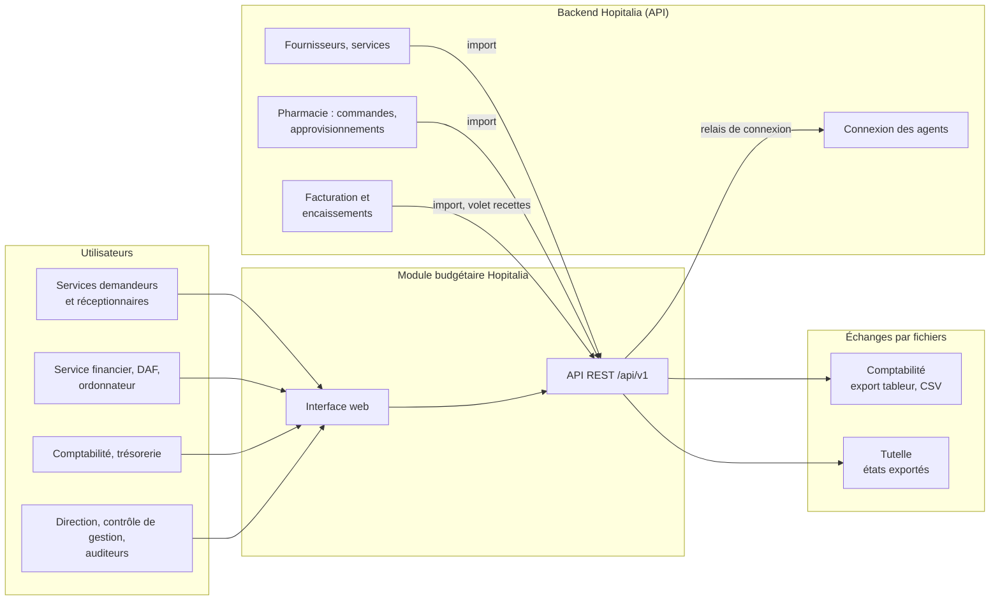

## 3. Acteurs et profils

| Profil | Rôle principal |
|---|---|
| Administrateur fonctionnel | Paramétrage : référentiels, circuits, règles d'alerte, profils. |
| Responsable budgétaire | Budgets, révisions, notifications de crédits, clôture d'exercice. |
| Agent financier | Contrôle d'imputation et de disponibilité, liquidation. |
| Gestionnaire de marchés et contrats | Fiches contrats, avenants, échéanciers. |
| Service demandeur | Expression du besoin, demande d'engagement. |
| Réceptionnaire | Réceptions, service fait, réserves. |
| Valideur (responsable de service, DAF) | Visas et validations selon les circuits. |
| Ordonnateur | Validation selon les délégations ; ordonnancement. |
| Comptable, agent de paiement | Prise en charge et enregistrement des règlements. |
| Auditeur | Consultation de la piste d'audit, sans modification. |
| Lecteur de tableaux de bord | Consultation des indicateurs et états. |

**Séparation des tâches :** lorsque les règles internes l'imposent, un même utilisateur ne peut pas créer, valider et payer seul une même opération (RG-13).

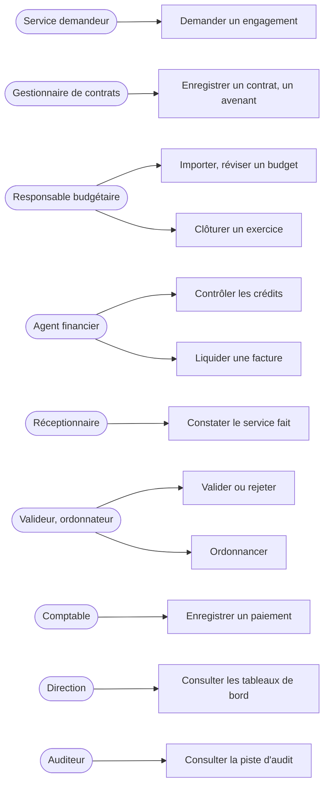

## 4. Exigences fonctionnelles

Chaque exigence porte un identifiant stable, repris dans la recette (section 15).

### 4.1. Organisation budgétaire et référentiels (lot 1)

| Réf. | Exigence |
|---|---|
| EF-REF-01 | Nomenclature configurable et hiérarchique : section, chapitre, article, paragraphe. |
| EF-REF-02 | Axes de classement : exercice et période (annuelle, trimestrielle, mensuelle), compte budgétaire, nature économique, programme ou projet, source de financement ou bailleur, centre de responsabilité, site. |
| EF-REF-03 | Le compte budgétaire de contrôle est distinct du compte comptable ; une table de correspondance les relie. |
| EF-REF-04 | Référentiels administrables : fournisseurs et coordonnées de paiement, services et responsables, types de dépenses, familles d'achats, modes de règlement, comptes de trésorerie, types de pièces, statuts. |
| EF-REF-05 | Les fournisseurs et les services sont **importés depuis Hopitalia** (identifiant externe `codeFourn`, `codeService`) et complétés dans le module (coordonnées bancaires, identifiants administratifs, fournisseurs hors pharmacie). Les établissements et sites sont gérés dans le module. |

### 4.2. Budgets et crédits (lot 1)

| Réf. | Exigence |
|---|---|
| EF-BUD-01 | Créer un budget par exercice et par établissement. |
| EF-BUD-02 | Saisir ou importer les dotations initiales par ligne budgétaire (import asynchrone, rapport d'anomalies). |
| EF-BUD-03 | Enregistrer les notifications de crédits et leurs références. |
| EF-BUD-04 | Budgets modificatifs, virements et réallocations selon les habilitations ; chaque révision est validée avant d'avoir un effet. |
| EF-BUD-05 | Historiser chaque modification avec auteur, date, motif et pièce justificative. |
| EF-BUD-06 | Afficher pour chaque ligne les indicateurs de la section 6.1, calculés et jamais saisis. |
| EF-BUD-07 | Distinguer le disponible prévisionnel et le disponible après engagements. |
| EF-BUD-08 | Bloquer toute opération qui dépasse le crédit disponible, sauf dérogation autorisée, tracée et motivée. |
| EF-BUD-09 | Clôturer un exercice sans supprimer l'historique ; reporter les engagements restant à payer selon les règles de report. |

### 4.3. Marchés et contrats (lot 2)

| Réf. | Exigence |
|---|---|
| EF-CTR-01 | Fiche contrat : numéro, intitulé, type, attributaire, dates (notification, signature, démarrage), durée, échéance, montant initial, devise, taxes, TTC, objet, périmètre, site, service bénéficiaire, responsable du suivi, périodicité et modalités de facturation, références du dossier. |
| EF-CTR-02 | Un contrat est enregistré à l'état « signé » ou « notifié » : la date de signature ou de notification est obligatoire (RG-03). |
| EF-CTR-03 | Ventilation du contrat sur une ou plusieurs lignes budgétaires, avec un montant par ligne (`ImputationContrat`). |
| EF-CTR-04 | Avenants : montant antérieur, variation, nouveau plafond, date d'effet. Seul un avenant validé modifie le plafond (RG-11). |
| EF-CTR-05 | Échéancier, lots et tranches, ordres de service, avance, retenue de garantie, révisions de prix, pénalités. |
| EF-CTR-06 | Fiche de synthèse financière actualisée automatiquement (annexe 18.1). |
| EF-CTR-07 | Alertes à 80 %, 90 % et 100 % de consommation ; alertes sur les échéances et les contrats arrivant à expiration. |
| EF-CTR-08 | Pièces jointes : contrat signé, notification, avenants, ordres de service, procès-verbaux. |

### 4.4. Engagements et commandes (lot 2 et lot 3)

| Réf. | Exigence |
|---|---|
| EF-ENG-01 | Un engagement naît d'un contrat, d'une décision autorisée ou d'une dépense hors marché. Il porte un numéro, une date, un objet, un bénéficiaire, un montant, une ou plusieurs imputations, un service demandeur et ses pièces. |
| EF-ENG-02 | Le montant de l'engagement est égal à la somme de ses imputations (RG-15). |
| EF-ENG-03 | Contrôles à la soumission et à la validation : disponibilité des crédits, cohérence engagement / contrat / fournisseur, plafond du contrat, doublons. |
| EF-ENG-04 | Validation selon un circuit configurable ; historisation des rejets, annulations, modifications et validations. |
| EF-ENG-05 | Annulation partielle ou totale tracée ; à la clôture d'un engagement, le reliquat non liquidé est désengagé automatiquement. |
| EF-CMD-01 | Bons de commande, tranches et ordres de service rattachés à un engagement validé, avec lignes (désignation, quantité, prix unitaire, taxe). |
| EF-DHM-01 | Dépenses hors marché (missions, petits achats, eau, électricité, télécoms, fonctionnement, prestations ponctuelles) : rattachées à une ligne, justifiées, soumises au circuit, et contrôlées par rapport au seuil du type de dépense. |

### 4.5. Exécution, service fait et réception (lot 3)

| Réf. | Exigence |
|---|---|
| EF-REC-01 | Réceptions totales ou partielles, en plusieurs étapes pour les marchés à exécution successive. |
| EF-REC-02 | Quantités commandées, reçues, acceptées et rejetées, par ligne de commande. |
| EF-REC-03 | Date de réception, réserves et levée des réserves. |
| EF-REC-04 | Pièces : bon de livraison, procès-verbal, attestation de service fait, décompte. |
| EF-REC-05 | Service réceptionnaire et agent responsable identifiés ; la réception est validée avant de servir de preuve. |
| EF-REC-06 | Suivi des prestations non réalisées, des retards et des réserves à lever. |
| EF-REC-07 | Les **achats pharmaceutiques** ne sont pas ressaisis : les bons de commande et approvisionnements de la pharmacie Hopitalia sont importés, rattachés aux engagements par l'agent financier, et les approvisionnements valent réceptions validées (preuve : bon de livraison). Un approvisionnement supprimé dans Hopitalia annule la réception importée, avec trace. |

### 4.6. Factures et liquidation (lot 4)

| Réf. | Exigence |
|---|---|
| EF-FAC-01 | Facture : numéro, date, fournisseur, objet, montants HT, taxes, TTC, références (contrat, engagement, commande), période de rattachement, échéance, date limite de traitement, pièce numérisée. |
| EF-FAC-02 | Types : avance, acompte, partielle, définitive, décompte, avoir. Un avoir référence la facture d'origine sans l'effacer. |
| EF-FAC-03 | Détection des doublons : même fournisseur, même numéro, même date, même montant ou même référence (RG-16). |
| EF-LIQ-01 | Rapprochement de la facture avec l'engagement, la commande et la réception ; contrôle des quantités, prix, taxes, retenues, pénalités, avances et montants déjà facturés. |
| EF-LIQ-02 | Calcul du montant liquidé, des déductions et du net à payer. |
| EF-LIQ-03 | Une liquidation porte sur une seule imputation d'engagement : une facture répartie sur plusieurs lignes donne plusieurs liquidations (RG-17). |
| EF-LIQ-04 | Rejet motivé ou retour pour correction ; validation par une personne habilitée ; date, auteur, visa et justificatifs conservés. |
| EF-LIQ-05 | Liquidation impossible au-delà du montant restant dû, sauf dérogation. |

### 4.7. Ordonnancement et paiements (lot 5)

| Réf. | Exigence |
|---|---|
| EF-ORD-01 | Constituer les dossiers de liquidations à transmettre au circuit de paiement. |
| EF-ORD-02 | Référence du mandat ou de l'ordre de paiement, date de transmission, service destinataire, statut. |
| EF-ORD-03 | Rejets, suspensions et demandes de complément ; une liquidation rejetée peut être retransmise dans un nouvel ordonnancement, l'historique est conservé. |
| EF-PAI-01 | Paiement : date, montant, bénéficiaire, mode de règlement, référence bancaire ou de transaction, pièce de caisse, compte de trésorerie, retenue à la source. |
| EF-PAI-02 | Paiements partiels et paiements groupés ; ventilation obligatoire par liquidation (`AllocationPaiement`). |
| EF-PAI-03 | Statuts distincts : facture liquidée, mise en paiement, partiellement payée, payée. |
| EF-PAI-04 | Calcul automatique des soldes ; aucun paiement au-delà du solde dû (RG-07). |

### 4.8. Recettes — volet activable (lot 6)

| Réf. | Exigence |
|---|---|
| EF-RCT-01 | Recettes par nature (subventions et dotations, recettes propres, remboursements des assurances, prestations hospitalières, autres), service, source de financement et période. |
| EF-RCT-02 | Montants prévus, facturés, encaissés et restant à recouvrer ; facturé et encaissé proviennent des modules Hopitalia par interface. |

**Mise en œuvre (lot P3.B).**

- **Activation.** Le volet est désactivé par défaut et activé par établissement par l'administrateur (`voletRecettesActif`). Désactivé, il n'apparaît pas dans le menu et l'API le refuse (`409 VOLET_RECETTES_INACTIF`) ; les recettes déjà saisies sont conservées.
- **Recette.** Numéro `RCT-ANNEE-RANG` ; nature, libellé, montant prévu, échéance, exercice, période, source de financement, service, ligne de prévision et débiteur facultatifs. La prévision se modifie (`If-Match`), avec trace ; une recette ne se supprime pas.
- **Débiteurs.** Référentiel commun à tous les établissements (État, collectivité, assurance, mutuelle, entreprise, particulier, autre), géré par l'administrateur.
- **Mouvements.** Le facturé et l'encaissé sont des mouvements datés, jamais modifiés : une correction est un contre-mouvement négatif, motivé, qui ne rend pas le cumul négatif (RG-18). En attendant l'interface avec la facturation d'Hopitalia (INT-02), ils sont saisis dans le module, notamment pour les subventions et remboursements, qui ne passent pas par Hopitalia ; un mouvement importé portera l'origine `HOPITALIA` et son identifiant externe, unique.
- **Droits.** Le responsable budgétaire, l'agent financier et le comptable saisissent ; le valideur, l'ordonnateur et l'auditeur consultent (matrice des habilitations, ligne ajoutée à confirmer par la DAF). Le tableau de bord des recettes suit le droit de consulter les tableaux de bord.
- **Tableau de bord.** Prévu, facturé, encaissé, reste à recouvrer et taux, au total et par nature, service et mois ; la période borne les mouvements, le prévu compte en entier.

### 4.9. Gestion documentaire et traçabilité (transverse)

| Réf. | Exigence |
|---|---|
| EF-DOC-01 | Pièces jointes à toute opération ; classement par exercice, marché, engagement, facture et fournisseur. |
| EF-DOC-02 | Empreinte (hash) de chaque fichier ; durée de conservation par type de pièce. |
| EF-DOC-03 | Recherche par numéro, date, fournisseur, montant, compte ou service. |
| EF-AUD-01 | Journal d'audit : horodatage, utilisateur, action, objet, ancienne et nouvelle valeur, adresse IP. Non modifiable par les utilisateurs opérationnels. |
| EF-AUD-02 | Journalisation des connexions et des opérations sensibles. |

**Audit et recherche (lot P2.C).** Sont tracées : chaque connexion réussie ou échouée (identifiant saisi et adresse IP, jamais le mot de passe), chaque export d'état et de rapport d'audit, chaque tentative de modification refusée, en plus de toute modification de donnée financière. Le journal se consulte en lecture seule (valideur, ordonnateur, auditeur), filtré par action, objet, identifiant et période ; le rapport d'audit l'exporte en PDF, tableur ou CSV. La recherche transverse lit le texte saisi comme un montant, une date ou un texte cherché dans les numéros, libellés, fournisseurs, comptes et services ; elle rend au plus 50 pièces, des plus récentes aux plus anciennes, dans les établissements visibles.

## 5. Règles de gestion

RG-01 à RG-12 reprennent le cahier des charges V2. RG-13 à RG-20 explicitent des règles qui y étaient implicites et que le modèle doit garantir.

| Réf. | Règle |
|---|---|
| RG-01 | Toute dépense est rattachée à un exercice et à une imputation budgétaire. |
| RG-02 | Tout engagement fait l'objet d'un contrôle de disponibilité des crédits. |
| RG-03 | Un marché intégré au module est déjà attribué ; un contrat est déjà signé. |
| RG-04 | Le montant engagé sur un marché ne dépasse pas son montant actualisé, sauf avenant ou dérogation autorisée. |
| RG-05 | Une facture est rattachée à un engagement, une commande ou une justification autorisée. |
| RG-06 | La liquidation est appuyée par une preuve de service fait ou de réception, selon la nature de la dépense. |
| RG-07 | Un paiement ne dépasse pas le solde dû, sauf correction ou dérogation documentée. |
| RG-08 | Les paiements partiels ne clôturent pas prématurément la facture. |
| RG-09 | Toute annulation, correction ou modification après validation est tracée et justifiée. |
| RG-10 | La clôture d'un exercice ne supprime ni l'historique ni les engagements restant à payer. |
| RG-11 | Un avenant est enregistré et validé avant la prise en compte de son incidence financière. |
| RG-12 | Le module ne réalise aucune opération de lancement, d'évaluation ou d'attribution des marchés. |
| RG-13 | Séparation des tâches : un même utilisateur ne peut pas être à la fois créateur, valideur et payeur d'une même opération lorsque le circuit l'exige. |
| RG-14 | Les indicateurs (engagé, liquidé, payé, restes, disponibles) sont **calculés** à partir des pièces ; ils ne sont jamais saisis ni stockés comme valeur de référence. |
| RG-15 | Le montant d'un engagement est égal à la somme de ses imputations ; le montant d'un contrat est égal à la somme de ses imputations contractuelles. |
| RG-16 | Une facture en doublon est bloquée à l'enregistrement, sauf levée motivée par un agent habilité. |
| RG-17 | Une liquidation porte sur une seule imputation d'engagement ; le liquidé et le payé se calculent donc par ligne sans répartition au prorata. |
| RG-18 | Une opération validée n'est plus modifiable : toute correction passe par une annulation ou une contre-opération tracée. |
| RG-19 | Une dérogation n'autorise que le dépassement pour lequel elle a été accordée (nature, objet et montant). |
| RG-20 | Le contrôle de disponibilité et l'enregistrement de l'engagement sont atomiques : deux engagements simultanés ne peuvent pas consommer le même crédit. |

## 6. Règles de calcul

Chaque indicateur a **une seule définition**, documentée ici et implémentée en un seul endroit (section 10.2, principe S). Les règles marquées « paramétrable » sont portées par `ParametreCalcul` et peuvent être ajustées par établissement.

> **Important.** Engagé, facturé, liquidé, transmis en paiement et payé sont des **étapes** d'une même dépense. Ils ne s'additionnent jamais entre eux.

### 6.1. Par ligne budgétaire

| Indicateur | Formule |
|---|---|
| Budget initial | Somme des dotations initiales du budget primitif. |
| Modifications + / − | Somme des révisions **validées** qui créditent / débitent la ligne (un virement débite la source et crédite la cible). |
| Budget révisé | Budget initial + modifications positives − modifications négatives. |
| Engagé | Somme des imputations des engagements validés (y compris partiellement exécutés, exécutés, clôturés), diminuée des annulations validées. |
| En cours de validation | Somme des imputations des engagements soumis ou en contrôle. |
| Disponible après engagements | Budget révisé − engagé. |
| Disponible prévisionnel | Disponible après engagements − en cours de validation. *(paramétrable)* |
| Liquidé | Somme des consommations budgétaires des liquidations validées imputées à la ligne (voir 6.3). |
| Payé | Somme des allocations de paiements exécutés vers les liquidations de la ligne. |
| Engagé restant à liquider | Engagé − liquidé. |
| Reste à payer | Somme des nets à payer des liquidations validées − payé. |
| Taux d'engagement / de liquidation / de paiement | Engagé / liquidé / payé, divisé par le budget révisé. *(dénominateur paramétrable)* |

### 6.2. Par contrat

| Indicateur | Formule |
|---|---|
| Montant contractuel actualisé | Montant initial + avenants validés positifs − avenants validés négatifs. |
| Cumul engagé | Somme des engagements validés rattachés, diminuée des annulations. |
| Reste à engager | Montant actualisé − cumul engagé. |
| Cumul commandé | Somme des bons de commande émis. |
| Cumul réceptionné | Valeur des quantités acceptées sur les réceptions validées. |
| Cumul facturé | Somme des factures enregistrées (y compris en contrôle), nettes des avoirs. |
| Cumul liquidé / transmis / payé | Comme en 6.1, restreint au contrat. |
| Engagé non encore facturé | Cumul engagé − cumul facturé. |
| Reste contractuel à payer | Montant actualisé − cumul payé. |
| Taux de consommation | Cumul engagé / montant actualisé *(base paramétrable : engagé par défaut, ou liquidé ; section 17, point 5)*. Déclenche les alertes à 80, 90 et 100 %. |

### 6.3. Par liquidation et par facture

| Indicateur | Formule |
|---|---|
| Montant liquidé | Montant reconnu dû après pénalités et réfactions. |
| Déductions | Retenue de garantie + retenue à la source + avance récupérée + autres retenues. |
| Net à payer | Montant liquidé − déductions. |
| Consommation budgétaire | Montant liquidé − avance récupérée *(paramétrable)* : l'avance a déjà consommé le crédit lors de sa propre liquidation, elle n'est pas comptée deux fois. |
| Reste à payer (facture) | Somme des nets à payer de ses liquidations validées − somme des allocations reçues. |
| Retenues de garantie à libérer | Retenues opérées − retenues libérées. |

### 6.4. Par recette (volet recettes)

| Indicateur | Formule |
|---|---|
| Facturé | Somme des mouvements « facturé » de la recette (contre-mouvements compris). |
| Encaissé | Somme des mouvements « encaissé » de la recette. |
| Reste à recouvrer | Facturé − encaissé. |
| Taux de recouvrement | Encaissé / facturé × 100 ; sans valeur si rien n'est facturé. |
| Taux de réalisation | Facturé / prévu × 100 ; sans valeur si rien n'est prévu. |

Sur un ensemble de recettes (tableau de bord), les montants s'additionnent puis les taux se recalculent : un taux ne s'additionne jamais. Aucun de ces indicateurs n'est stocké (RG-14).

## 7. Modèle de données

Notation UML (Mermaid). Types : `UUID`, `Decimal`, `Date`, `DateTime`, `String`, `Json`. Les noms sont sans accents pour un usage direct en code. Les méthodes notées `() Decimal` sont des **calculs** (RG-14), pas des colonnes.

**Corrections par rapport au diagramme V2**

| # | Problème V2 | Correction V3 |
|---|---|---|
| 1 | `Derogation` définie deux fois avec des attributs différents. | Une seule classe, avec `nature`, `typeObjet` et `idObjet`. |
| 2 | `Facture "1" --> "1..*" Liquidation` : une facture reçue n'a pas encore de liquidation. | `0..*`. |
| 3 | Contrat ventilé sur plusieurs lignes sans montant par ligne. | Classe `ImputationContrat`. |
| 4 | Dépendance circulaire : `OrigineEngagement.BON_COMMANDE` alors qu'un bon de commande exige un engagement. | Valeur retirée ; une commande suit toujours un engagement. |
| 5 | Facture imputée sur une seule ligne alors que l'engagement peut en avoir plusieurs. | La liquidation porte l'imputation (`Liquidation --> ImputationEngagement`, RG-17). |
| 6 | Statuts en énumérations figées alors que le cahier des charges les veut configurables. | Statuts de référence fixes + statuts et transitions configurables (7.6). |
| 7 | `Reception`, `Contrat`, `Rapprochement` validés sans implémenter `Validable`. | Ils l'implémentent. |
| 8 | `Validable` trop large (validations, pièces, annulations, dérogations, alertes). | Découpé en interfaces ciblées (principe I, 10.2). |
| 9 | Cumuls stockés sur `LigneBudgetaire`, `AvanceContrat`, `RetenueGarantie`, `Recette`. | Remplacés par des méthodes de calcul (RG-14). |
| 10 | Pas de lien direct à l'établissement sur les objets métier. | `etablissementId` sur chaque objet métier (cloisonnement). |
| 11 | Une liquidation ne peut appartenir qu'à un ordonnancement : pas d'historique de retransmission. | Classe `LigneOrdonnancement`. |
| 12 | `AllocationPaiement` vers une facture ou une liquidation, au choix. | Toujours vers une liquidation ; l'avance est une facture de type `AVANCE`. |

### 7.1. Vue d'ensemble

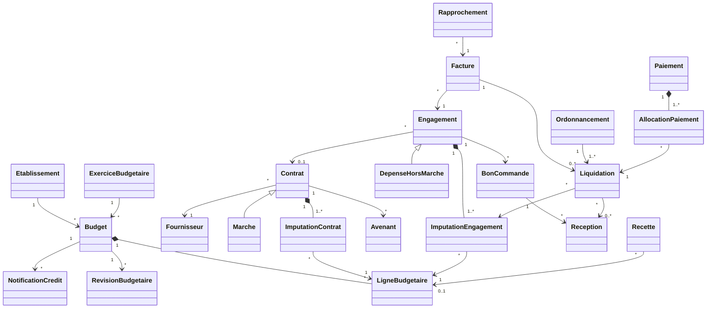

### 7.2. Domaine 1 — Établissements, budgets et crédits

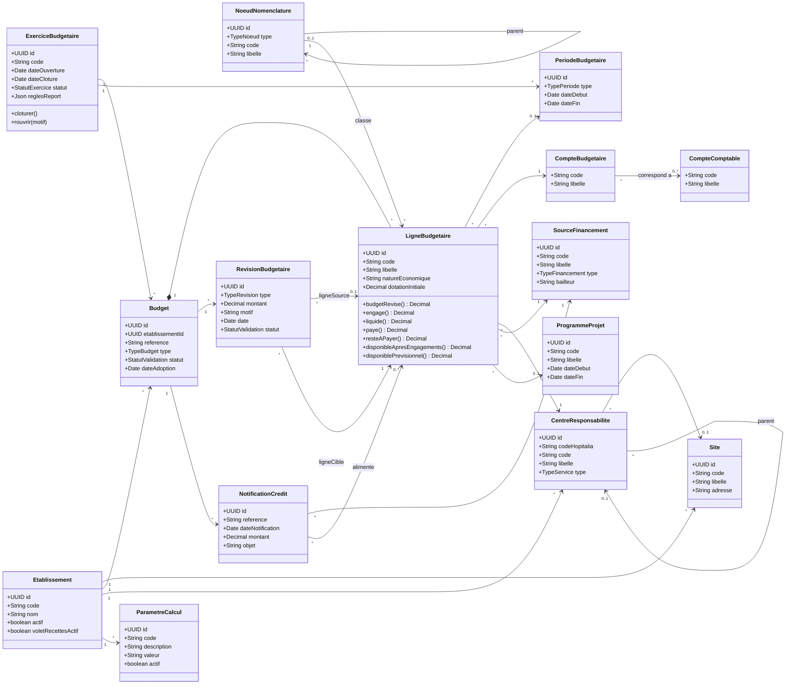

### 7.3. Domaine 2 — Marchés attribués, contrats signés et avenants

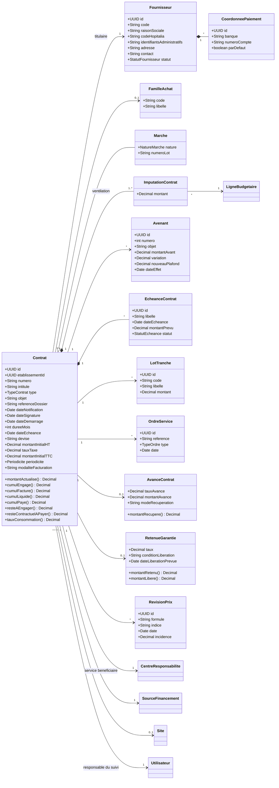

### 7.4. Domaine 3 — Chaîne d'exécution de la dépense

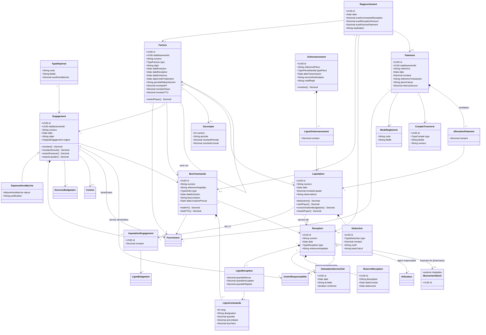

### 7.5. Domaine 4 — Recettes (volet activable)

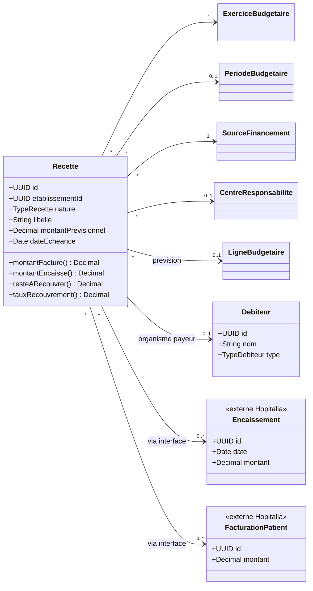

### 7.6. Domaine 5 — Habilitations, workflows, audit, alertes et intégrations

Les interfaces sont découpées selon les capacités réelles de chaque objet (principe I, section 10.2).

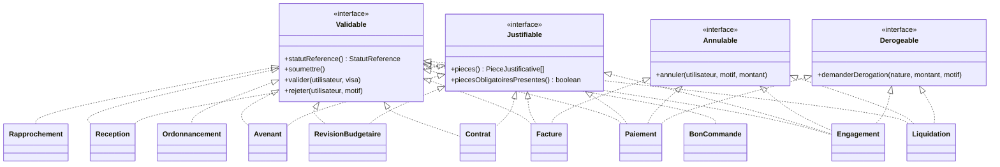

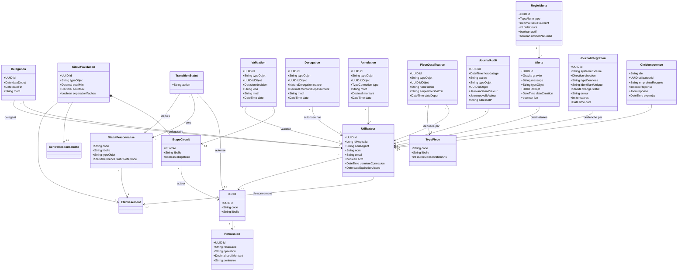

**Statuts configurables (§7.3 du cahier des charges V2).** Chaque objet a un **statut de référence** fixe (énumération, utilisé par les calculs de la section 6). Chaque établissement définit ses **statuts personnalisés** (libellés, étapes intermédiaires) rattachés à un statut de référence, et les **transitions** autorisées entre eux, avec le profil habilité. Les calculs restent stables quel que soit le paramétrage.

**Règles du workflow (P1.B).**

- **Circuit figé à la soumission.** Le circuit applicable est choisi à la soumission puis conservé avec l'objet : un changement de paramétrage ne touche pas une opération en cours.
- **Choix du circuit.** Parmi les circuits actifs de l'établissement pour ce type d'objet, ceux dont la tranche `[seuilMin, seuilMax[` contient le montant ; celui du service (`centreId`) prime sur celui de l'établissement, puis le seuil minimal le plus élevé. Sans circuit, le circuit par défaut s'applique : visa de la DAF (profil VAL), puis ordonnateur (section 17, point 16).
- **Étapes.** Numérotées à partir de 1. Chaque profil d'étape a le droit « Valider » sur ce type d'objet dans la matrice des habilitations. La dernière étape est obligatoire ; pour les objets du point 16 de la section 17 (révisions, contrats, avenants, engagements, dérogations), elle revient à l'ordonnateur. Le service fait d'une réception est validé par le valideur du service (profil VAL), seul à avoir ce droit dans la matrice. Une étape facultative peut être sautée : l'agent de l'étape obligatoire suivante peut viser directement.
- **Décisions.** Visa favorable, rejet (définitif) ou retour pour correction ; motif obligatoire pour le rejet et le retour. Après correction, l'auteur renvoie l'opération au début du même circuit ; la séparation des tâches se juge sur le cycle en cours.
- **Séparation des tâches** (RG-13, si le circuit l'exige) : l'auteur ne vise pas sa propre opération et un agent ne vise qu'une étape par cycle.
- **Délégations.** Pendant sa période, le délégataire vise avec les profils du délégant, dans les circuits seulement ; il n'obtient aucun autre droit. Le visa garde le code du délégant. Une délégation se raccourcit ou se révoque, elle ne se prolonge pas.
- **Statuts personnalisés et transitions.** Un statut personnalisé se rattache à un statut de référence. Une transition paramétrée doit correspondre à une transition de référence (même action, mêmes statuts de référence). Dès qu'un établissement paramètre une transition pour un type d'objet, seules ses transitions s'appliquent : une transition non paramétrée est refusée (`409 TRANSITION_NON_AUTORISEE`).
- **Pièces obligatoires.** Un type de pièce désigne les objets pour lesquels il est obligatoire ; un visa favorable est refusé tant qu'il manque (`PIECES_MANQUANTES`). Le contenu est rangé sous son empreinte SHA-256 et vérifié à chaque lecture.

## 8. Cycles de vie

Les diagrammes montrent les statuts de référence. Les étapes intermédiaires propres à un établissement s'insèrent par paramétrage (7.6).

### 8.1. Engagement

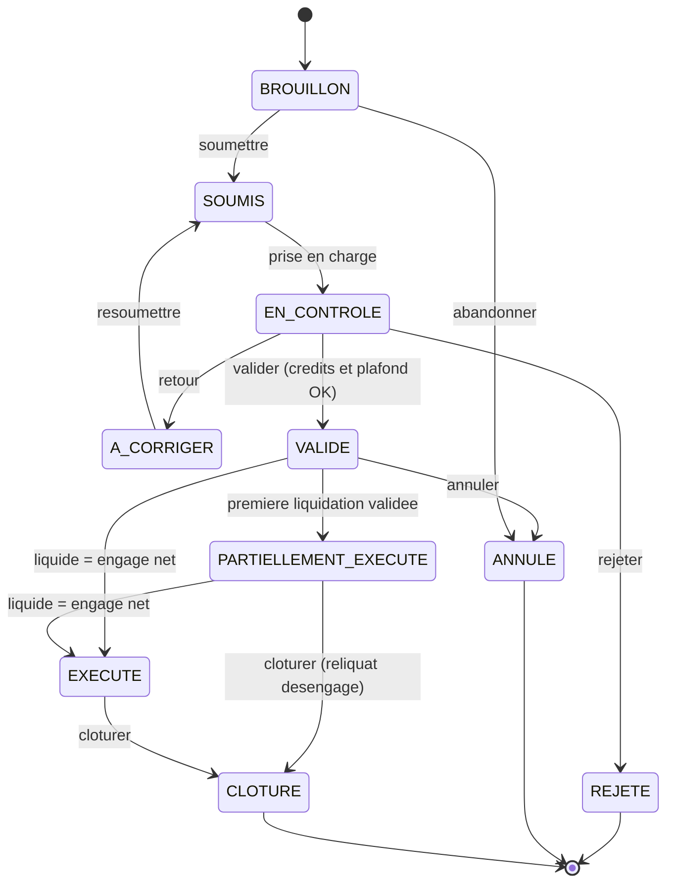

**Règles de l'engagement (lot P1.D).**

- Saisie en brouillon ; montant égal à la somme des imputations, toutes positives (RG-15) ; lignes d'un même exercice ouvert, de l'établissement de l'engagement (RG-01). Origine `CONTRAT` : contrat obligatoire ; `HORS_MARCHE` : type de dépense et nature obligatoires ; sinon, pas de contrat. Numéro attribué par établissement et exercice (`ENG-2026-00001`).
- Circuit par défaut : contrôle financier (profil AF, « prise en charge » : `EN_CONTROLE`), visa de la DAF, puis ordonnateur (section 17, point 16). Un établissement peut paramétrer d'autres circuits (7.6).
- Contrôles automatiques, à la soumission puis à la validation finale : crédits de chaque ligne (RG-02), plafond du contrat (RG-04), contrat validé et bénéficiaire égal au titulaire, doublon probable (même bénéficiaire, même montant, même objet, à moins de 30 jours), seuil hors marché (point 9 : sans seuil renseigné, la dérogation est exigée). À la validation finale, les lignes et le contrat sont verrouillés jusqu'à la fin de la transaction (RG-20).
- Un écart bloquant se corrige, ou se couvre par une dérogation de même nature, validée (visa DAF puis ordonnateur), d'un montant au moins égal au dépassement, sur cet engagement seulement (RG-19). Le contrat non validé et le bénéficiaire incohérent ne se couvrent pas. La dérogation est un objet commun : elle porte le type et l'identifiant de l'objet couvert (engagement ou liquidation) et suit le même circuit.
- L'engagé d'une ligne ou d'un contrat compte les engagements validés, moins leurs annulations et clôtures ; l'en-cours compte les engagements soumis ou en contrôle (6.1, 6.2).
- Clôture d'exercice (EF-BUD-09, RG-10), pour un établissement, par le responsable budgétaire ou l'ordonnateur, motivée : refusée tant qu'un engagement de l'exercice est dans son circuit, ou si une ligne à reporter n'existe pas (même code) dans le budget de l'exercice suivant. Le reliquat non liquidé de chaque engagement validé ou partiellement exécuté est désengagé (contre-opération `REPORT`) et repris dans l'exercice suivant par un engagement de report : validé, daté du premier jour de l'exercice, lié à son origine (`engagementOrigineId`), sur les lignes de même code. L'engagement d'origine passe à `CLOTURE`. Les liquidations validées non payées restent sur leur engagement d'origine et se paient après la clôture. Aucun engagement ne se crée ni ne se soumet sur un exercice clos. Une réouverture motivée lève la clôture sans annuler les reports ; clôture et réouverture sont tracées.
- Annulation partielle ou totale du reliquat d'un engagement validé, par imputation : l'engagement reste intact, l'annulation s'y ajoute (RG-18). Le reliquat entièrement annulé, sans rien de liquidé, fait passer l'engagement à `ANNULE`. La clôture d'un engagement exécuté désengage le reliquat non liquidé et le fait passer à `CLOTURE`.

### 8.2. Facture

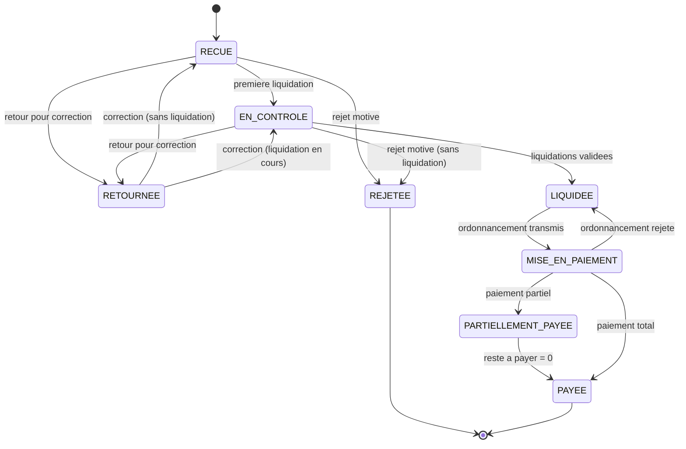

**Règles de la facture et de la liquidation (lot P1.F).**

- La facture se rattache à un engagement validé, partiellement exécuté ou exécuté ; son fournisseur est celui de l'engagement. Type : avance, acompte, partielle, définitive, décompte, avoir. TTC = HT + taxes. Un décompte porte son numéro et le cumul des décomptes s'affiche. Un avoir est négatif, lié à sa facture d'origine et ne dépasse pas son montant ; il n'est pas liquidé.
- Doublon (RG-16) : même fournisseur et même numéro, ou même date et même montant, hors factures rejetées. La création est refusée (`409 FACTURE_DOUBLON` avec la référence du doublon) ; l'agent qui sait la facture distincte la crée avec un motif de levée, tracé au journal d'audit.
- La facture n'a pas de circuit propre : enregistrement, correction, retour et rejet sont des actions de l'agent financier (profil AF), motivées et tracées. Le rejet n'est plus possible dès qu'une liquidation existe. La facture numérisée est une pièce obligatoire, vérifiée à la validation de la liquidation.
- Une liquidation par imputation de l'engagement (RG-17), saisie en brouillon puis validée par le circuit (par défaut : visa de la DAF, puis ordonnateur). Montants selon 6.3 : pénalités et réfactions (motif obligatoire) réduisent le liquidé ; retenue de garantie et avance récupérée se calculent depuis le contrat quand leur montant n'est pas saisi (l'avance au prorata, plafonnée à ce qui reste à récupérer).
- Contrôles à la soumission et à la validation finale : service fait par une réception validée (RG-05, non dérogeable ; les factures d'avance en sont dispensées) ; liquidé au-delà du reste dû de l'imputation (dérogeable, `LIQUIDATION_SUP_DU`) ; liquidations au-delà du montant de la facture (bloquant) ; facturé au-delà du réceptionné (alerte, non bloquante). L'imputation est verrouillée à la validation (RG-20).
- La facture passe à `LIQUIDEE` quand ses liquidations validées couvrent son montant ; l'engagement passe à `PARTIELLEMENT_EXECUTE`, puis à `EXECUTE` quand le liquidé atteint son montant net d'annulations.
- Rapprochement (9.1) : commandé, réceptionné, facturé et payé de la facture, et leurs écarts. Un rapprochement avec écart n'est enregistré qu'avec son explication (`422 ECART_NON_EXPLIQUE`). L'écart facture et paiement ne compte qu'une fois la facture mise en paiement (lot 5).

### 8.3. Ordonnancement

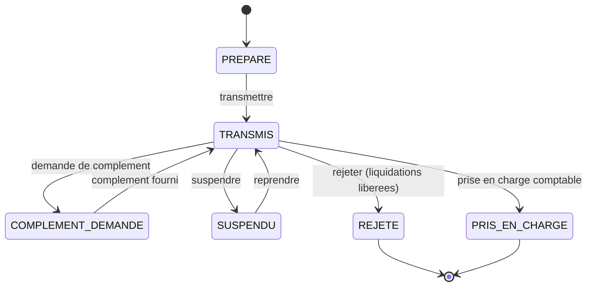

**Règles de l'ordonnancement et du paiement (lot P1.G).**

- L'ordonnateur (profil ORD) prépare l'ordonnancement : référence du mandat ou de l'ordre de paiement, service destinataire, liquidations validées de factures entièrement liquidées. Chaque ligne porte le solde dû de sa liquidation. Une liquidation n'est que dans un seul ordonnancement actif ; un rejet la libère et elle se retransmet dans un nouvel ordonnancement, l'ancien restant consultable (EF-ORD-03).
- L'ordonnateur transmet et fournit les compléments ; le comptable (profil CPT) demande un complément, suspend, reprend, rejette ou prend en charge. Complément, suspension et rejet sont motivés. La matrice ne donne à personne le droit de viser un ordonnancement : il n'a pas de circuit.
- À la transmission, la facture passe à `MISE_EN_PAIEMENT` ; au rejet, elle revient à `LIQUIDEE`. Le montant « transmis » (6.2) compte les ordonnancements transmis, en complément, suspendus ou pris en charge.
- Le comptable enregistre le paiement d'un bénéficiaire, partiel ou groupé, ventilé par liquidation : chaque part est positive, leur somme égale le montant (EF-PAI-02). Seules les liquidations d'un ordonnancement pris en charge se paient, sans dépasser leur solde dû (RG-07 ; la dérogation de paiement n'est pas ouverte, le paiement n'ayant pas de circuit). Les liquidations sont verrouillées pendant l'enregistrement. La clé d'idempotence est obligatoire (9.2).
- Le paiement est enregistré à l'état `EXECUTE` : le comptable le saisit une fois exécuté. `ENREGISTRE` reste réservé à un import des relevés bancaires.
- Séparation des tâches (RG-13), quand le circuit de la liquidation l'exige : qui a visé la liquidation, préparé ou transmis son ordonnancement ne la paie pas.
- Statut de la facture recalculé à chaque paiement ou annulation (RG-08) : partiellement payée tant que les paiements ne couvrent pas les nets à payer de ses liquidations validées, payée ensuite.
- Un paiement ne se modifie pas : il s'annule, motivé et tracé, par un agent habilité à annuler une opération validée (AF, VAL ou ORD) ; il reste visible, et les soldes et statuts sont recalculés (RG-18).

### 8.4. Révision budgétaire

Une révision (budget modificatif, virement, réallocation) n'a d'effet sur les crédits qu'au statut `VALIDEE` (EF-BUD-04).

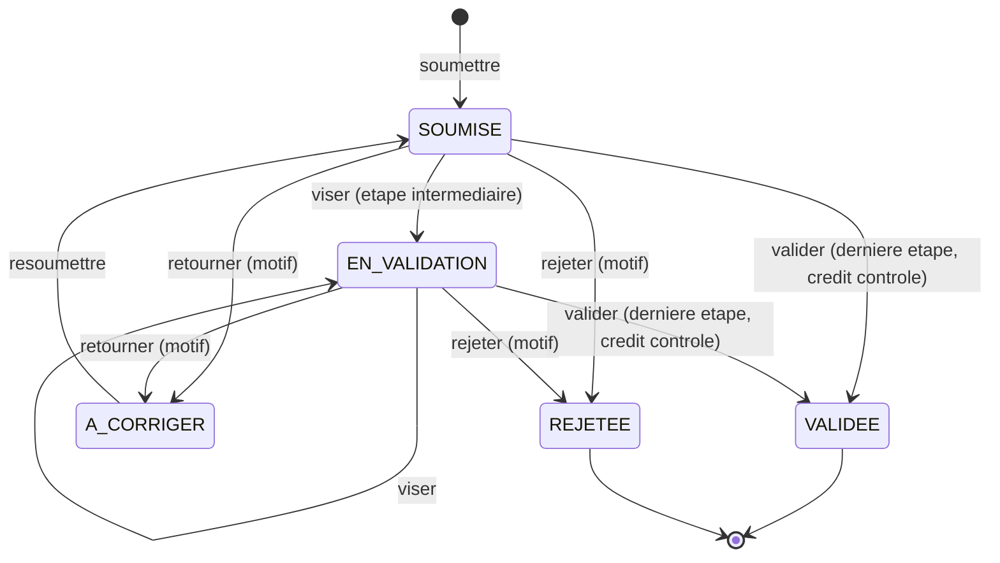

### 8.5. Contrat et avenant

Un contrat entre **signé ou notifié** (RG-03) et se prépare en brouillon : fiche, ventilation, pièces. Il n'entre dans le circuit qu'à sa soumission ; il ne sert de référence (plafond, avenants, engagements) qu'au statut `VALIDE`. Un avenant naît soumis, sur un contrat validé.

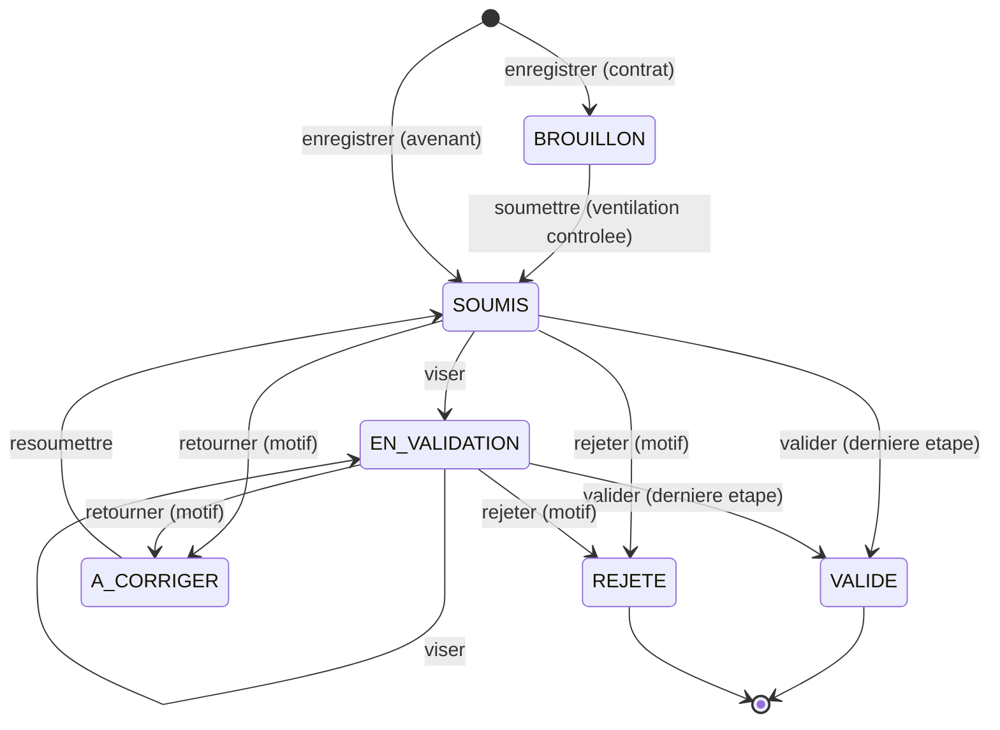

**Règles de saisie et de calcul.**

- Montant du contrat : le TTC, calculé à l'enregistrement depuis le HT et le taux de taxe ; c'est lui que la ventilation doit égaler (RG-15), contrôle fait à la soumission et à la validation finale.
- Nature et numéro de lot : réservés au type `MARCHE`. Un marché est un contrat (ARC-L) : mêmes règles, mêmes écrans.
- Lots et tranches : leur total ne dépasse pas le montant du contrat ; ils se modifient tant que le contrat est en brouillon ou à corriger. Échéancier, ordres de service et révisions de prix s'ajoutent pendant l'exécution.
- Avenant : variation positive ou négative, non nulle. À la validation finale, le contrat doit être validé et le nouveau plafond rester positif et au moins égal au cumul engagé (RG-04) ; le montant avant et le nouveau plafond sont alors relevés sur l'avenant pour l'historique (REC-04). Le montant actualisé, lui, se recalcule toujours depuis les avenants validés (RG-14).
- Révisions de prix : leur incidence est suivie à part ; elle n'entre pas dans le montant actualisé (6.2).
- Avance et retenue de garantie : le contrat porte les taux et les conditions ; montant d'avance, avance récupérée, retenue opérée et libérée se calculent depuis le montant actualisé et les déductions des liquidations (6.3).

### 8.6. Commande et réception

Un bon de commande (ou une tranche, ou un ordre de service) est **émis** par le gestionnaire de marchés sur un engagement validé ; la matrice ne donne à personne le droit de le valider, il n'a donc pas de circuit. Le total des commandes d'un engagement ne dépasse pas son montant net d'annulations.

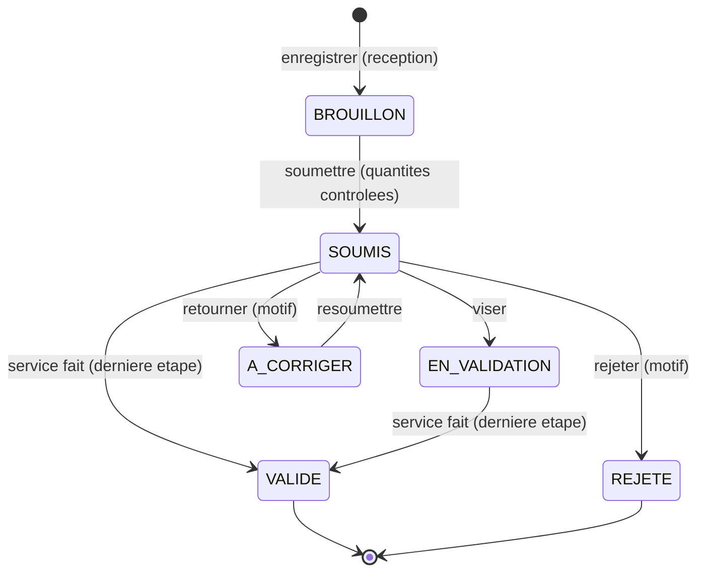

- Une commande reçoit autant de réceptions que nécessaire. Par ligne : acceptée + rejetée ≤ reçue ; le cumul accepté des réceptions validées ne dépasse pas la quantité commandée (contrôle repris à la validation, commande verrouillée).
- Seule une réception **validée** fait preuve du service fait : elle seule réduit le reste à recevoir et compte dans le « réceptionné » (6.2). Son type (totale, partielle, refusée) est établi à la validation.
- Réserves constatées puis levées ; attestation de service fait (une par réception, avant validation) ; pièces obligatoires par type de pièce (bon de livraison, procès-verbal).
- Une commande est en retard quand sa date de livraison prévue est passée et qu'il reste à recevoir.

## 9. Processus

### 9.1. Chaîne de rapprochement obligatoire

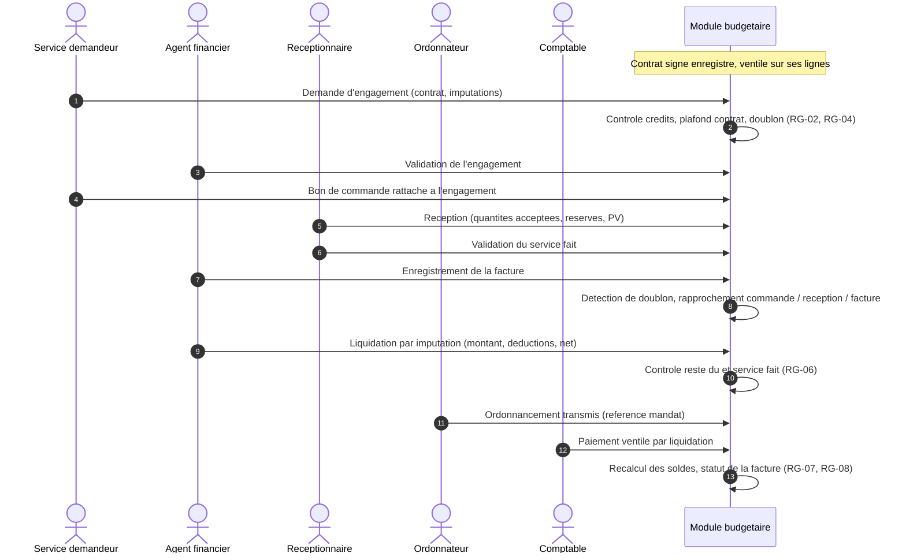

### 9.2. Enregistrement idempotent d'un paiement

Un paiement ne doit jamais être enregistré deux fois, même si le réseau coupe et que le client renvoie la requête (section 11.3).

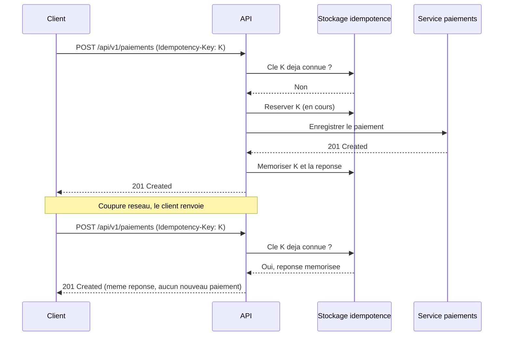

## 10. Architecture logicielle et principes SOLID

### 10.1. Architecture en couches (ports et adaptateurs)

Le domaine métier ne dépend d'aucun cadriciel, base de données ni système externe. Les dépendances pointent vers l'intérieur.

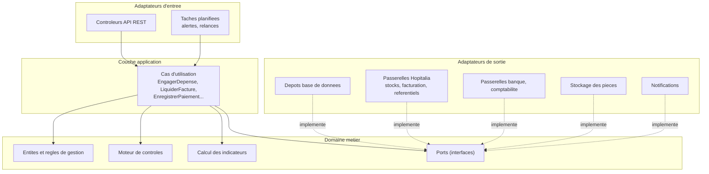

### 10.2. Application des principes SOLID

Chaque principe est traduit en exigence vérifiable en revue de code (section 15.3).

#### S — Responsabilité unique

Une classe a une seule raison de changer.

| Responsabilité | Porteur | Ce qu'il ne fait pas |
|---|---|---|
| Contrôle de disponibilité des crédits | `ControleCredits` | Ni enregistrement, ni notification. |
| Contrôle du plafond contractuel | `ControlePlafondContrat` | Ni calcul de taux de consommation. |
| Détection de doublons | `DetectionDoublonFacture` | Ni blocage : il signale, le cas d'utilisation décide. |
| Calcul des indicateurs (section 6) | `CalculIndicateurs` | Ni accès direct à la base : il reçoit les pièces d'un dépôt. |
| Persistance | Dépôts (`DepotEngagement`, …) | Aucune règle de gestion. |
| Piste d'audit | `JournaliseurAudit` | Aucune logique métier. |

**Exigence ARC-S :** une formule de la section 6 est implémentée une seule fois ; les états, tableaux de bord et contrôles l'appellent.

#### O — Ouvert / fermé

Le module s'étend sans modifier le code existant. Ajouter un contrôle, une alerte ou un type de déduction se fait en ajoutant une classe.

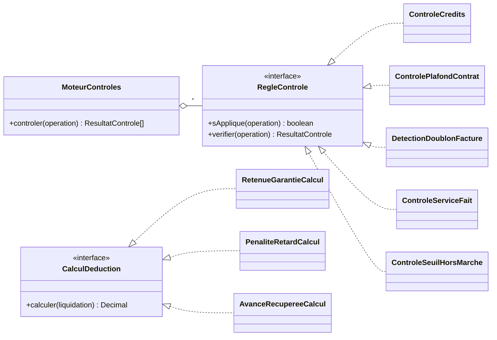

**Exigence ARC-O :** ajouter un nouveau contrôle automatique ne modifie ni `MoteurControles` ni les cas d'utilisation existants.

#### L — Substitution de Liskov

Une sous-classe s'utilise partout où sa classe mère est attendue, sans surprise.

- `Marche` est un `Contrat` : tout calcul, contrôle ou écran prévu pour un contrat fonctionne avec un marché.
- `DepenseHorsMarche` est un `Engagement` : elle ne redéfinit pas `valider()` pour lever une erreur propre. La contrainte de seuil est un contrôle (`ControleSeuilHorsMarche`) branché sur le moteur, pas une précondition durcie dans la sous-classe.
- Un avoir est une `Facture` de type `AVOIR` à montant négatif : les cumuls le traitent sans cas particulier.

**Exigence ARC-L :** les tests écrits pour `Contrat` et `Engagement` passent aussi avec `Marche` et `DepenseHorsMarche`.

#### I — Ségrégation des interfaces

Un objet n'implémente que les capacités qu'il possède. Le `Validable` unique de la V2 regroupait validations, pièces, annulations, dérogations et alertes. La V3 le découpe en `Validable`, `Justifiable`, `Annulable` et `Derogeable` (7.6).

| Objet | Validable | Justifiable | Annulable | Derogeable |
|---|:-:|:-:|:-:|:-:|
| Engagement | Oui | Oui | Oui | Oui |
| Contrat, Avenant | Oui | Oui | | |
| Révision budgétaire | Oui | Oui | | |
| Bon de commande | | | | |
| Réception | Oui | Oui | | |
| Facture | | Oui | Oui | |
| Liquidation | Oui | Oui | Oui | Oui |
| Ordonnancement, Rapprochement | | | | |
| Paiement | | | Oui | |

**Exigence ARC-I :** aucune classe n'implémente une méthode d'interface par une exception « non supporté ».

#### D — Inversion des dépendances

Les cas d'utilisation dépendent d'abstractions (ports) ; les implémentations sont injectées.

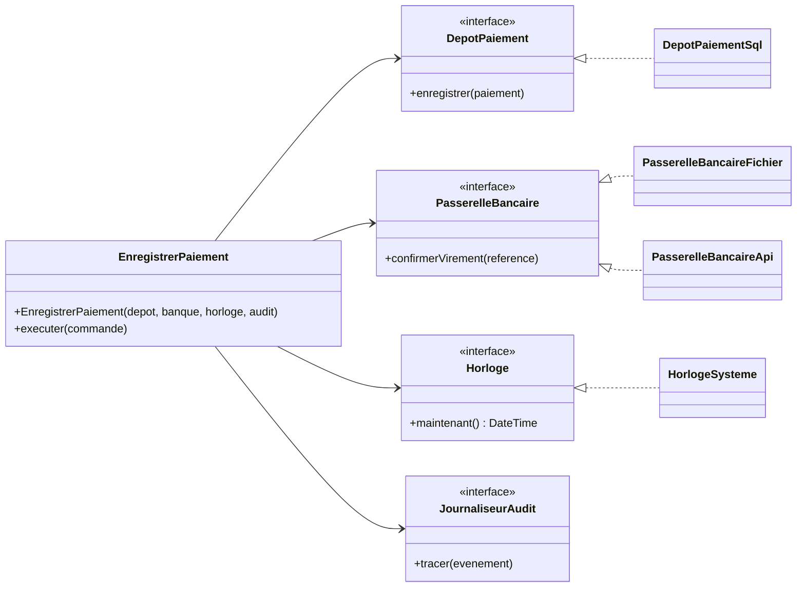

Ports prévus : dépôts de chaque agrégat, `PasserelleReferentielsHopitalia`, `PasserelleStock`, `PasserelleFacturationPatient`, `PasserelleBancaire`, `PasserelleComptabilite`, `StockagePieces`, `Notificateur`, `Horloge`, `JournaliseurAudit`.

**Exigence ARC-D :** le domaine et la couche application compilent et se testent sans base de données, sans réseau et sans module Hopitalia (implémentations de test des ports).

> SOLID est un moyen, pas un objectif : une abstraction n'est introduite que si elle a au moins deux implémentations (réelle et de test comptent) ou un point d'extension identifié par ce cahier des charges.

## 11. Conventions d'API

L'API REST sert l'interface web et les intégrations. Elle suit les règles ci-dessous, opposables en recette (section 15.2).

### 11.1. Nommage clair

- Ressources au **pluriel**, en minuscules, mots séparés par des tirets, sans accents : `/engagements`, `/bons-commande`, `/lignes-budgetaires`.
- Le **verbe HTTP** porte l'action, pas l'URL : pas de `/creerEngagement`.

| Action | Méthode | Exemple |
|---|---|---|
| Créer | `POST` | `POST /api/v1/engagements` |
| Lire | `GET` | `GET /api/v1/engagements/{id}` |
| Remplacer | `PUT` | `PUT /api/v1/fournisseurs/{id}` |
| Modifier partiellement | `PATCH` | `PATCH /api/v1/engagements/{id}` (brouillon uniquement) |
| Supprimer | `DELETE` | `DELETE /api/v1/engagements/{id}` (brouillon uniquement) |

- **Transitions de workflow = création d'une ressource.** Valider un engagement crée une `Validation` : `POST /api/v1/engagements/{id}/validations` avec `{"decision": "VALIDE", "visa": "..."}`. Même principe pour `/annulations`, `/derogations` et `/pieces`. Le modèle (7.6) et l'API restent alignés.
- **Les opérations validées sont immuables** (RG-18) : `PUT`, `PATCH` et `DELETE` répondent `409 Conflict`.
- Champs JSON en `camelCase`, identiques aux attributs du modèle.
- Montants en **chaîne décimale** (`"45000000.00"`), jamais en nombre flottant ; devise ISO 4217 (`XOF`). Dates ISO 8601.

### 11.2. Ressources principales

| Ressource | Opérations | Remarques |
|---|---|---|
| `/exercices` | GET, POST | `POST /exercices/{id}/clotures` clôture l'exercice pour un établissement (reports) ; `POST /exercices/{id}/reouvertures` ; `GET /exercices/{id}/clotures` (historique). |
| `/recherche` | GET | Paramètre `q` (au moins 2 caractères). |
| `/journal-audit` | GET | Pagination par curseur ; filtres `action`, `typeObjet`, `idObjet`, `du`, `au` ; `GET /journal-audit/rapport?format=pdf|xlsx|csv`. |
| `/budgets` | GET, POST | `POST /budgets/{id}/imports` : import asynchrone, `202 Accepted` et lien de suivi. |
| `/budgets/{id}/lignes` | GET, POST | |
| `/budgets/{id}/revisions` | GET, POST | |
| `/lignes-budgetaires/{id}/disponibilite` | GET | Indicateurs 6.1 calculés. |
| `/notifications-credits` | GET, POST | |
| `/fournisseurs` | GET, POST, PUT | Synchronisés avec le référentiel Hopitalia. |
| `/contrats` | GET, POST, PATCH | Filtres `type` (`MARCHE` pour les marchés), `statut`, `fournisseurId`, `centreId`, `consommationMin`. La ventilation (`imputations`) est dans le corps du contrat, remplacée en bloc tant qu'il est modifiable. |
| `/contrats/{id}/avenants` | GET, POST | `PATCH /avenants/{id}` pour la correction après retour. |
| `/contrats/{id}/echeances`, `/lots`, `/ordres-service`, `/revisions-prix` | GET, POST | `DELETE` sur les échéances et les lots. |
| `/contrats/{id}/synthese` | GET | Fiche de synthèse (annexe 18.1). |
| `/engagements` | GET, POST, PATCH | Filtres `statut`, `origine`, `contratId`, `fournisseurId`, `centreId`. `GET /engagements/{id}/controles` donne les écarts à l'instant. |
| `/engagements/{id}/derogations`, `/annulations`, `/clotures` | GET, POST | Dérogations validées par le circuit (`/derogations/{id}/validations`). |
| `/engagements/{id}/bons-commande` | GET, POST | `GET /bons-commande?enRetard=true` : commandes en retard ; `GET /bons-commande/{id}` donne le reste à recevoir par ligne. |
| `/bons-commande/{id}/receptions` | GET, POST | `PATCH /receptions/{id}` en brouillon ou à corriger ; `/receptions/{id}/reserves`, `/attestations` ; `PATCH /reserves/{id}` (levée) ; `GET /reserves?nonLevees=true`. |
| `/factures` | GET, POST, PATCH | Filtres `engagementId`, `statut`, `type`. Détection de doublon à la création (`409` + référence du doublon, levée par `motifLeveeDoublon`). `POST /factures/{id}/retours`, `/rejets` (motif). |
| `/factures/{id}/liquidations` | GET, POST | `PATCH /liquidations/{id}` en brouillon ou à corriger ; `GET /liquidations/{id}/controles` ; `POST /liquidations/{id}/derogations` ; circuit par `/liquidations/{id}/validations`. |
| `/ordonnancements` | GET, POST, PATCH | `PATCH` tant que préparé ; `POST /ordonnancements/{id}/decisions` (transmettre, complément, suspension, reprise, rejet, prise en charge). `GET /liquidations?etape=A_ORDONNANCER` ou `A_PAYER` : liquidations à traiter. |
| `/paiements` | GET, POST | Allocations dans le corps de la requête ; filtres `fournisseurId`, `factureId`, `statut`. `POST /paiements/{id}/annulations` (motif). |
| `/tableaux-de-bord/direction`, `/tableaux-de-bord/restes-a-payer` | GET | Filtres `exerciceId` (obligatoire), `etablissementId`, `centreId`, `compteId`, `sourceId`, `fournisseurId`, `contratId`, `du`, `au` (14.1). |
| `/factures/{id}/rapprochements` | GET, POST | `GET /factures/{id}/rapprochement` donne les montants et les écarts à l'instant. |
| `/{ressource}/{id}/validations`, `/annulations`, `/derogations`, `/pieces` | GET, POST | Sur les ressources qui implémentent l'interface correspondante. `GET .../validations` donne le circuit figé, les visas, les étapes ouvertes et si l'agent peut décider. |
| `/{ressource}/{id}/soumissions` | POST | Renvoi au circuit après un retour pour correction. |
| `/pieces/{id}/contenu` | GET | Fichier vérifié par son empreinte ; `409 PIECE_ALTEREE` sinon. |
| `/circuits-validation`, `/statuts-personnalises`, `/transitions-statuts` | GET, POST, PATCH | Paramétrage du workflow par établissement ; `DELETE` sur les transitions. `GET /statuts-reference/{typeObjet}` donne le cycle de référence. |
| `/delegations` | GET, POST, PATCH | `PATCH` raccourcit ou révoque. |
| `/alertes` | GET, PATCH | Pagination par curseur, filtres `nonLues`, `type` ; `PATCH` pour marquer comme lue (par agent) ; `GET /alertes/compteur` ; `POST /alertes/planifications` (administrateur). |
| `/regles-alertes` | GET, PUT | Filtre `etablissementId` obligatoire ; `PUT /regles-alertes/{type}` (administrateur). |
| `/journal-audit` | GET | Lecture seule, pagination par curseur. |
| `/tableaux-de-bord/{code}` | GET | |
| `/etats/{code}` | GET | `Accept: application/pdf`, tableur ou JSON, ou `?format=pdf|xlsx|csv|json` ; filtres du tableau de bord (14.1). |
| `/journal-integration` | GET, POST | Pagination par curseur, filtres `typeDonnees`, `statut` ; `POST` lance l'échange du jour (`typeDonnees`) ; `POST /journal-integration/{id}/reprises` reprend un échange en échec (administrateur). |
| `/commandes-pharmacie` | GET | Commandes importées de la pharmacie, filtre `rattachee` ; `POST /commandes-pharmacie/{id}/rattachement` (`engagementId`, idempotent). |
| `/budgets/{id}/export` | GET | Lignes et dotations initiales au format de l'import des dotations, `?format=csv|json`. |
| `/recettes` | GET, POST, PATCH | Si le volet est actif. Filtres `exerciceId`, `etablissementId`, `nature`, `centreId`, `debiteurId` ; `POST` idempotent ; `PATCH /recettes/{id}` avec `If-Match` (prévision). `GET`, `POST /recettes/{id}/mouvements` (facturé, encaissé, idempotent). `GET /tableaux-de-bord/recettes`. |
| `/debiteurs` | GET, POST, PATCH | Référentiel des débiteurs des recettes. |

### 11.3. Idempotence

| Méthode | Idempotente | Règle |
|---|:-:|---|
| GET, HEAD, PUT, DELETE | Oui | Rejouer la requête donne le même état. |
| POST, PATCH | Non | Rendus sûrs par une clé d'idempotence. |

- Tout `POST` qui crée une opération financière (engagement, facture, liquidation, ordonnancement, paiement, révision, avenant) **exige** l'en-tête `Idempotency-Key` (UUID généré par le client). Sans clé : `400 Bad Request`.
- Même clé et même corps : la réponse mémorisée est renvoyée, rien n'est créé (diagramme 9.2).
- Même clé et corps différent : `422 Unprocessable Content`.
- Même clé encore en cours de traitement : `409 Conflict`.
- Les clés sont conservées au moins 24 heures *(durée paramétrable)* dans `CleIdempotence`.
- **Concurrence :** les ressources modifiables renvoient un `ETag` ; `PUT` et `PATCH` exigent `If-Match`, sinon `428`, et `412` si la ressource a changé entre-temps.

### 11.4. Pagination

- **Par décalage** pour les listes de gestion (contrats, engagements, factures) : `?page=2&taille=50`. Taille par défaut 25, maximum 100.
- **Par curseur** pour les flux volumineux qui ne font que croître (journal d'audit, journal d'intégration, alertes) : `?apres=<curseur>&taille=100`. Le curseur est opaque et la pagination reste stable même si de nouvelles lignes arrivent.

```json
{
  "donnees": [ { "id": "…", "numero": "ENG-2026-0042" } ],
  "pagination": { "page": 2, "taille": 50, "total": 312, "suivant": "/api/v1/engagements?page=3&taille=50" }
}
```

### 11.5. Tri et filtrage

- Tri : `?tri=-dateEmission,numero` (le signe `-` donne l'ordre décroissant).
- Filtres sur les axes du cahier des charges (§13) : `exercice`, `periode`, `service`, `compte`, `fournisseur`, `contrat`, `sourceFinancement`, `statut`, ainsi que des bornes `montantMin`, `montantMax`, `dateDu`, `dateAu`.
- Exemple : `GET /api/v1/factures?statut=EN_CONTROLE&fournisseur=…&tri=-dateReception&taille=50`.
- Seuls les champs listés dans la documentation sont filtrables et triables ; un champ inconnu donne `400`.

### 11.6. Références entre ressources

Une ressource rattachée à une autre est exposée **sous** son parent :

- Recommandé : `GET /api/v1/contrats/{id}/avenants/{avenantId}`
- À éviter : `GET /api/v1/avenants?contrat={id}&avenant={avenantId}` (moins lisible)

Règle d'usage : **un seul niveau d'imbrication**. Au-delà, on repart de la ressource enfant par son identifiant : `/receptions/{id}`, et non `/contrats/{c}/engagements/{e}/bons-commande/{b}/receptions/{r}`. Les réponses incluent les liens vers les ressources liées (`"liens": {"contrat": "/api/v1/contrats/…"}`).

### 11.7. Limitation de débit

- Limites par utilisateur et par client d'intégration. Valeurs proposées *(paramétrables)* : 300 requêtes par minute par utilisateur ; 10 imports ou exports par heure ; quota propre à chaque client d'intégration.
- En-têtes `RateLimit-Limit`, `RateLimit-Remaining` et `RateLimit-Reset` sur chaque réponse.
- Au-delà : `429 Too Many Requests` avec `Retry-After`.

### 11.8. Versionnement

- Version dans l'URL : `/api/v1/…`.
- Les ajouts compatibles (nouveau champ, nouvelle ressource, nouveau filtre) restent en `v1`.
- Un changement incompatible (champ supprimé ou renommé, sémantique modifiée) crée une `v2`. La `v1` est maintenue au moins 12 mois après la publication de la `v2` *(durée à valider)* ; les réponses de la version dépréciée portent les en-têtes `Deprecation` et `Sunset`.

### 11.9. Erreurs et sécurité

- Format d'erreur unique : `application/problem+json` (RFC 9457), avec un code métier stable :

```json
{
  "type": "https://hopitalia/erreurs/credit-insuffisant",
  "title": "Crédit insuffisant",
  "status": 422,
  "code": "RG-02",
  "detail": "Disponible 12 000 000 XOF, demandé 15 000 000 XOF sur la ligne 6011-PHARMA.",
  "ligneBudgetaire": "…"
}
```

- Le champ `code` est stable et sert de clé de traduction côté frontend ; `title` et `detail` suivent l'en-tête `Accept-Language` (I18N-07).
- `401` sans authentification, `403` sans habilitation ou hors de l'établissement de l'utilisateur, `404` pour un objet d'un autre établissement (on ne révèle pas son existence).
- TLS obligatoire ; jetons d'accès à durée courte, révocables ; connexion relayée vers Hopitalia et vérification locale des jetons Hopitalia ; les droits budgétaires sont propres au module (section 17, point 2).
- Documentation OpenAPI 3 générée par FastAPI et publiée avec chaque version.

## 12. Exigences non fonctionnelles

| Réf. | Exigence |
|---|---|
| ENF-01 | Application web accessible selon les habilitations et le réseau de l'établissement. |
| ENF-02 | Utilisateurs, rôles, permissions, authentification sécurisée ; sessions avec expiration et révocation. |
| ENF-03 | Chiffrement des échanges (TLS) et des données sensibles (coordonnées bancaires). |
| ENF-04 | Fonctionnement multi-établissements avec cloisonnement des données, vérifié côté serveur à chaque requête. |
| ENF-05 | Journal d'audit en ajout seul, non modifiable par les utilisateurs opérationnels. |
| ENF-06 | Sauvegardes régulières et restauration testée au moins une fois par trimestre *(fréquence à valider)*. Base et pièces justificatives sauvegardées chaque jour, conservées 30 jours (paramétrable), copiées hors du serveur par la DSI ; restauration toujours dans une base neuve (`docs/exploitation/sauvegarde.md`). |
| ENF-07 | Temps de réponse indicatifs : 95 % des lectures en moins d'une seconde, tableaux de bord en moins de trois secondes, à volumétrie d'un exercice. |
| ENF-08 | Contrôle de crédit atomique : verrouillage ou transaction sérialisée sur la ligne budgétaire (RG-20). |
| ENF-09 | Exports PDF, tableur et formats structurés (CSV, JSON). |
| ENF-10 | Paramétrage des exercices et clôture annuelle avec conservation de l'historique. |
| ENF-11 | Tests automatisés : règles de gestion RG-01 à RG-20 et formules de la section 6 couvertes par des tests unitaires ; scénarios de recette 15.1 automatisés au niveau de l'API. |

### 12.1. Interface utilisateur

**Pile :** React, TypeScript et Vite ; composants Ant Design 6 (version courante au démarrage du développement) ; client d'API généré depuis l'OpenAPI de FastAPI.

| Réf. | Exigence |
|---|---|
| IHM-01 | **Style** sobre et fonctionnel, de type « minimaliste suisse » : grille régulière, hiérarchie typographique nette, peu d'effets. Thème clair par défaut, thème sombre en option. |
| IHM-02 | **Densité** élevée adaptée au travail sur écran toute la journée : mode compact d'Ant Design pour les tableaux et formulaires. **Préférences d'affichage** (lot P3.C) : thème (clair, sombre ou celui du système), densité (compacte par défaut, ou confortable) et colonnes masquées de chaque tableau, choisis par l'agent et conservés sur son profil (`PUT /moi/preferences`, champs partiels), donc d'une session et d'un poste à l'autre. |
| IHM-03 | **Palette** définie une seule fois dans le thème Ant Design (`ConfigProvider`), jamais de couleur en dur dans un composant. Couleur principale `#1E40AF` (bleu de confiance), fond `#F8FAFC`, cartes `#FFFFFF`, texte `#020617`, texte secondaire `#475569`, bordures `#E2E8F0`, succès `#059669`, avertissement `#B45309`, erreur `#DC2626`. Un texte ou une étiquette de statut prend la teinte foncée de sa couleur, pour garder le contraste de 4,5:1 (IHM-07) : succès `#047857` (`#065F46` sur une étiquette), avertissement `#92400E`, erreur `#B91C1C`, information `#1E40AF` ; textes discrets et indications de saisie `#64748B`. Thème sombre (lot P3.C) : fonds `#020617`, `#0F172A`, `#1E293B` ; texte `#F1F5F9`, secondaire `#CBD5E1`, discret `#94A3B8` ; couleur principale `#60A5FA`, liens `#93C5FD`, succès `#34D399`, avertissement `#FBBF24`, erreur `#F87171`, bordures `#334155` ; texte foncé (`#020617`) sur les boutons pleins, le blanc n'y atteignant pas 4,5:1 ; élément de menu sélectionné en texte clair sur `#1E3A8A`. |
| IHM-04 | **Typographie :** Lexend pour les titres, Source Sans 3 pour le texte, 14 px minimum dans les tableaux, 16 px dans les formulaires. Polices hébergées avec l'application, pas chargées depuis Google : le réseau de l'hôpital peut filtrer l'accès externe. |
| IHM-05 | **Montants :** chiffres à chasse fixe (`tabular-nums`), alignés à droite, séparateur de milliers, devise affichée (`45 000 000 XOF`). |
| IHM-06 | **Statuts et alertes** jamais signalés par la seule couleur : libellé et icône toujours présents (accessibilité). |
| IHM-07 | **Accessibilité :** contraste 4,5:1 minimum, navigation complète au clavier, focus visible, libellés visibles sur tous les champs, erreurs affichées près du champ concerné. |
| IHM-08 | **Responsive :** utilisable sur ordinateur (cible principale), tablette et téléphone, testé à 375, 768, 1024 et 1440 px. Sur petit écran, les listes passent en cartes ou défilent horizontalement, sans casser la page. |
| IHM-09 | **Tableaux :** tri, filtres et pagination côté serveur (section 11), sélection multiple et actions groupées (validation, export). |
| IHM-10 | **Tableaux de bord :** jauges linéaires (« bullet charts ») pour la consommation des crédits et des marchés, avec repères à 80, 90 et 100 % ; chaque graphique a sa valeur en texte et un tableau équivalent. |
| IHM-11 | **Animations** discrètes (150 à 250 ms) limitées aux retours d'action ; préférence « mouvement réduit » du système respectée. |
| IHM-12 | **Icônes** en SVG (jeu d'icônes Ant Design), jamais d'émojis. |

### 12.2. Internationalisation (i18n)

L'application est internationalisée dès le lot 0 : ajouter une langue ne demande aucune modification du code, seulement des fichiers de traduction.

| Réf. | Exigence |
|---|---|
| I18N-01 | **Langues :** français par défaut, anglais en seconde langue. La liste des langues est paramétrable. |
| I18N-02 | **Aucun texte en dur** dans les composants : chaque libellé, message, bouton et texte d'aide passe par une clé de traduction (`react-i18next`). Un contrôle automatique (lint) le vérifie. |
| I18N-03 | **Fichiers de traduction** au format JSON, un par langue et par domaine (`budget`, `contrats`, `factures`…), chargés à la demande. Une clé manquante est signalée en test et affiche la langue par défaut en production. |
| I18N-04 | **Choix de la langue :** préférence de l'utilisateur enregistrée sur son profil, sinon langue du navigateur, sinon français. Changement de langue sans rechargement de la page. |
| I18N-05 | **Formats** selon la langue choisie, avec les API `Intl` du navigateur : nombres et montants (séparateurs, position de la devise), dates, pluriels. La devise reste celle de l'opération, quelle que soit la langue. |
| I18N-06 | **Composants Ant Design** dans la langue choisie (calendriers, pagination, messages intégrés). |
| I18N-07 | **Erreurs de l'API :** le backend renvoie un code stable (section 11.9) ; le frontend traduit ce code. Le champ `detail` suit l'en-tête `Accept-Language`. |
| I18N-08 | **Contenus produits par le backend** (états PDF et tableur, courriels d'alerte) dans la langue de l'utilisateur destinataire. |
| I18N-09 | **Données métier non traduites :** libellés de comptes, de fournisseurs ou de contrats restent tels que saisis. Seule l'interface est traduite. |
| I18N-10 | **Prêt pour l'écriture de droite à gauche** (propriétés CSS logiques, `direction` d'Ant Design), sans qu'aucune langue de ce type ne soit prévue au départ. La direction suit la langue ; une règle de lint refuse les propriétés physiques (gauche, droite) ; un mode de test (`localStorage` `hopitalia-budget.direction` = `"rtl"`) force la droite à gauche. |

## 13. Intégrations

| Réf. | Exigence |
|---|---|
| INT-01 | Importer les fournisseurs et les services d'Hopitalia ; un élément disparu d'Hopitalia est désactivé, jamais supprimé. |
| INT-02 | Échanger avec la facturation hospitalière pour le volet recettes. |
| INT-03 | Importer de la pharmacie d'Hopitalia les bons de commande et les approvisionnements (EF-REC-07). Le module n'écrit jamais dans le stock, et ne confond pas consommation de stock et paiement fournisseur. |
| INT-04 | Échanges avec la comptabilité par export de fichiers (tableur, CSV) ; confirmations de virement saisies dans le module, sans échange automatique avec les banques. |
| INT-05 | Import et export des budgets, engagements, liquidations et paiements en formats structurés. |
| INT-06 | Identifiants uniques partagés entre modules pour éviter les doublons. |
| INT-07 | Chaque échange est journalisé (`JournalIntegration`) ; les erreurs sont reprises automatiquement ou manuellement ; les reprises sont idempotentes. |

**Mise en œuvre (lot P3.A).**

- **Journal et reprises (INT-07).** Un échange est identifié par son système, son type de données (fournisseurs, services, pharmacie) et sa période (le jour, ou la fenêtre relue pour la pharmacie, 30 jours par défaut). Relancer ou reprendre un échange rejoue la même ligne du journal : le nombre de tentatives augmente, sans nouvelle ligne. Un échange se déroule dans un point de sauvegarde : en échec, il n'écrit rien d'autre que sa ligne du journal (code d'erreur, jamais de détail technique). La tâche planifiée quotidienne lance les trois échanges, puis reprend d'elle-même les échanges en échec jusqu'à cinq tentatives ; au-delà, l'administrateur les reprend depuis l'écran « Intégrations ». Le journal se consulte avec le droit de consulter le paramétrage (ADM, RB, AUD) ; seul l'administrateur lance et reprend.
- **Lecture seule.** Le module lit Hopitalia avec le compte technique (`GET` seulement) et n'y écrit jamais. L'établissement du module qui reçoit les services et la pharmacie est fixé par `HOPITALIA_ETABLISSEMENT` ; sans compte technique ni établissement, l'échange est refusé (`503 CONFIGURATION_INCOMPLETE`).
- **Fournisseurs et services (INT-01, INT-06).** Rapprochement par le code Hopitalia (`codeFourn`, `codeService`). Un élément déjà saisi dans le module avec le même code est rattaché, pas dupliqué. Hopitalia fait foi pour la raison sociale, l'adresse, le téléphone et le libellé du service ; une valeur absente d'Hopitalia n'efface pas celle complétée dans le module. Un élément disparu est désactivé, réactivé s'il revient. Une liste vide est refusée (l'échange échoue) plutôt que de tout désactiver. Chaque création, modification et désactivation est tracée au nom de l'échange (`HOPITALIA`).
- **Pharmacie (INT-03, EF-REC-07).** Une commande importée attend son rattachement (liste « à rattacher », avec les engagements validés du même fournisseur dont le reste à commander la couvre). L'agent financier la rattache à un engagement validé du même fournisseur : le bon de commande du module est créé dans la limite du montant net de l'engagement (EF-CMD-01). Le montant d'une ligne Hopitalia étant le total de la ligne, le prix unitaire est ce total divisé par la quantité, arrondi au centime. Un approvisionnement devient une réception **validée** dès que sa commande est rattachée (preuve : bon de livraison) ; s'il porte un produit absent de la commande ou dépasse la quantité commandée, il reste en attente. Un approvisionnement déjà importé et inchangé n'est pas réimporté (empreinte du contenu). Modifié dans Hopitalia après sa réception, il ne change pas la réception validée (RG-18) : une alerte d'écart est adressée à l'agent financier. Supprimé dans Hopitalia, sa réception passe à l'état `ANNULE`, avec trace et alerte.
- **Comptabilité (INT-04).** L'état `ecritures` donne les écritures équilibrées des liquidations validées (compte de charge du compte budgétaire au débit ; fournisseur 401 et déductions au crédit, sur le compte d'attente 471 que le comptable ventile) et des paiements exécutés (fournisseur 401 au débit ; trésorerie 521, 531 ou 571 selon le type de compte au crédit), en CSV ou tableur. Comptes et présentation à valider par le service comptable.
- **Import et export structurés (INT-05).** Un budget s'exporte (`/budgets/{id}/export`, CSV ou JSON) au format de l'import des dotations, et se réimporte tel quel dans un autre budget. Engagements, liquidations et paiements s'exportent par les états (JSON, CSV, tableur) et par l'API ; ils s'importent par l'API (JSON, `POST` idempotents), si bien que les contrôles et les circuits de validation s'appliquent : aucun import ne crée une opération déjà validée.
- **Identifiants partagés (INT-06).** Chaque objet du module a un identifiant unique (UUID) exposé par l'API ; les codes Hopitalia sont uniques (un fournisseur, un centre par établissement, une commande et un approvisionnement par établissement).

## 14. Tableaux de bord, alertes et états

### 14.1. Tableau de bord de la direction

Budget initial, budget révisé et taux d'exécution ; engagements cumulés et crédits disponibles ; liquidé, ordonnancé ou transmis ; payé et restes à payer ; répartition par compte, service et nature ; principaux marchés en cours avec montant consommé et solde ; factures en attente ; échéances contractuelles et dépenses prévisionnelles.

Filtres : exercice, période, service, compte, fournisseur, marché, source de financement.

**Périmètre et filtres (lot P2.A).**

- Les crédits (budget initial et révisé, engagé, disponible, liquidé, transmis, payé, taux) agrègent les lignes budgétaires de l'exercice retenues par les filtres établissement, service (service de la ligne), compte et source. Un total additionne les mouvements des lignes puis applique les formules de la section 6 : un taux agrégé est recalculé, jamais additionné.
- Les étapes de la dépense (engagé, commandé, réceptionné, facturé, liquidé, transmis, payé) portent sur les engagements validés imputés sur ces lignes, restreints par les filtres fournisseur, marché et période. La période porte sur la date d'engagement. Engagé, liquidé, transmis et payé se comptent par imputation ; commandé, réceptionné et facturé ne se répartissent pas par ligne et comptent pour l'engagement entier. Le liquidé des étapes est le montant liquidé (6.3) ; celui des crédits est la consommation budgétaire (6.1).
- Un fournisseur n'a pas de budget : les filtres fournisseur, marché et période ne changent pas les crédits, seulement les étapes, les marchés et les factures en attente.
- Répartition par compte, par service, par nature (nature économique de la ligne budgétaire) et par fournisseur (fournisseur de l'engagement). Principaux marchés en cours : les dix contrats validés les plus engagés, avec leur échéance.
- Un agent ne voit que les établissements où il a le droit de consulter les tableaux de bord ; le réceptionnaire n'y a pas accès (matrice des habilitations).

### 14.2. Indicateurs opérationnels

Taux d'engagement, de liquidation et de paiement ; reste à engager sur marchés ; reste contractuel à payer ; reste à payer sur factures ; âge des factures en attente et délai moyen de traitement ; part des dépenses par service, nature, compte et fournisseur. Définitions : section 6.

Facture en attente : reçue, en contrôle, retournée, liquidée, mise en paiement ou partiellement payée. Âge : jours écoulés depuis sa réception. Délai moyen de traitement : moyenne, sur les factures entièrement liquidées, des jours entre la réception et la dernière liquidation validée. Le tableau des restes à payer liste les factures en attente du périmètre, avec leur reste à payer sur liquidé (6.3), et s'exporte en CSV.

### 14.3. Alertes

| Type | Déclencheur | Effet par défaut |
|---|---|---|
| `CREDIT_INSUFFISANT` | Engagement > disponible. | Blocage, sauf dérogation. |
| `DEPASSEMENT_MARCHE` | Engagement > reste à engager du contrat. | Blocage, sauf avenant ou dérogation. |
| `SEUIL_MARCHE` | Consommation ≥ 80 %, 90 %, 100 %. | Alerte. |
| `AVENANT_NECESSAIRE` | Besoin au-delà du plafond. | Alerte ; le plafond ne change qu'à la validation de l'avenant. |
| `FACTURE_DOUBLON` | Même fournisseur, numéro, date, montant ou référence. | Blocage, sauf levée motivée. |
| `FACTURE_SUP_RECEPTION` | Facturé > réceptionné, commandé ou restant dû. | Alerte en liquidation. |
| `SERVICE_FAIT_MANQUANT` | Liquidation sans réception ni pièce requise. | Blocage. |
| `PAIEMENT_SUP_LIQUIDE` | Cumul payé > net à payer. | Blocage. |
| `FACTURE_ECHUE` | Délai paramétré dépassé. | Alerte. |
| `ECART_RAPPROCHEMENT` | Écart commande / réception / facture / paiement. | Alerte ; explication requise. |
| `ENGAGEMENT_ANCIEN` | Engagement ou liquidation non soldé depuis N jours. | Alerte. |
| `ECHEANCE_CONTRAT` | Contrat proche de son échéance. | Alerte. |
| `MODIFICATION_APRES_VALIDATION` | Tentative de modification d'une opération validée. | Blocage et trace. |
| `CONTROLE_BLOQUANT` | Autre contrôle bloquant (cohérence engagement et contrat, doublon d'engagement, seuil hors marché). | Blocage. |

**Règles des alertes (lot P2.B).**

- Une alerte naît d'un écart ouvert d'un contrôle automatique (à la soumission ou à la validation), d'une opération refusée (doublon de facture, paiement au-delà du solde dû, modification après validation, rapprochement avec écart) ou de la tâche planifiée. Un refus annule l'opération, pas son alerte : celle-ci est écrite dans une transaction à part.
- Une alerte de même type, sur le même objet et pour la même raison (code du contrôle, repère de seuil, numéro de facture) n'est créée qu'une fois. Chaque tentative de modification refusée crée la sienne, et une ligne `TENTATIVE_MODIFICATION` au journal d'audit.
- Destinataires : les profils qui saisissent ou valident l'opération concernée, dans l'établissement de l'objet (crédit : RB et AF ; marché, seuil, avenant, échéance : GMC et VAL, plus ORD pour les seuils ; factures et liquidations : AF, avec VAL, REC ou CPT selon le cas ; paiement : CPT et AF ; modification après validation : VAL, ORD et AUD ; contrôle bloquant : AF et VAL). Chaque agent marque ses propres alertes comme lues.
- Règles par établissement, valeurs par défaut sinon : chaque type actif ; seuil des marchés à 80 %, puis repères à 90 et 100 % ; facture échue à sa date d'échéance, ou 30 jours après sa réception ; engagement ancien après 90 jours ; échéance de contrat dans les 60 jours. Seul l'administrateur les modifie ; chaque modification est tracée.
- La tâche planifiée (seuils, factures échues, engagements anciens, échéances) tourne une fois par jour ; l'administrateur peut la lancer à la demande.
- **Courriels (T-225).** Une règle qui le demande (`notifierParEmail`) envoie aussi l'alerte par courriel aux agents des profils destinataires de l'établissement qui ont donné leur adresse. L'API Hopitalia ne fournissant pas d'adresse, chaque agent saisit la sienne dans l'écran Alertes (`PUT /moi/preferences`, champ `courriel`). Le courriel est dans la langue du destinataire (I18N-08), avec le texte de l'écran Alertes. L'alerte est écrite dans la transaction de l'opération ; une file d'envoi, traitée chaque minute par le service `courriels`, envoie ensuite par le serveur de messagerie de l'hôpital (`SMTP_*`). Une panne de messagerie ne bloque aucune opération : un courriel en échec est repris jusqu'à cinq tentatives ; sans serveur configuré, la file attend. Les alertes antérieures à la mise en service des courriels ne sont pas envoyées.

### 14.4. États et éditions

Budget primitif et révisé par compte et service ; situation des crédits disponibles ; engagements par fournisseur, marché et compte ; exécution financière de chaque contrat ; commandes et réceptions ; factures reçues, rejetées, validées et liquidées ; dossiers transmis en paiement ; paiements et rapprochements ; restes à engager, à liquider et à payer ; dépenses par service, compte, nature et période ; contrats arrivant à échéance ; journal des opérations et rapport d'audit.

La tutelle n'impose pas de modèle officiel : la présentation des états est libre (réponse de cadrage Q-D11).

**Production des états (lot P2.C).**

- États disponibles (`/etats/{code}`) : `budget` (budget primitif et révisé, crédits disponibles), `restes` (restes à engager, à liquider et à payer), `engagements`, `contrats` (exécution financière), `commandes` (et réceptions), `factures`, `liquidations`, `paiements`, `rapprochements`, `depenses` (par service, compte, nature et fournisseur) et `echeances` (contrats par date d'échéance). Le journal des opérations et le rapport d'audit relèvent de la consultation du journal (T-236).
- État `ecritures` (lot P3.A) : écritures pour la comptabilité, débit égal au crédit (13, INT-04).
- Mêmes filtres et même périmètre que le tableau de bord (14.1) : chaque total d'état est celui du tableau de bord pour les mêmes filtres. Un paiement groupé compte pour sa part affectée au périmètre ; le total des paiements ne compte que les paiements exécutés.
- Formats : JSON, CSV (séparateur « ; », pour tableur français), tableur XLSX (montants en nombres exacts) et PDF (A4 paysage, en-tête répété, numéros de page). Le format se choisit par `?format=` ou par l'en-tête `Accept`. Titres, colonnes, statuts, montants et dates suivent la langue de l'agent (I18N-08).

## 15. Recette

**Recette blanche (16/11/2026).** Avant la séance avec la DAF, la recette se répète sur un poste avec la pile complète, un Hopitalia simulé et un serveur de courrier de test (`docker-compose.simulation.yml`, `simulation/`, `docs/recette/recette-blanche.md`). La répétition produit un procès-verbal de répétition, sans valeur de procès-verbal de recette : elle ne remplace ni la séance, ni la signature, ni la vérification sur un vrai Hopitalia.

### 15.1. Scénarios fonctionnels

| Réf. | Scénario | Exigences |
|---|---|---|
| REC-01 | Créer un exercice et importer les crédits par compte. | EF-BUD-01, 02 |
| REC-02 | Enregistrer un marché attribué avec montant, fournisseur, échéances, ventilation et pièces. | EF-CTR-01 à 03 |
| REC-03 | Créer un engagement lié au marché ; vérifier le contrôle des crédits et du plafond. | EF-ENG-03, RG-02, RG-04 |
| REC-04 | Enregistrer un avenant ; le plafond change seulement après validation, l'historique est conservé. | EF-CTR-04, RG-11 |
| REC-05 | Enregistrer une livraison partielle avec son procès-verbal. | EF-REC-01 à 05 |
| REC-06 | Enregistrer une facture partielle, la contrôler et la liquider sans clôturer le marché. | EF-LIQ-01 à 05 |
| REC-07 | Une facture supérieure à la réception acceptée déclenche une alerte. | 14.3 |
| REC-08 | Ordonnancer, puis enregistrer un paiement partiel : la facture reste ouverte. | EF-PAI-02, RG-08 |
| REC-09 | Enregistrer un second paiement ; vérifier le solde restant dû. | EF-PAI-04 |
| REC-10 | Un paiement groupé est ventilé et rapproché facture par facture. | EF-PAI-02 |
| REC-11 | Un doublon de facture est détecté et bloqué. | RG-16 |
| REC-12 | Rejet de facture, correction, annulation contrôlée ; vérifier la piste d'audit. | RG-09, RG-18 |
| REC-13 | Un utilisateur non habilité ne peut ni valider ni payer ; un même utilisateur ne peut pas créer, valider et payer. | RG-13 |
| REC-14 | Les tableaux de bord distinguent engagé, réceptionné, facturé, liquidé, transmis et payé ; les chiffres de l'annexe 18.2 sont retrouvés. | Section 6 |
| REC-15 | Aucune fonction de lancement ou d'attribution de marché n'est proposée. | RG-12 |
| REC-16 | Deux engagements simultanés sur le même crédit : un seul passe. | RG-20 |
| REC-17 | Un utilisateur d'un établissement ne voit aucune donnée d'un autre établissement. | ENF-04 |
| REC-18 | Passer l'interface en anglais puis en français : tous les écrans, messages d'erreur, formats de montants et de dates et l'état PDF exporté changent de langue ; les données métier restent inchangées. | I18N-01 à 09 |

### 15.2. Scénarios d'API

| Réf. | Scénario | Résultat attendu |
|---|---|---|
| API-01 | Rejouer `POST /paiements` avec la même `Idempotency-Key`. | Même réponse, un seul paiement en base. |
| API-02 | Même clé, corps différent. | `422`. |
| API-03 | `POST` financier sans clé. | `400`. |
| API-04 | `PATCH` d'un engagement validé. | `409`. |
| API-05 | `PATCH` avec un `If-Match` périmé. | `412`. |
| API-06 | Parcourir le journal d'audit par curseur pendant que des écritures arrivent. | Ni ligne perdue, ni doublon. |
| API-07 | Tri et filtre sur un champ non documenté. | `400`. |
| API-08 | Dépasser la limite de débit. | `429` avec `Retry-After`. |
| API-09 | Appeler `/api/v2/…` inexistant, puis `/api/v1/…`. | `404`, puis réponse normale. |
| API-10 | Lire un objet d'un autre établissement. | `404`. |
| API-11 | Comparer la documentation OpenAPI publiée et l'API réelle. | Conformes. |

### 15.3. Critères d'architecture (revue de code)

| Réf. | Critère |
|---|---|
| ARC-S | Chaque formule de la section 6 est implémentée une seule fois. |
| ARC-O | Un nouveau contrôle s'ajoute sans modifier le moteur ni les cas d'utilisation existants. |
| ARC-L | Les tests de `Contrat` et `Engagement` passent avec `Marche` et `DepenseHorsMarche`. |
| ARC-I | Aucune méthode d'interface n'est implémentée par une exception « non supporté ». |
| ARC-D | Le domaine se teste sans base de données, sans réseau et sans module Hopitalia. |

### 15.4. Critères généraux d'acceptation

Données budgétaires exactes et rapprochées des référentiels validés ; marchés enregistrés sans reproduire leur passation ; engagements, liquidations et paiements liés, historique consultable ; calculs vérifiables ; dépassements non autorisés et doublons courants bloqués ; habilitations et séparation des tâches conformes à la matrice ; états filtrables, imprimables et exportables ; scénarios exécutés et validés par les représentants de l'établissement.

## 16. Livrables et lots

**Livrables :** module intégré à Hopitalia ; document de conception et règles de gestion détaillées ; modèle de données et dictionnaire des champs ; workflows et matrice des habilitations ; documentation OpenAPI et des interfaces d'import et d'export ; états et modèles d'impression ; jeux d'essai et procès-verbal de recette ; guides utilisateur et administrateur ; plan de déploiement, sauvegarde, reprise et maintenance.

**Emplacement des livrables (lot P3.D).** Le dictionnaire des données (`docs/conception/dictionnaire-donnees.md`) et la description des workflows avec la matrice des habilitations (`docs/conception/workflows-et-habilitations.md`) sont produits depuis le code ; un test échoue s'ils ne sont plus à jour. Le document OpenAPI de chaque version est joint, avec le guide d'intégration (`docs/integration/`), à la version GitHub créée par l'étiquette `vX.Y.Z`. Guides utilisateur et d'administration : `docs/guides/` ; plan de déploiement, de sauvegarde, de reprise et de maintenance : `docs/exploitation/plan-exploitation.md` ; procès-verbal de recette final : `docs/recette/proces-verbal-final.md`.

| Lot | Contenu | Résultat |
|---|---|---|
| 0 | Socle technique : architecture en couches, authentification, cloisonnement, audit, idempotence, conventions d'API, intégration continue. | Fondations communes |
| 1 | Référentiels, exercices, budgets, comptes et crédits. | Socle budgétaire |
| 2 | Contrats, marchés, avenants, ventilation, engagements. | Suivi contractuel et engagements |
| 3 | Commandes, réceptions, service fait. | Exécution des prestations |
| 4 | Factures, contrôles, liquidations. | Chaîne de dépense |
| 5 | Ordonnancement, paiements, restes à payer. | Suivi du règlement |
| 6 | Tableaux de bord, alertes, états ; volet recettes. | Pilotage et contrôle |
| 7 | Intégrations Hopitalia et systèmes tiers. | Interopérabilité |

Le lot 0 est ajouté : l'audit, l'idempotence et le cloisonnement sont difficiles à ajouter après coup.

## 17. Décisions de cadrage

Réponses aux questionnaires de cadrage (`docs/cadrage/`), données par le responsable du projet le 13/11/2026, puis corrigées le même jour après lecture du code `hopitalia-backend` (points 2, 12, 13 et 19 ; détail dans `docs/cadrage/integration-hopitalia.md`). Statuts : **Décidé** ; **Provisoire** (appliqué, à confirmer) ; **Ouvert** (information encore attendue).

| # | Sujet | Décision | Statut |
|---|---|---|---|
| 1 | Pile technique | Backend **FastAPI** (Python) ; interface **React + TypeScript + Ant Design** (12.1) ; base **PostgreSQL** (verrouillage de lignes pour RG-20, types numériques exacts, JSON pour l'audit). | Décidé |
| 2 | Authentification | **Connexion Hopitalia réutilisée** : le backend du module relaie la connexion vers Hopitalia et vérifie localement les jetons Hopitalia (HS512, clé en variable d'environnement). Les droits budgétaires (profils, établissements) sont attribués dans le module ; les rôles Hopitalia n'y donnent aucun droit. | Décidé |
| 3 | Nomenclature et plan comptable | Comptes comptables du **plan SYSCOHADA révisé** ; nomenclature budgétaire construite sur ce plan, chargée par import et relue par la DAF. | Décidé |
| 4 | Fournisseurs | Référentiel partagé entre établissements ; coordonnées bancaires et statut propres à chaque établissement. | Décidé |
| 5 | Taux de consommation d'un marché | Calculé sur l'engagé (cumul engagé / montant actualisé). | Décidé |
| 6 | Avance | L'avance consomme le crédit à sa liquidation ; sa récupération sur les décomptes réduit leur consommation (6.3). | Décidé |
| 7 | Limites techniques de l'API | 300 requêtes par minute par utilisateur, 10 imports ou exports par heure ; version d'API maintenue 12 mois après la suivante ; clés d'idempotence conservées 24 heures. Valeurs paramétrables. | Provisoire |
| 8 | Conservation des pièces | 10 ans par défaut, modifiable par type de pièce. | Décidé |
| 9 | Seuils hors marché | Paramétrables par type de dépense. Tant qu'aucun seuil n'est renseigné pour un type, une dépense hors marché de ce type exige une dérogation. Valeurs saisies plus tard par paramétrage. | Décidé |
| 10 | Intégration de l'interface | **Application séparée**, accessible par un lien depuis Hopitalia. | Décidé |
| 11 | Hébergement | **Serveurs de l'hôpital**, sur le réseau hospitalier. | Décidé |
| 12 | Référentiels | Fournisseurs et services importés depuis Hopitalia, complétés dans le module ; établissements et sites gérés dans le module (EF-REF-05, INT-01). | Décidé |
| 13 | Stocks et facturation patient | API Hopitalia documentées à partir du code (`docs/cadrage/integration-hopitalia.md`). Environnement de test Hopitalia à monter. | Décidé |
| 14 | Volet recettes | Activé après la mise en service, pas au démarrage. | Décidé |
| 15 | Langues | Français par défaut et anglais (I18N-01). | Décidé |
| 16 | Circuits de validation | L'ordonnateur valide **toujours**, après le valideur (DAF), quel que soit le montant : révisions, avenants, engagements, liquidations, dérogations. | Décidé |
| 17 | Comptabilité et banque | Export de fichiers vers la comptabilité ; confirmations de virement saisies dans le module (INT-04). | Décidé |
| 18 | États réglementaires | Pas de modèle officiel imposé par la tutelle : présentation libre (14.4). | Décidé |
| 19 | Achats pharmaceutiques | Commandes et approvisionnements de la pharmacie repris d'Hopitalia, sans ressaisie (EF-REC-07, INT-03). Les autres achats sont saisis dans le module. | Décidé |

**Encore attendus** (questionnaires) : charte graphique Hopitalia (Q-H04), établissements du premier déploiement (Q-H11), données réelles anonymisées pour la recette (Q-D08), interlocuteurs (Q-H12, Q-D14), compte technique et clé de vérification des jetons Hopitalia (T-017).

## 18. Annexes

### 18.1. Fiche de synthèse financière d'un contrat

| Indicateur | Définition |
|---|---|
| Montant initial | Montant du contrat signé. |
| Avenants validés | Cumul des avenants validés à incidence financière. |
| Montant contractuel actualisé | Montant initial + avenants positifs − avenants négatifs. |
| Engagements validés | Engagements rattachés, non annulés. |
| Commandes émises | Cumul des bons de commande. |
| Réceptionné | Prestations acceptées ou livraisons réceptionnées. |
| Factures reçues | Cumul des factures enregistrées, y compris en contrôle. |
| Factures liquidées | Montants validés en liquidation. |
| Transmis en paiement | Montants ordonnancés. |
| Payé | Règlements enregistrés et rapprochés. |
| Engagé non facturé | Engagements validés − factures prises en compte. |
| Reste à payer | Liquidé (net) − paiements imputés. |
| Solde non engagé | Montant actualisé − engagements validés. |

Écrans associés : liste des contrats (filtres par exercice, fournisseur, service, statut, niveau de consommation) ; fiche contrat à onglets (informations, avenants, imputations, engagements, commandes, réceptions, factures, liquidations, paiements, pièces) ; écran de rapprochement des écarts ; traitement des factures ; tableau de bord des restes à payer ; journal d'audit.

### 18.2. Exemple de suivi d'un marché (jeu d'essai)

Marché annuel de fournitures médicales, montant contractuel actualisé : 100 000 000 XOF. Le détail pièce par pièce (engagements, réceptions, factures, liquidations, paiements) et les contrôles à tester sont dans `docs/cadrage/jeu-essai-marche-fournitures.md`.

| Indicateur | Valeur (XOF) |
|---|---:|
| Montant contractuel actualisé | 100 000 000 |
| Engagements validés | 80 000 000 |
| Livraisons réceptionnées | 55 000 000 |
| Factures reçues | 50 000 000 |
| Factures liquidées | 45 000 000 |
| Paiements effectués | 30 000 000 |
| Reste à payer sur liquidé | 15 000 000 |
| Engagé non encore facturé | 30 000 000 |
| Solde contractuel non engagé | 20 000 000 |

Le tableau de bord doit faire ressortir les 15 000 000 liquidés non payés, signaler que les engagements dépassent les réceptions, et que les factures ne couvrent pas encore toutes les prestations engagées. Les rapprochements se font pièce par pièce, pas seulement sur les cumuls.

### 18.3. Situations particulières

| Situation | Comportement attendu |
|---|---|
| Facture partielle | Plusieurs factures par engagement, cumul et solde contrôlés. |
| Paiement partiel | Facture ouverte jusqu'au règlement complet ou à une clôture justifiée. |
| Paiement groupé | Un paiement couvre plusieurs liquidations, ventilation obligatoire. |
| Réception partielle | Chaque réception rattachée à sa commande et à sa facture. |
| Avoir | Facture de type `AVOIR` liée à la facture d'origine, sans effacer l'opération initiale. |
| Retenue de garantie | Montant retenu distinct du montant versé ; libération suivie. |
| Avance | Facture de type `AVANCE` liquidée et payée, puis récupérée par déduction sur les décomptes. |
| Pénalité, réfaction | Motif, base de calcul, validation et incidence sur le montant liquidé. |
| Avenant | Montant antérieur, variation, date d'effet et nouveau plafond conservés. |
| Clôture d'exercice | Engagements, factures et paiements restants suivis et rattachés au bon exercice. |

### 18.4. Énumérations (statuts de référence et types)

| Énumération | Valeurs |
|---|---|
| `StatutExercice` | OUVERT, CLOTURE, REOUVERT |
| `TypePeriode` | ANNUELLE, TRIMESTRIELLE, MENSUELLE |
| `TypeNoeud` | SECTION, CHAPITRE, ARTICLE, PARAGRAPHE |
| `TypeBudget` | PRIMITIF, MODIFICATIF |
| `TypeRevision` | BUDGET_MODIFICATIF, VIREMENT, REALLOCATION |
| `StatutValidation` | BROUILLON, SOUMIS, VALIDE, REJETE, ANNULE |
| `TypeContrat` | FOURNITURES, TRAVAUX, SERVICES, PRESTATIONS_INTELLECTUELLES, MAINTENANCE, ABONNEMENT, AUTRE |
| `StatutEngagement` | BROUILLON, SOUMIS, EN_CONTROLE, A_CORRIGER, VALIDE, REJETE, PARTIELLEMENT_EXECUTE, EXECUTE, CLOTURE, ANNULE |
| `OrigineEngagement` | CONTRAT, DECISION_AUTORISEE, HORS_MARCHE |
| `NatureHorsMarche` | MISSION, PETIT_ACHAT, EAU_ELEC_TELECOM, FONCTIONNEMENT, PRESTATION_PONCTUELLE, AUTRE |
| `TypeOrdre` | BON_COMMANDE, TRANCHE, ORDRE_SERVICE |
| `TypeReception` | TOTALE, PARTIELLE, REFUSEE |
| `TypeFacture` | AVANCE, ACOMPTE, PARTIELLE, DEFINITIVE, DECOMPTE, AVOIR |
| `StatutFacture` | RECUE, EN_CONTROLE, RETOURNEE, REJETEE, LIQUIDEE, MISE_EN_PAIEMENT, PARTIELLEMENT_PAYEE, PAYEE |
| `StatutLiquidation` | EN_COURS, A_CORRIGER, VALIDEE, REJETEE, ANNULEE |
| `TypeDeduction` | AVANCE_RECUPEREE, RETENUE_GARANTIE, PENALITE, REFACTION, RETENUE_SOURCE, AUTRE |
| `StatutOrdonnancement` | PREPARE, TRANSMIS, COMPLEMENT_DEMANDE, SUSPENDU, REJETE, PRIS_EN_CHARGE |
| `StatutPaiement` | ENREGISTRE, EXECUTE, ANNULE |
| `NatureDerogation` | CREDIT, PLAFOND_CONTRAT, SEUIL_HORS_MARCHE, LIQUIDATION_SUP_DU, PAIEMENT_SUP_SOLDE, DOUBLON |
| `TypeRecette` | SUBVENTION_DOTATION, RECETTE_PROPRE, REMBOURSEMENT_ASSURANCE, PRESTATION_HOSPITALIERE, AUTRE |
| `TypeDebiteur` | ETAT, COLLECTIVITE, ASSURANCE, MUTUELLE, ENTREPRISE, PARTICULIER, AUTRE |
| `TypeMouvementRecette` | FACTURE, ENCAISSEMENT |
| `TypeAlerte` | voir 14.3 |

Les pénalités et réfactions diminuent le montant liquidé ; elles figurent dans `TypeDeduction` pour la traçabilité de leur calcul.

### 18.5. Traçabilité des règles de gestion

| Règle | Réalisation |
|---|---|
| RG-01 | `Engagement → ExerciceBudgetaire` ; `ImputationEngagement → LigneBudgetaire`. |
| RG-02 | `ControleCredits` ; `LigneBudgetaire.disponibleApresEngagements()` ; `Derogation(CREDIT)`. |
| RG-03 | `Contrat.dateSignature` ou `dateNotification` obligatoire ; aucune entité de passation. |
| RG-04 | `ControlePlafondContrat` ; `Contrat.montantActualise()` ; `Derogation(PLAFOND_CONTRAT)`. |
| RG-05 | `Facture → Engagement` obligatoire ; `BonCommande` facultatif. |
| RG-06 | `ControleServiceFait` ; `Liquidation → Reception` ; `AttestationServiceFait`. |
| RG-07 | `AllocationPaiement` ≤ `Liquidation.resteAPayer()` ; `Derogation(PAIEMENT_SUP_SOLDE)`. |
| RG-08 | `StatutFacture.PARTIELLEMENT_PAYEE` ; `Facture.resteAPayer()`. |
| RG-09 | `Annulation` ; `JournalAudit` (ancienne et nouvelle valeur) ; `Validation.motif`. |
| RG-10 | `ExerciceBudgetaire.cloturer()` ; `reglesReport`. |
| RG-11 | Seuls les avenants validés entrent dans `montantActualise()`. |
| RG-12 | Aucune entité ni aucun point d'API de passation. |
| RG-13 | `CircuitValidation.separationTaches` ; contrôle sur `Validation.valideur`. |
| RG-14 | Indicateurs exposés par des méthodes de calcul (section 7), aucun cumul stocké. |
| RG-15 | Contrôle à la validation : somme des imputations = montant. |
| RG-16 | `DetectionDoublonFacture` ; `409` à la création. |
| RG-17 | `Liquidation → ImputationEngagement` (multiplicité 1). |
| RG-18 | `409` sur `PUT`, `PATCH`, `DELETE` d'un objet validé ; alerte `MODIFICATION_APRES_VALIDATION`. |
| RG-19 | `Derogation.nature`, `idObjet` et `montantDepassement`. |
| RG-20 | ENF-08 ; scénario REC-16. |
